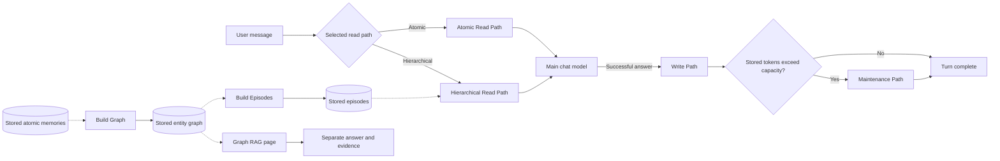
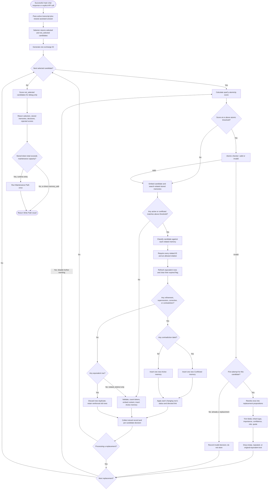
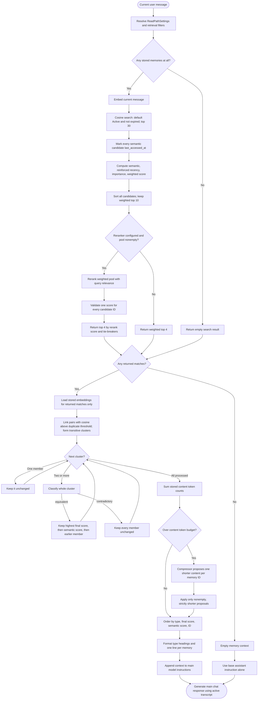
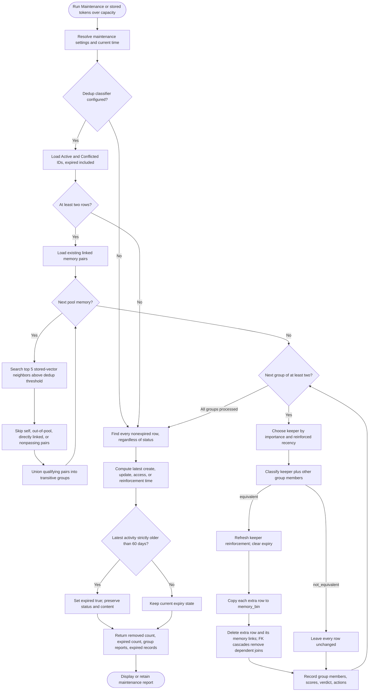
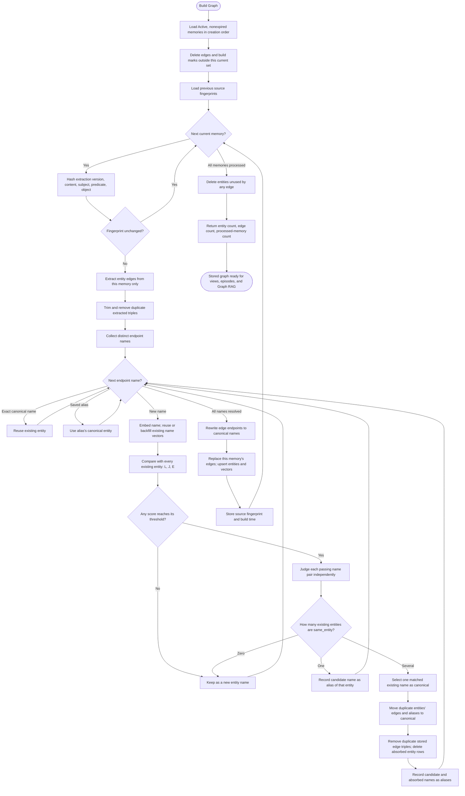
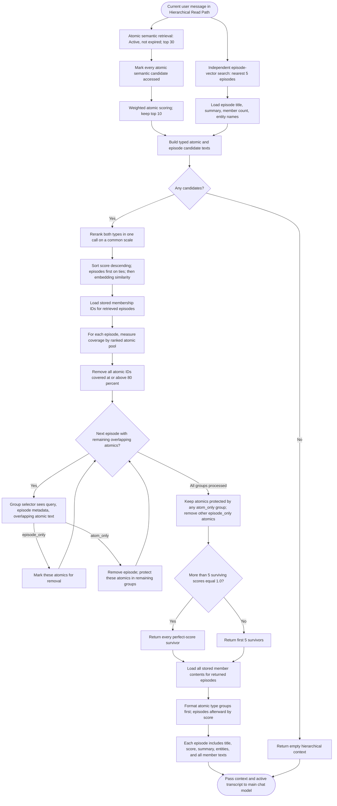
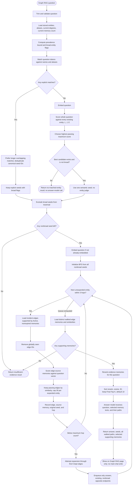

# AI Agent Memory Infrastructure

A technical environment and implementation reference for the current system.

**Source baseline:** commit `ac5e8b1` · **Python package version:** `0.1.0` · **Documentation generation:** V6.

The behavior described here follows the Python implementation. Earlier README files describe earlier stages of the project; their ChromaDB architecture and some older relation rules do not describe the current system. Mermaid diagrams and LaTeX equations require a Markdown viewer with Mermaid and math support.

**Author statement:** <u> This is a personal, independently developed project created for exploration & learning purposes. It has six development phases (V1–V6), reflecting the gradual progress in understanding, implementing & improving the system from the author & his work process. The system is functional, but it is intended solely for the own experimentation & learning of the author, and is hence not intended for use by others. It was developed independently & does not copy an existing memory system. This upload on github serves both as a documentation of personal progress, and as proof that such a system has indeed been designed & built by the author, with the help of AI, of course. </u>

## 1. Setup Information

### 1.1 Version and environment baseline

| Item | Repository information |
| --- | --- |
| Project / distribution name | `ai-agent-memory-infrastructure`. |
| Python import package | `ai_agent_memory_infrastructure`, under `src/`. |
| Package version | `0.1.0` in `pyproject.toml`. |
| System documentation version | **V6**; the package version and documentation version are separate identifiers. |
| Implementation baseline | Commit `ac5e8b1`, used for the implementation descriptions and file inventory in this document. |
| Python requirement | `>=3.13`; `.python-version` selects `3.13`. |
| Environment and dependency management | uv, with the resolved dependency graph recorded in `uv.lock`; no uv tool version is pinned. |
| Build system | Hatchling, using the `hatchling.build` backend; no Hatchling version is pinned in `pyproject.toml`. |
| Application form | Python memory library with a browser-based Streamlit chat and inspection interface. |
| External services | PostgreSQL with the server-side pgvector extension, and OpenAI model/embedding APIs. |

The versions below are recorded project requirements and lockfile values. They do not identify the versions currently running on a particular machine.

### 1.2 Python packages and dependencies

All ten direct dependencies declared in `pyproject.toml` are listed below.

| Package | Declared requirement | Version in `uv.lock` | Role in this system |
| --- | --- | --- | --- |
| `openai` | `>=3.19.2` | `3.19.2` | Responses API, structured model outputs, and embeddings. |
| `psycopg[binary]` | `>=3.3.6` | `3.3.6` | PostgreSQL connections, SQL queries, and JSONB adaptation; the binary extra resolves `psycopg-binary==3.3.6`. |
| `pgvector` | `>=0.5.0` | `0.5.0` | Python integration for PostgreSQL vector values. |
| `streamlit` | `>=1.64.0` | `1.64.0` | Chat, session controls, parameter configuration, and inspection pages. |
| `plotly` | `>=7.1.0` | `7.1.0` | Interactive 3D graph-connection visualization. |
| `python-dotenv` | `>=1.2.3` | `1.2.3` | Local `.env` loading through `load_dotenv()`. |
| `spacy` | `>=3.8.16` | `3.8.16` | Linguistic parsing for deterministic atomicity features. |
| `en-core-web-sm` | Direct wheel source in `[tool.uv.sources]` | `3.8.0` | English spaCy model, loaded as `en_core_web_sm`. |
| `tiktoken` | `>=0.14.0` | `0.14.0` | Memory-content token counting with `o200k_base`. |
| `watchdog` | `>=6.0.0` | `6.0.0` | File-watching support. |

Two additional packages are imported directly by the application code but arrive through the dependency graph rather than separate top-level declarations:

| Package | Version in `uv.lock` | Role |
| --- | --- | --- |
| `pandas` | `3.0.6` | Dataframes used in the interface and inspection tables. |
| `pydantic` | `2.13.5` | Structured schemas and validation for model adapters. |

`uv.lock` contains the complete transitive dependency graph, artifact hashes, and platform/Python resolution markers. The spaCy model is a declared dependency sourced from its versioned wheel.

### 1.3 PostgreSQL and persistent schema

| Property | Current design / repository value |
| --- | --- |
| Database engine | PostgreSQL. No server major/minor version is pinned by the repository. |
| Default connection setting | `DATABASE_URL=postgresql://localhost:5432/agent_memory`. This is a configured default, not a record of a live deployment. |
| Default host / port / database | `localhost` / `5432` / `agent_memory`. |
| Required server extension | `vector` from pgvector. The server-side extension version is not pinned; Python `pgvector==0.5.0` is a separate package. |
| Store implementation | `PostgresMemoryStore` in `postgres_memory_store.py`, using Psycopg and the pgvector adapter. |
| Connection timeout | Five seconds for both administrative and target-database connections. |
| Schema initialization | Store initialization checks the target database through the server's `postgres` database, creates the target if absent, enables `vector`, and prepares tables, indexes, and implemented compatibility backfills. |
| Database-role capabilities | Access to the administrative `postgres` database and target database, with privileges for the database/extension/schema operations performed during initialization. |
| Embedding width | Default **1,536 dimensions** for atomic-memory, bin, entity-name, and episode vector columns. |
| Similarity and vector index | Cosine-distance operations; `memories_embedding_cosine` is an HNSW index on `memories.embedding` using `vector_cosine_ops`. |
| Record representation | Text identifiers, `TIMESTAMPTZ` timestamps, `JSONB` memory metadata, and pgvector `vector` columns. Application timestamps are UTC-aware. |

The current schema has **ten memory-system tables**:

| Table | Main contents / keys | Path responsible for the data |
| --- | --- | --- |
| `memories` | Atomic propositions, subject/predicate/object, type, provenance, importance, lifecycle fields, metadata, and embeddings; primary key `id`. | Write; read/access and Maintenance operations also update applicable fields. |
| `memory_links` | Revision/conflict relations between newer and older memories; primary key `id`, with `from_memory_id` and `to_memory_id` references. | Write reconciliation; Maintenance also handles affected links. |
| `memory_bin` | Preserved copies of atomic rows removed by maintenance, including their fields and embeddings; primary key `id`. | Maintenance. |
| `graph_entities` | Canonical entity names, optional name embeddings, and timestamps; primary key `entity_id`, unique `name_key`. | Graph. |
| `graph_edges` | Directed entity relations attributed to source atomic memories; primary key `edge_id`, with memory/entity references. | Graph; subsequently read by Episode and Graph RAG operations. |
| `graph_builds` | Per-memory source fingerprints and build times; primary key `memory_id`. | Graph incremental building. |
| `graph_entity_aliases` | Alias names and normalized keys mapped to canonical entities; primary key `alias_name_key`. | Graph entity resolution. |
| `memory_episodes` | Episode title, summary, fingerprint, member count, cohesion measures, timestamps, and optional embedding; primary key `episode_id`, unique `entity_key`. | Episode; subsequently read by Hierarchical Read. |
| `memory_episode_members` | Episode-to-atomic-memory membership; composite primary key `(episode_id, memory_id)`. | Episode; used by Hierarchical Read. |
| `memory_episode_entities` | Episode-to-entity membership; composite primary key `(episode_id, entity_id)`. | Episode; used by Hierarchical Read. |

Section 2.5 describes the persisted record fields in more detail. Graph and episode data are derived from stored atomic memories; their builds are explicit operations.

### 1.4 Environment settings and model defaults

The application reads process environment variables and loads local `.env` settings with `python-dotenv`. The tracked `.env.example` documents 17 settings; actual credentials are local configuration. The table below lists the shared credential and database connection. Model defaults are in Section 2.3.

| Environment variable | Repository default / requirement | Component or path |
| --- | --- | --- |
| `OPENAI_API_KEY` | Required credential; no usable key is supplied by the repository. | Shared OpenAI clients. |
| `DATABASE_URL` | `postgresql://localhost:5432/agent_memory` | Shared PostgreSQL store. |

The embedding adapter checks vector lengths against the store's configured dimensions. A model-setting change does not migrate existing vector columns or regenerate stored embeddings. The full parameter reference appears in Section 10.

### 1.5 Runtime, interface, and data environment

| Area | Technical information |
| --- | --- |
| Main application module | `src/ai_agent_memory_infrastructure/app.py`; Streamlit uses a wide layout. |
| Page configuration | `.streamlit/config.toml` sets `client.showSidebarNavigation=false`; the application supplies its own page controls. |
| Python interface | `AgentMemory` and runtime wrappers provide in-process functions; there is no separate HTTP memory service or main-model memory-tool registration. |
| Package console entry | `ai-agent-memory-infrastructure` maps to `ai_agent_memory_infrastructure:main`; the current function prints a greeting. |
| Local processing | spaCy parsing, token counting, mathematical scoring, lifecycle rules, SQL operations, and prompt assembly run in Python. |
| Remote processing | Model judgments, generation, and embedding requests use OpenAI APIs when their relevant branches execute. |
| Persistent application data | Atomic memories, links, bin copies, graph data, and episodes reside in PostgreSQL. |
| Session data | Conversation transcript, prompt snapshots, candidate reports, runtime timing, and interface/debug state reside in Streamlit session state. |
| Numeric parameter settings | Stored in the current Streamlit session rather than as durable database configuration. |
| Cached resources | Store and model-adapter resources use Streamlit's `st.cache_resource`. |
| Local environment files | `.env` and `.venv/` are excluded by `.gitignore`. |
| Build/maintenance execution | Graph and episode builds are explicit operations; maintenance is manual or triggered by stored-token capacity after a write. There is no background build/maintenance scheduler. |
| Test environment | Database-backed tests use the separate, hardcoded `agent_memory_test` database on `localhost:5432` with three-dimensional fake vectors; the application default remains 1,536 dimensions. Test execution and scope are documented in Section 13. |

## 2. Introduction

### 2.1 Project overview

AI Agent Memory Infrastructure is a Python memory system with a Streamlit chat and inspection interface. It extracts useful information from conversations into independently updateable atomic memories, reconciles new memories with stored ones, retrieves relevant context for future responses, and derives an entity graph and higher-level episodes from the stored facts.

PostgreSQL stores the records and relationships. pgvector stores and searches content, entity-name, and episode embeddings. OpenAI models perform the semantic decisions; Python applies the deterministic thresholds, ordering rules, status transitions, and persistence actions.

The system exposes Python classes and methods. It does not currently provide an HTTP memory service, and the main chat model is not given memory methods as callable tools. The Python runtime invokes the appropriate operations.

### 2.2 All paths

| Path | Responsibility | Trigger | Main persistent effect |
| --- | --- | --- | --- |
| **Write Path** | Select, validate, repair, compare, store, reinforce, and link atomic memories. | After a successful main chat response; or a direct `memory_add()` call. | Inserts memories; reinforces existing rows; updates related statuses and revision/conflict links. |
| **Atomic Read Path** | Retrieve, score, rerank, deduplicate, compress, and format atomic memories. | Before a chat response when the atomic mode is selected. | Marks semantic candidates as accessed; context transformations are transient. |
| **Maintenance Path** | Remove stored equivalent copies and expire inactive memories. | **Run Maintenance**, or a write whose stored token total exceeds capacity. | Refreshes keepers, moves duplicate rows to `memory_bin`, sets expiry flags. |
| **Graph Path** | Extract entity relationships and resolve names to canonical entities. | **Build Graph** or a direct build call. | Writes entities, aliases, edges, and build fingerprints. |
| **Episode Path** | Group graph-connected atomic memories into episodes and describe them. | **Build Episodes** or a direct build call. | Writes episode summaries, embeddings, member joins, and entity joins. |
| **Hierarchical Read Path** | Retrieve atomic memories and episodes together, resolve overlap, and format the result. | Before a chat response when hierarchical mode is selected. | Marks atomic semantic candidates as accessed; selection and prompt assembly are transient. |
| **Graph RAG Path** | Answer a separate question using graph walks and supporting atomic memories. | **Search Graph** on the Graph RAG page or `run_graph_rag()`. | No application-level writes to memory/graph/episode records during the search. |

Normal chat execution is:



The main chat generation step sits between either read path and the Write Path. Graph RAG has its own answer-generation call and does not add its result to the main transcript.

### 2.3 Models used throughout the system

| Path or component | Model role | Default model | Configuration |
| --- | --- | --- | --- |
| Main chat, after either read path | Generate the assistant response. | `gpt-5.6-sol` | `OPENAI_MODEL`; the main sidebar can override it for chat. |
| Write | Extract selected and rejected atomic candidates. | `gpt-5.6-luna` | `MEMORY_SELECTOR_MODEL` |
| Write | Score linguistic atomicity locally. | spaCy `en_core_web_sm` | Fixed model loaded by `score_atomic_memory()`; scoring weights are configurable. |
| Write | Check uncertain atomic candidates. | `gpt-5-mini` | `MEMORY_ATOMIC_CHECKER_MODEL` |
| Write | Rewrite/split an invalid candidate once. | `gpt-5.6-luna` | `MEMORY_ATOMIC_REWRITER_MODEL` |
| Write | Classify each candidate–stored-memory relation. | `gpt-5.6-luna` | `MEMORY_CANDIDATE_RELATION_MODEL` |
| Atomic Read | Score query relevance for the weighted pool. | `gpt-5-nano` | `MEMORY_RERANKER_MODEL` |
| Atomic Read | Classify each near-duplicate context cluster. | `gpt-5-mini` | `MEMORY_RELATION_MODEL` |
| Atomic Read | Shorten context content over its token budget. | `gpt-5-mini` | `MEMORY_COMPRESSOR_MODEL` |
| Maintenance | Decide whether a stored duplicate group is equivalent. | `gpt-5-mini` | `MEMORY_DEDUP_MODEL` |
| Graph | Extract directed entity edges from one stored memory. | `gpt-5.6-luna` | `MEMORY_GRAPH_MODEL` |
| Graph | Judge whether two names are the same entity. | `gpt-5.6-luna` | `MEMORY_ENTITY_JUDGE_MODEL` |
| Graph | Choose a canonical name among matched existing entities. | `gpt-5.6-luna` | `MEMORY_ENTITY_SELECTOR_MODEL` |
| Episode | Generate a title and retrieval summary. | `gpt-5.6-luna` | `MEMORY_EPISODE_TITLE_MODEL` |
| Hierarchical Read | Rerank atomic memories and episodes on one scale. | `gpt-5-nano` | `MEMORY_RERANKER_MODEL` |
| Hierarchical Read | Choose episode-only or atomic-only representation for an overlap group. | `gpt-5.6-luna` | `MEMORY_EPISODE_GROUP_MODEL` |
| Graph RAG | Rerank memories reached by the graph walk. | `gpt-5-nano` | `MEMORY_RERANKER_MODEL` |
| Graph RAG | Generate an answer from selected graph evidence. | `gpt-5.6-sol` | `OPENAI_MODEL` from the environment. |
| Write, Atomic Read, Graph, Episode, Hierarchical Read, Graph RAG | Embed memory text, queries, new entity names, or episode retrieval text as needed. | `text-embedding-3-small` | `OPENAI_EMBEDDING_MODEL` |

Maintenance neighbor search and Atomic Read duplicate clustering reuse existing embeddings; they do not call the embedding model for those comparisons. A model's inclusion in this table does not mean it runs on every turn: the relevant branches must execute.

### 2.4 Important terminology

| Term | Meaning |
| --- | --- |
| Atomic memory | One independently updateable proposition stored in `memories`. |
| `memory_type="episode"` | One atomic memory describing an event. It is one of the five memory types. |
| Built episode | A higher-level group of atomic memories, with its own title, summary, embedding, and member/entity joins. Stored in `memory_episodes`. |
| Memory link | A revision/conflict relationship between a newer and an older atomic memory, stored in `memory_links`. |
| Graph edge | A directed relationship between two entities, attributed to the atomic memory that supports it. Stored in `graph_edges`. |
| Status | Current lifecycle state of an atomic memory. |
| Expired | A separate inactivity flag, independent of status. |
| Selected candidate | The selector recommends it for storage. Later atomicity and relation checks may still rewrite or discard it. |
| Retrieval candidate | A memory in a semantic or weighted retrieval pool. It need not enter the final prompt. |

Memory types are:

| Type | Intended classification |
| --- | --- |
| `fact` | Stable information presented as true. |
| `preference` | A user's recurring preference or choice. |
| `goal` | An objective or desired future outcome. |
| `instruction` | Persistent guidance for future behavior. |
| `episode` | Something that happened at a particular time. |

Memory statuses are:

| Status | Meaning | Included in default atomic retrieval? | Included in write-related/maintenance duplicate search? |
| --- | --- | --- | --- |
| `active` | Current stored proposition. | Yes, if not expired. | Yes, including expired rows. |
| `superseded` | Replaced or refined by another memory. | No. | No. |
| `corrected` | Marked wrong by a correcting memory. | No. | No. |
| `conflicted` | Involved in unresolved contradictory claims. | No. | Yes, including expired rows. |

These are application defaults. Programmatic `MemoryFilters` can explicitly request other statuses and expiry scopes.

### 2.5 Persistent data

| Table | Stores |
| --- | --- |
| `memories` | Atomic memory content, metadata, lifecycle fields, and content embedding. |
| `memory_links` | `REFINES`, `SUPERSEDES`, `CORRECTS`, and `CONFLICTS` relationships. |
| `memory_bin` | Copies removed by maintenance, with the memory fields and embedding preserved. |
| `graph_entities` | Canonical entity ID, name, normalized key, optional name embedding, creation time. |
| `graph_edges` | Directed entity edges, relation text, source memory ID, edge ID, creation time. |
| `graph_builds` | Source fingerprint and build time for each processed atomic memory. |
| `graph_entity_aliases` | Alias names/normalized keys pointing to canonical entity IDs. |
| `memory_episodes` | Episode identity, title, summary, fingerprint, member count, timestamps, cohesion scores, optional embedding. |
| `memory_episode_members` | Episode-to-atomic-memory membership. |
| `memory_episode_entities` | Episode-to-entity membership. |

An atomic memory exposes these fields:

| Field | Purpose |
| --- | --- |
| `id` | Python-generated UUID hex string. |
| `content` | The proposition; the text embedded for atomic retrieval. |
| `subject`, `predicate`, `object` | Structured restatement of that same proposition. |
| `memory_type` | One of the five memory types. |
| `role` | Source role, ordinarily `user`, `assistant`, or `conversation` for selected candidates. |
| `source` | Provenance label; Streamlit writes use `memory_selector_v1`. |
| `session_id` | Session provenance; it does not automatically restrict retrieval. |
| `importance` | Future usefulness/consequence score. |
| `status` | Active, superseded, corrected, or conflicted. |
| `expired` | Inactivity flag. |
| `token_count` | Stored `o200k_base` count of the content. |
| `created_at`, `updated_at` | UTC-aware creation/update timestamps. |
| `last_accessed_at` | Last semantic-pool access recorded by the application. |
| `reinforced_at` | Creation time initially; refreshed when an equivalent copy reinforces the record. |
| `metadata` | Selector confidence, exact source quote, exchange ID, and selector model for normal selected writes. |

The database also stores the content `embedding`. It is fetched separately when an operation needs vectors and is not a field on the public `Memory` dataclass.

Runtime scores, rejected candidates, atomic scores, compressed wording, prompt snapshots, and debug traces are not additional persisted memory facts. They remain in the relevant results or Streamlit session state.

### 2.6 Complete repository file inventory

This inventory lists the **46 tracked project files** at the source baseline. Paths under the package are shown relative to `src/ai_agent_memory_infrastructure/`. This consolidated `README.md` is a new documentation deliverable.

| Root or test file | Purpose |
| --- | --- |
| `.env.example` | Complete environment-variable template. |
| `.gitignore` | Excludes local environment, secrets, caches, and generated artifacts. |
| `.python-version` | Python version selection. |
| `.streamlit/config.toml` | Hides Streamlit's automatic sidebar page navigation. |
| `pyproject.toml` | Package metadata, dependencies, console entry point, build configuration, spaCy model source. |
| `uv.lock` | Locked dependency graph and installation artifacts. |
| `READMEV0.md` | Original raw-conversation/Chroma design. |
| `READMEV1.md` | Selector-based writes and rejection inspection. |
| `READMEV2.md` | Weighted retrieval and reranking. |
| `READMEV3.md` | Context deduplication/compression and configurable read behavior. |
| `READMEV4.md` | PostgreSQL, atomic checks/rewrites, reconciliation, maintenance. |
| `READMEV5.md` | Graph extraction, per-memory relation classification, entity resolution. |
| `READMEV6.md` | Episodes, hierarchical retrieval, Graph RAG, runtime inspection. |
| `tests/test_memory_api.py` | Unit and database-backed integration tests. |

| Package file | Purpose |
| --- | --- |
| `__init__.py` | Package's greeting-only console entry function. |
| `app.py` | Main Streamlit app, cached resources, chat orchestration, sidebar, debug panels. |
| `memory_api.py` | `AgentMemory` facade, settings, results, and pipeline orchestration. |
| `memory_store.py` | Shared record/filter/enumeration definitions and record validation. |
| `postgres_memory_store.py` | PostgreSQL setup/schema, CRUD, vector search, lifecycle, graph, episode, and Graph RAG queries. |
| `memory_runtime.py` | Runtime wrappers and post-write capacity-triggered maintenance. |
| `memory_selector.py` | Atomic candidate schema, extraction policy, OpenAI selector. |
| `memory_atomic_score.py` | spaCy-based atomicity components, weights, counts, review threshold. |
| `memory_atomic_checker.py` | Structured valid/invalid atomicity judgment. |
| `memory_atomic_rewriter.py` | Structured one-pass atomic repair/splitting. |
| `memory_candidate_relation.py` | Write-related relation labels, effects, strict similarity helper, classifier. |
| `memory_retrieval.py` | Recency/weighted scores, ranking, retrieval records, rerank application. |
| `memory_reranker.py` | Atomic-only and mixed atomic/episode OpenAI rerankers. |
| `memory_context.py` | Duplicate clustering, token counting, compression application, ordering, formatting. |
| `memory_relation.py` | Read-context cluster relation classifier. |
| `memory_compressor.py` | Structured context-shortening adapter. |
| `memory_maintenance.py` | Stored duplicate grouping, keeper scoring, maintenance execution and reports. |
| `memory_dedup.py` | Maintenance equivalent/not-equivalent classifier. |
| `memory_graph.py` | Graph extraction/building, name-resolution orchestration, connection-view construction. |
| `memory_entity_similarity.py` | Name normalization, edit/Jaccard/cosine similarity, resolution thresholds. |
| `memory_entity_judge.py` | Same-entity/not-same-entity judgment. |
| `memory_entity_selector.py` | Canonical-name selection among matched existing entities. |
| `memory_episode.py` | Episode rules, cohesion, redundancy, titling, summaries, embeddings, persistence orchestration. |
| `memory_episode_group.py` | Hierarchical episode-only/atomic-only group selector. |
| `memory_hierarchical.py` | Independent retrieval pools, mixed ranking, coverage/group selection, formatting. |
| `memory_graph_rag.py` | Seed selection, bounded graph traversal, evidence reranking, separate answering. |
| `memory_timing.py` | Nested timing traces and repeated-span collapsing. |
| `pages/parameter_configuration.py` | Numeric retrieval/write/maintenance/entity/episode controls. |
| `pages/graph_connection.py` | Interactive 3D memory-connection page. |
| `pages/graph_connection_table.py` | Shared-entity memory tables. |
| `pages/episodes.py` | Episode summaries, cohesion metrics, and member tables. |
| `pages/graph_rag.py` | Standalone graph-question interface and controls. |

Local `.env`, `.venv/`, bytecode, caches, and PostgreSQL database files are not tracked project files.

### 2.7 Navigation

[Write Path](#3-write-path) · [Atomic Read Path](#4-atomic-read-path) · [Maintenance Path](#5-maintenance-path) · [Graph Path](#6-graph-path) · [Episode Path](#7-episode-path) · [Hierarchical Read Path](#8-hierarchical-read-path) · [Graph RAG Path](#9-graph-rag-path) · [Parameter Configuration](#10-parameter-configuration) · [Memory Function](#11-memory-function) · [Session & Interface](#12-session--interface) · [Tests](#13-tests)

## 3. Write Path

**Purpose:** decide which propositions from the latest exchange should become memory and how they relate to existing records.

**Entry:** `MemoryRuntime.runtime_write_memory()` → `AgentMemory.memory_add()`.

### 3.1 Full flowchart



The final capacity check belongs to the runtime wrapper. Calling `memory_add()` directly runs the selection/storage pipeline without automatically invoking maintenance. Errors propagate to the caller; the Streamlit chat catches write errors and keeps the generated answer.

### 3.2 Step 1 — Extract and classify the latest exchange

`OpenAIMemorySelector.extract_memory()` receives role/content messages. The active conversation is supplied, but its prompt instructs the selector to use earlier turns only to resolve references and extract the **latest user/assistant exchange**.

| Selector list | Meaning | Subsequent action |
| --- | --- | --- |
| `selected` | Durable information with future usefulness. | Atomicity scoring, optional checking/repair, related-memory reconciliation. |
| `not_selected` | Other meaningful content: greetings, questions, transient details, acknowledgements, speculation, secrets. | Atomicity score for inspection; no persistence. |

The prompt requests that every meaningful proposition appear in exactly one list. This is an instruction to the model, not a deterministic proof of exhaustive coverage.

Each candidate has:

| Candidate field | Validation or meaning |
| --- | --- |
| `content` | 1–1,000 characters. |
| `subject`, `predicate`, `object` | Each 1–300 characters; must restate the same proposition. |
| `type` | One of the five `MemoryType` values. |
| `importance` | Number from 0 to 1 measuring future usefulness/consequence. |
| `confidence` | Number from 0 to 1 measuring support in the conversation. |
| `role` | `user`, `assistant`, or `conversation`. |
| `debug_source_quote` | 1–2,000 characters; exact supporting quote requested. |
| `debug_reason` | 1–500 characters; selection/rejection rationale. |

Extra fields are forbidden by the candidate schema. A parsed response is required.

| Importance range | Prompt interpretation |
| --- | --- |
| 0.0–0.2 | Trivial or transient. |
| 0.3–0.4 | Limited future usefulness. |
| 0.5–0.6 | Useful recurring context. |
| 0.7–0.8 | Stable preference, goal, project, decision, or constraint. |
| 0.9–1.0 | Identity-critical fact, safety requirement, or persistent instruction. |

There is no fixed numerical importance cutoff that automatically selects a memory. Selection and rejection are model decisions; importance and confidence are different quantities.

The selector is instructed to reject credentials and redact secret values in debug content/quotes. There is no additional deterministic secret detector.

### 3.3 Step 2 — Preserve atomic propositions and identifying context

An atomic memory is one proposition that can be corrected, superseded, or contradicted independently.

| Input or proposed memory | Expected treatment |
| --- | --- |
| “The user likes Python and Java.” | Split into a Python preference and a Java preference. |
| “The user scored 116 on TOEFL and 1500 on SAT.” | Split into two score facts. |
| “The user is majoring in Economics at New York University.” | Keep the school qualifier with the major. |
| “MemoryOS uses Python 3.12.” | Keep the product and version together. |
| “MemoryOS uses PostgreSQL with pgvector.” | Keep database and extension together as one technical fact. |
| Several activities performed at the same employer | Preserve the employer on each resulting activity memory. |

A shorter sentence is not automatically more correct. Dropping the employer, school, time, purpose, or tool relationship can remove the information that later connects the fact to other memories.

### 3.4 Step 3 — Calculate the atomicity score

The English spaCy parser supplies six raw counts:

| Count | What the implementation counts |
| --- | --- |
| $n_P$ | Predicates: eligible verb/auxiliary clause heads; auxiliary property constructions include coordinated predicative properties. |
| $n_L$ | Size of the largest coordinated non-verb list. |
| $n_C$ | Eligible clause heads, including coordinated verbs. |
| $n_J$ | Coordinating conjunctions and selected contrast subordinators such as “while” and “whereas.” |
| $n_V$ | Numeric/number-like tokens. |
| $n_T$ | Non-punctuation, non-space spaCy tokens. This is not the tiktoken count. |

Define the component normalizations:

$$
P=\min\!\left(\max(n_P-1,0),1\right)
$$

$$
L=\min\!\left(\frac{\max(n_L-1,0)}{2},1\right)
$$

$$
C=\min\!\left(\frac{\max(n_C-1,0)}{2},1\right)
$$

$$
J=\min\!\left(\max(n_J,0),1\right)
$$

$$
V=\min\!\left(\frac{\max(n_V-1,0)}{2},1\right)
$$

$$
T=\min\!\left(\max\!\left(\frac{n_T-15}{30},0\right),1\right)
$$

The general score is:

$$
A=w_PP+w_LL+w_CC+w_JJ+w_VV+w_TT,
\qquad
\sum_{x\in\{P,L,C,J,V,T\}}w_x=1,\quad w_x\geq0.
$$

The default is:

$$
A=0.35P+0.20L+0.15C+0.10J+0.10V+0.10T.
$$

The score lies from 0 to 1 for valid weights. **Higher means less atomic.** Fifteen or fewer linguistic tokens add no length penalty; 45 or more saturate it. One predicate adds no predicate penalty; a second saturates that component.

The checker runs when:

$$
A\geq\tau_A,\qquad \tau_A=0.20.
$$

### 3.5 Step 4 — Check and, if necessary, rewrite once

| Atomic checker classification | Action |
| --- | --- |
| `valid` | Continue to related-memory search. |
| `invalid` | Rewrite once if this is the original candidate; otherwise discard the still-invalid replacement. |

Below the review threshold, the candidate proceeds without an LLM atomic check. At or above it, a checker must be configured.

The rewriter receives only the invalid candidate's content/subject/predicate/object and the shared atomic-memory standard. It returns one or more replacements containing only those four fields. Python copies the original type, importance, confidence, role, source quote, and debug reason.

Before processing replacements, Python trims fields and rejects empty pieces, duplicate replacement text, and text matching the original after whitespace normalization and case folding. Each surviving replacement is scored and, if necessary, checked again. A second rewrite is never attempted.

An invalid original remains visible as a debug decision with its replacement texts; replacement decisions can produce the actual stored records.

### 3.6 Step 5 — Search related stored memories

The candidate content is embedded and searched against `active` and `conflicted` memories, **including expired ones**. Superseded and corrected records are excluded.

Cosine similarity for vectors $u$ and $v$ is:

$$
\operatorname{cos}(u,v)=
\frac{u\cdot v}{\lVert u\rVert_2\,\lVert v\rVert_2}.
$$

PostgreSQL exposes it as:

$$
s(m,q)=1-d_{\mathrm{cos}}(e_m,e_q).
$$

The default related set is at most five matches with similarity **strictly greater than** 0.60. The store uses a strict distance predicate; the final Python `similarity_above()` check also requires:

$$
\operatorname{round}(s,6)>\tau_{\mathrm{related}},
\qquad \tau_{\mathrm{related}}=0.60.
$$

If no memory qualifies, the new candidate is stored as Active without a candidate-relation call.

### 3.7 Step 6 — Classify each related memory

The candidate-relation model receives one new candidate and the qualifying existing memories. It returns **one relation for each existing memory ID**. Python requires the expected ID set and rejects unknown relation labels.

| Classification | Meaning | Effect on that older row | Directed link if a new row is stored |
| --- | --- | --- | --- |
| `equivalent` | Same fact; no added/removed/updated/denied fact. | Refresh `reinforced_at` and clear `expired`; keep its existing status. | None. |
| `refinement` | Retains the claim and adds detail, precision, or a qualifier. | Set `superseded`. | New `REFINES` old. |
| `supersession` | Replaces a previously valid state because the situation changed. | Set `superseded`. | New `SUPERSEDES` old. |
| `correction` | Fixes an older claim that was wrong. | Set `corrected`. | New `CORRECTS` old. |
| `contradiction` | Incompatible claims with no established correction/newer-state interpretation. | Set `conflicted`. | New `CONFLICTS` old. |
| `related_distinct` | Separate fact about a related subject, tool, course, or task. | Unchanged. | None. |

The new candidate is stored **at most once** for the whole related set:

| Related-set outcome | New candidate action |
| --- | --- |
| Only `related_distinct` labels | Store one Active row. |
| One or more `equivalent` labels, with any remaining labels only `related_distinct` | Reinforce equivalent rows; discard the new duplicate. |
| Any refinement, supersession, or correction; no contradiction | Store one Active row and apply each changing row's own effect. |
| Any contradiction | Store one Conflicted row; apply all changing rows' own effects. |

An equivalent conflicted memory is reinforced but is **not** automatically changed to Active. The current reinforcement operation changes time/expiry, not status.

### 3.8 Step 7 — Persist records and return decisions

`PostgresMemoryStore.write_memory()` validates nonempty content/role/source/session, an importance in the unit interval, and JSON-serializable metadata. It generates an ID and UTC timestamps, counts content tokens, embeds content, and inserts the row.

Normal selected-write metadata contains:

| Metadata key | Source |
| --- | --- |
| `confidence` | Selector. |
| `debug_source_quote` | Selector. |
| `exchange_id` | Python; shared by writes from the same extraction call. |
| `selector_model` | Selector adapter's model name. |

`debug_reason`, atomic scores, rejected candidates, and relation decision reports are not added to the stored metadata.

`MemoryAddResult` returns the original selection, stored memories, detailed candidate decisions, and scores for `not_selected` candidates.

Memory insertion, reinforcement, and link operations commit independently. A later failure can leave earlier changes in place; the full write pipeline is not one transaction.

### 3.9 Step 8 — Runtime maintenance trigger

After `memory_add()` returns, the runtime checks:

$$
T_{\mathrm{store}}=\sum_{m\in\texttt{memories}}\operatorname{token\_count}(m),
\qquad
\text{run maintenance if }T_{\mathrm{store}}>C_{\mathrm{store}},
\quad C_{\mathrm{store}}=10000.
$$

This sum includes all rows in `memories`, including expired or non-Active rows. It excludes `memory_bin` and episode text. The runtime runs one maintenance pass and retains its report as `last_maintenance`.

## 4. Atomic Read Path

**Purpose:** prepare a small, relevant block of atomic-memory context before the main chat model answers.

**Entry:** `runtime_build_memory_context()` → `memory_context()` → `memory_search()`.

### 4.1 Full flowchart



The semantic search does not embed a query when the entire store is empty. It can still embed when the store has rows but no rows qualify under the read filters.

### 4.2 Step 1 — Retrieve semantic candidates

The newest user message is the query. By default, `AgentMemory` supplies:

| Filter | Default |
| --- | --- |
| Status | `active` |
| Expired | `false` |
| Session | All sessions. |
| Memory type, role, source, minimum importance | No additional restriction. |
| Minimum semantic similarity | None. |
| Semantic candidate count | 30. |

The query is embedded with the configured embedding model. PostgreSQL orders qualifying rows by cosine distance. The `memories` table has an HNSW cosine index.

Every memory returned in this semantic pool is marked with `last_accessed_at`. This happens **before** the weighted cut, reranking, deduplication, or compression, so a candidate can be marked accessed even when it never enters the final prompt.

### 4.3 Step 2 — Calculate the weighted retrieval score

The semantic and importance inputs are clamped:

$$
\operatorname{clip}_{[0,1]}(x)=\min(\max(x,0),1),
\qquad
S_m=\operatorname{clip}_{[0,1]}(s_m),
\qquad
I_m=\operatorname{clip}_{[0,1]}(\operatorname{importance}_m).
$$

Recency is measured from `reinforced_at`, falling back to `created_at`:

$$
t_m=
\max\!\left(
\frac{t_{\mathrm{now}}-t_{\mathrm{reinforced},m}}{86400\ \mathrm{seconds}},
0
\right).
$$

For half-life $h$ days:

$$
\lambda=\frac{\ln 2}{h},
\qquad
R_m=e^{-\lambda t_m}=2^{-t_m/h},
\qquad h=30\ \mathrm{days}.
$$

Naive timestamps are treated as UTC by the recency helper; aware timestamps are converted to UTC. Future timestamps have zero age.

The weighted score is:

$$
W_m=w_SS_m+w_RR_m+w_II_m,
\qquad w_S+w_R+w_I=1,\quad w_S,w_R,w_I\geq0.
$$

By default:

$$
W_m=0.60S_m+0.20R_m+0.20I_m.
$$

Candidates sort by weighted score descending, then semantic score descending, then creation time descending. The weighted top 10 continue.

### 4.4 Step 3 — Rerank and return the top four

The reranker sees the query and each surviving memory's ID/content. It does not receive the importance/recency features as its scoring basis.

| Relevance anchor | Interpretation |
| --- | --- |
| 1.0 | Directly answers the query or is necessary for it. |
| 0.5 | Related but indirect or incomplete. |
| 0.0 | Unrelated. |

These are scale anchors, not three exclusive classes; any score in the unit interval is allowed.

For reranked matches:

$$
F_m=Q_m,
$$

where $Q_m$ is the rerank relevance score. Before reranking, or when no reranker is configured, the final score is:

$$
F_m=W_m.
$$

The adapter rejects duplicate IDs and responses that do not score exactly the expected candidate set. Python clamps scores when applying them.

Reranked results sort by final score, weighted retrieval score, semantic score, and creation time, all descending. The default top four become `MemorySearchResult.matches`. The full semantic pool remains available as `candidates`, with `rerank_score` populated only for memories that reached the reranker.

### 4.5 Step 4 — Cluster returned memories using stored embeddings

Only the returned matches, normally at most four, are considered. Their existing content embeddings are loaded; no new content embedding request is made for this step.

Two memories are linked when:

$$
\operatorname{cos}(e_i,e_j)>\tau_{\mathrm{context}},
\qquad \tau_{\mathrm{context}}=0.90.
$$

The comparison is strict. A similarity exactly at the threshold does not create a link. Union-find forms transitive clusters: if A links to B and B links to C, all three belong to one cluster even if A and C do not directly pass the threshold.

The cosine helper returns zero for zero-norm vectors and rejects empty or mismatched-width vectors. Missing stored embeddings cause an error.

### 4.6 Step 5 — Classify and resolve each cluster

Singletons are kept without a relation-model call. Each cluster of at least two is classified as one group:

| Classification | Definition used by the classifier | Action |
| --- | --- | --- |
| `equivalent` | Same facts; no member adds, removes, or denies a fact stated by another. | Keep the member with the highest final score, then semantic score; a complete tie keeps the earlier group member. |
| `contradictory` | Disagreement, negation, different values, **or a fact present in one member but not another**. | Keep every member unchanged. |

The second label is intentionally broader than ordinary logical contradiction. It is also the preserve-both category for information that is not fully equivalent.

The classifier does not choose the keeper and does not rewrite text. Unknown labels fail the operation. `deduplicated` is true only when an equivalent cluster actually drops a memory.

This step changes the read result, not PostgreSQL records or write-related memory links.

### 4.7 Step 6 — Compress only when over the content budget

After deduplication:

$$
T_{\mathrm{context}}=\sum_{m\in M_{\mathrm{kept}}}\operatorname{token\_count}(m).
$$

The default trigger is:

$$
T_{\mathrm{context}}>B,\qquad B=200.
$$

Counts use `o200k_base` and only the memory contents. Type headings, role labels, relevance labels, base instructions, and conversation text are outside this budget.

If over budget, the compressor receives all remaining memory contents and the budget. Its prompt requests preservation of facts, names, numbers, constraints, and negations.

| Proposed content | Python action |
| --- | --- |
| Empty after trimming | Keep original. |
| Same or greater token count | Keep original. |
| Nonempty and strictly fewer tokens | Use proposed text in this result and set `compressed=True`. |

Formally, a proposal $c'_m$ is accepted only when:

$$
c'_m\neq\varnothing
\quad\land\quad
\operatorname{tokens}(c'_m)<\operatorname{token\_count}(m).
$$

The proposal mapping must contain the expected memory-ID set. One pass is used; there is no retry-until-budget loop. The result may remain over budget, and Python does not independently prove semantic preservation. PostgreSQL content is never rewritten by this compression.

### 4.8 Step 7 — Order, format, and inject context

| Type order | Type |
| --- | --- |
| 1 | `fact` |
| 2 | `preference` |
| 3 | `goal` |
| 4 | `instruction` |
| 5 | `episode` |

Within each type: final score descending, semantic score descending, then ID ascending. Empty type groups are omitted.

Example:

```text
fact
- [user; relevance=0.860; ] The user's name is Beta.
preference
- [user; relevance=0.910; ] The user prefers concise answers.
```

The formatted text is appended to:

```text
You are a helpful AI assistant. Use these relevant memories when helpful. Ignore any that are unrelated:
```

The active transcript is supplied separately as Responses API `input`. If the context is empty, the main model receives the base assistant instruction alone.

### 4.9 Results and failure behavior

`MemoryContextResult` distinguishes final context `memories`, pre-context-engine `matches`, the broader `candidates`, dropped memories, duplicate clusters, and the dedup flag.

The API itself fails on missing required adapters, invalid model output, or missing vectors. In Streamlit, the read exception is recorded and the main model can still answer without memory. A failed read is not silently substituted with an invented memory result.

## 5. Maintenance Path

**Purpose:** consolidate truly equivalent stored copies and mark memories inactive after a fixed period.

**Entry:** `runtime_run_maintenance()` or the post-write capacity check → `memory_maintain()` → `MemoryMaintenance.run()`.

### 5.1 Full flowchart



### 5.2 Step 1 — Start one maintenance pass

| Trigger | When it occurs | Inspector label |
| --- | --- | --- |
| Manual | **Run Maintenance** sidebar button. | `Manual` |
| Automatic after a successful write | Stored atomic-memory token total is strictly over capacity. | `Token Capacity` |
| Programmatic | Direct API/runtime invocation. | Caller determines reporting. |

There is no timer or background scheduler. The default 10,000-token capacity is a **maintenance trigger**, not an enforced maximum store size.

### 5.3 Step 2 — Form stored duplicate groups

The pool contains Active and Conflicted memories, expired or not. Superseded and Corrected rows are not candidates for stored deduplication.

For each pool memory, `similar_memories()` uses its already-stored embedding to find up to five other qualifying neighbors. No new embedding call is made.

The default condition is strict similarity above 0.90. The Python helper additionally uses:

$$
\operatorname{round}(s_{ij},6)>\tau_{\mathrm{maintenance}},
\qquad \tau_{\mathrm{maintenance}}=0.90.
$$

Directly linked pairs are skipped, regardless of link direction. This exclusion is evaluated per neighbor pair. Accepted pairs form transitive groups, and singleton groups are ignored.

The five-neighbor cap is fixed separately from the Write Path's configurable related-memory count. Duplicates beyond the nearest-neighbor window may not be joined.

### 5.4 Step 3 — Choose a keeper

The keeper score is:

$$
K_m=w_{\mathrm{importance}}I_m+
w_{\mathrm{recency}}R^{\mathrm{maintenance}}_m,
\qquad
w_{\mathrm{importance}}+w_{\mathrm{recency}}=1.
$$

By default:

$$
K_m=0.50I_m+0.50R^{\mathrm{maintenance}}_m,
\qquad
R^{\mathrm{maintenance}}_m=2^{-t_m/30}.
$$

The age is measured from `reinforced_at`, falling back to `created_at`. Maintenance has its own half-life setting; changing the read half-life does not change it.

Choose the highest score. Ties prefer the later reinforcement time, then the later creation time. Token count and last-access time do not determine the keeper.

### 5.5 Step 4 — Classify and apply the group outcome

| Dedup classification | Meaning | Action |
| --- | --- | --- |
| `equivalent` | Same facts with no addition, removal, update, or denial. | Reinforce the keeper, clear its expiry flag, and move other copies into `memory_bin`. |
| `not_equivalent` | Any other relationship, including refinement, state change, correction, contradiction, or distinct facts. | Leave all group members unchanged. |

Python chooses the keeper before the model is called. The model only labels equivalence.

Each moved copy retains its ID, content, type, metadata, lifecycle fields, and embedding in `memory_bin`. Its `memories` row and revision/conflict links are deleted. Foreign-key cascades also remove its graph edges/build mark and episode-member joins. Binned copies are not searched by ordinary memory retrieval.

Reinforcement does not change a keeper's status. A Conflicted keeper remains Conflicted.

### 5.6 Step 5 — Expire inactive memories

Forget runs after deduplication, over every currently nonexpired row, including Superseded and Corrected rows.

$$
t_{\mathrm{activity},m}=
\max\!\left(
t_{\mathrm{created},m},
t_{\mathrm{updated},m},
t_{\mathrm{accessed},m}^{*},
t_{\mathrm{reinforced},m}^{*}
\right),
$$

where a missing access or reinforcement timestamp falls back to creation time.

The expiry rule is:

$$
t_{\mathrm{activity},m}<t_{\mathrm{now}}-60\ \mathrm{days}.
$$

The boundary is strict: exactly 60 days is not older than 60 days. Expiry changes only `expired` to true; it does not delete the row, change its status, or rewrite content.

An equivalent memory encountered later by the Write Path can clear that expiry flag through reinforcement. A keeper just reinforced during the current maintenance pass will not expire in the same pass.

### 5.7 Reports and limits

`MaintenanceResult` contains:

| Field | Meaning |
| --- | --- |
| `removed_count` | Copies moved out of `memories`. |
| `expired_count` | Rows newly marked expired. |
| `groups` | Verdict and each member's ID/content/status/expiry/importance/keep score/action. |
| `expired_memories` | ID/content/status of newly expired memories. |

Member actions are `kept`, `removed`, or `unchanged`; the interface labels them **Kept**, **Moved To Bin**, and **Left Unchanged**.

One pass need not bring the store under capacity. Expired rows still contribute to the stored token sum. Group actions are not a single transaction spanning the whole maintenance run. Graph/episode cleanup is not a replacement for rebuilding those derived structures after lifecycle changes.

## 6. Graph Path

**Purpose:** derive a named-entity graph from current atomic memories and connect alternate names to canonical entities.

**Entry:** **Build Graph** → `runtime_build_graph()` → `memory_graph_build()` → `MemoryGraph.build()`.

### 6.1 Full flowchart



New names from one extraction are compared to the entities already stored, not to one another before storage. Exact names and saved aliases bypass similarity scoring and entity judging.

### 6.2 Step 1 — Load current memory sources and prune stale graph rows

Only Active memories with `expired=false` are graph sources. They are processed by creation time, then ID.

Before extraction, edges and build marks whose memories are outside that current set are deleted. After the build, entities with no remaining edges are deleted; alias and episode-entity foreign keys can cascade when an entity disappears.

The graph does not read the conversation. It reads stored atomic memories, including their content/subject/predicate/object.

### 6.3 Step 2 — Detect changed memories

A source fingerprint covers:

$$
H_{\mathrm{graph}}(m)=
\operatorname{SHA256}
\left(
v_{\mathrm{extract}}
\Vert c_m\Vert s_m\Vert p_m\Vert o_m
\right).
$$

The implementation joins those components with newline separators before hashing. The extraction-rule version is currently `"2"`.

| Fingerprint outcome | Action |
| --- | --- |
| Same as `graph_builds.source_key` | Keep existing edges and skip extraction. |
| New memory or different fingerprint | Extract and replace that memory's edges. |

The fingerprint does not include the graph model identifier or entity-resolution thresholds. Changing those settings alone does not reprocess unchanged memories.

### 6.4 Step 3 — Extract directed edges

The graph extractor returns triples:

```text
from_entity --relation--> to_entity
```

| Output | Rule |
| --- | --- |
| Endpoint names | Copied from the memory; names can identify people, organizations, places, times, tools, subjects, or other named things. |
| Relation | Nonempty free text, not a fixed relation enum. |
| Content bounds | Each endpoint/relation field is 1–300 characters in the structured schema. |
| Evidence scope | Only the supplied stored memory. |
| Qualifiers | Employer, school, place, time, or purpose can become separate entities. |
| Organization contained in a longer name | Emit the organization and a `part of` edge when explicitly present in the text. |

Example:

```text
The user is majoring in Economics at New York University.

The user --majoring in--> Economics
The user --majoring at--> New York University
```

The extractor is instructed not to expand “NYU” to “New York University” unless the expanded text appears in the memory. Entity resolution is the later operation that can connect those names.

Whitespace is trimmed; empty triples are discarded; duplicate extracted triples are removed using normalized endpoints and relation text. The evidence-only requirement is model guidance, not an independent entailment check.

### 6.5 Step 4 — Resolve exact names and aliases

The name key is:

$$
k(n)=
\operatorname{casefold}
\left(
\operatorname{join}_{\mathrm{space}}
\left(\operatorname{split}_{\mathrm{whitespace}}(n)\right)
\right).
$$

| Name lookup | Action |
| --- | --- |
| Canonical entity with the same normalized key | Reuse it; no pair scoring/judge. |
| Alias with the same normalized key | Reuse its canonical entity; no pair scoring/judge. |
| Neither | Compare the new mention with existing canonical entities. |

The first two checks ignore capitalization and extra whitespace. They do not remove arbitrary punctuation; Graph RAG's explicit-match tokenizer is a different operation.

### 6.6 Step 5 — Score a new mention against existing entities

The mention and existing names have embedding vectors. Stored name vectors are reused; missing existing name vectors and new mentions are embedded and saved where applicable.

The comparison vector is:

$$
\mathbf{s}(a,b)=\left[L(a,b),J(a,b),E(a,b)\right].
$$

Normalized Levenshtein similarity is:

$$
L(a,b)=
\begin{cases}
1,&k(a)=k(b),\\
1-\dfrac{d_{\mathrm{lev}}(k(a),k(b))}
{\max(\operatorname{len}(k(a)),\operatorname{len}(k(b)))},
&\text{otherwise}.
\end{cases}
$$

For sets of whitespace-separated normalized words $A$ and $B$:

$$
J(a,b)=
\begin{cases}
1,&A\cup B=\varnothing,\\
\dfrac{\lvert A\cap B\rvert}{\lvert A\cup B\rvert},&\text{otherwise}.
\end{cases}
$$

Embedding similarity is:

$$
E(a,b)=\operatorname{cos}(e_a,e_b).
$$

A pair is sent to the entity judge when:

$$
L(a,b)\geq\tau_L
\quad\lor\quad
J(a,b)\geq\tau_J
\quad\lor\quad
E(a,b)\geq\tau_E,
$$

with defaults:

$$
\tau_L=0.80,\qquad \tau_J=0.50,\qquad \tau_E=0.80.
$$

This is an inclusive **OR**, not an average or a requirement that all three scores pass. Each passing pair is judged independently.

### 6.7 Step 6 — Judge names and select a canonical entity

| Entity-judge classification | Meaning |
| --- | --- |
| `same_entity` | Alternate names, abbreviations, or spellings of the same entity. |
| `not_same_entity` | Different entities, including a part and its whole, such as a division and its organization. |

| Number of same-entity matches | Action |
| --- | --- |
| Zero | Store the mention as a new entity. |
| One | Save the mention as an alias and use the existing entity. |
| More than one | Ask the entity selector to choose one matched existing name; merge the other matched entities into it. |

The selector is prompted to prefer the fullest proper name. Its choices are the **matched existing names**; it does not invent a name or choose an unlisted candidate. Python validates membership in that choice set.

When merging:

1. Duplicate names become aliases of the kept entity.
2. Existing aliases pointing to absorbed entities are redirected.
3. Edge endpoints referencing absorbed IDs move to the kept ID.
4. Stored duplicate edges with the same source memory, endpoints, and relation are removed.
5. Absorbed entity rows are deleted.
6. The incoming mention is recorded as an alias too.

Relations on surviving edges are not rewritten by the canonical-name selection.

### 6.8 Step 7 — Store edges and build state

For each processed memory, `replace_memory_graph()` replaces its existing edge rows, upserts endpoint entities and any supplied embeddings, and records its source key/build time.

| Field | Meaning |
| --- | --- |
| `graph_entities.entity_id` | Canonical entity's own ID. |
| `graph_entities.name` | Stored canonical display name. |
| `graph_entities.name_key` | Unique normalized key. |
| `graph_entities.embedding` | Name vector, reused in future comparisons. |
| `graph_edges.edge_id` | One edge's own ID. |
| `graph_edges.memory_id` | Atomic memory supplying the edge's evidence. |
| `graph_edges.from_entity_id` / `to_entity_id` | Canonical endpoints. |
| `graph_edges.relation` | Extracted free-text relationship. |
| `graph_builds.source_key` | Fingerprint of the memory/extraction-rule input. |
| `graph_builds.built_at` | Last recorded build time for that memory. |

`GraphBuildResult` returns `entity_count`, `edge_count`, and `built_count`. The last counts processed memories, not model calls or newly created entities.

### 6.9 Graph freshness and views

Writes, maintenance, and direct memory updates do not run Build Graph. The connection pages read stored edges, so they can display older graph state until it is refreshed.

The visual/table views project the entity graph into **connections between atomic memories** sharing an entity. A shared entity joins memories through their evidence edges. The graph view's hub cutoff of more than 20 memories is a display rule; it is different from the prevalence bound used by episodes and Graph RAG.

To deliberately re-extract unchanged memories after a model/rule-setting change, clear and rebuild the graph, then rebuild episodes as needed. Clearing the graph does not erase atomic memories, but it also does not itself rebuild or remove the remaining episode summaries/member rows.

## 7. Episode Path

**Purpose:** identify situations represented by groups of atomic memories, using the stored graph rather than a new conversation analysis.

**Entry:** **Build Episodes** → `runtime_build_episodes()` → `memory_episode_build()` → `MemoryEpisode.build()`.

### 7.1 Full flowchart

```mermaid
flowchart TD
    START(["Build Episodes"]) --> LOAD["Read stored graph mentions of Active, nonexpired memories"]
    LOAD --> TOTAL["Count all Active, nonexpired memories as N"]
    TOTAL --> BOUND["Compute prevalence bound P(N)"]
    BOUND --> DEGREES["Build entity-to-memory sets and entity degrees"]
    DEGREES --> SINGLES["Propose one episode for each specific entity with at least 2 memories"]
    DEGREES --> PAIRS["Enumerate pairs of entities with degree at least 2"]
    PAIRS --> RARE{"Less common entity specific?"}
    RARE -->|No| SKIPPAIR["Skip pair"]
    RARE -->|Yes| OVERLAP{"At least 2 shared memories and overlap reaches threshold?"}
    OVERLAP -->|No| SKIPPAIR
    OVERLAP -->|Yes| PAIRKEEP["Propose pair episode from shared memory intersection"]
    SINGLES --> VECS["Load stored content embeddings for single-entity drafts"]
    VECS --> CENTROID["Compute centroid and each member's cosine to it"]
    CENTROID --> TRIM["Remove members below Minimum Cohesion"]
    TRIM --> ENOUGH{"At least 2 remain?"}
    ENOUGH -->|No| DROPSINGLE["Drop single-entity draft"]
    ENOUGH -->|Yes| RESCORE["Recompute cohesion, minimum, and standard deviation"]
    RESCORE --> COH{"Mean and minimum reach thresholds?"}
    COH -->|No| DROPSINGLE
    COH -->|Yes| SINGLEKEEP["Keep cohesive single-entity draft"]
    SINGLEKEEP --> UNION["Collect surviving single-entity and pair drafts"]
    PAIRKEEP --> UNION
    SKIPPAIR --> UNION
    DROPSINGLE --> UNION
    UNION --> RED["Compare memory sets: Jaccard, containment, novelty"]
    RED --> DROP["Remove contained low-novelty drafts; deterministic tie-break"]
    DROP --> STATE["Load previous episode state by entity key"]
    STATE --> NEXT{"Next remaining draft?"}
    NEXT -->|Yes| HASH["Hash sorted entity IDs and member memory IDs"]
    HASH --> SAME{"Same entity key and source fingerprint?"}
    SAME -->|Yes| REUSE["Reuse episode ID, title, summary, timestamps"]
    REUSE --> HASV{"Stored episode embedding exists?"}
    HASV -->|Yes| WRITE["Prepare episode row, scores, members, entities"]
    HASV -->|No| EMB["Embed title, summary, and entity names"]
    SAME -->|No| TITLE["Generate title and summary from member memories only"]
    TITLE --> ID["Preserve ID and creation time for existing entity key; otherwise generate"]
    ID --> EMB
    EMB --> WRITE
    WRITE --> NEXT
    NEXT -->|All drafts processed| SYNC["Delete obsolete episodes; upsert rows; replace membership joins"]
    SYNC --> END(["Return episode count and newly titled count"])
```



A pair episode bypasses the embedding-cohesion filter. An empty set of qualifying drafts synchronizes the store to an empty episode set.

### 7.2 Step 1 — Read graph mentions and measure prevalence

The input is the graph already stored by Build Graph. Its mentions are filtered to memories currently Active and not expired.

Let:

| Symbol | Meaning |
| --- | --- |
| $N$ | Count of **all** Active, nonexpired atomic memories, including ones with no graph edges. |
| $M_e$ | Set of current memories mentioning entity $e$ through a graph edge. |
| $d_e$ | Number of distinct memories in that set. |
| $p_e$ | Entity prevalence. |

$$
d_e=\lvert M_e\rvert,
\qquad
p_e=\frac{d_e}{N}.
$$

No episodes are proposed when $N<1$.

The prevalence bound is:

$$
P(N)=\min\!\left(
1,\frac{b+0.30}{1+N/s}
\right),
\qquad b=0.20,\quad s=100.
$$

An entity is specific when:

$$
d_e\geq2
\quad\land\quad
p_e\leq P(N).
$$

The minimum of two is fixed. No entity name is specially exempted or privileged; “The user” is evaluated by the same rule as any organization, place, or tool.

With default settings:

$$
P(0)=0.50,\qquad P(100)=0.25.
$$

The baseline and the additional 0.30 both decay with $N$; the formula is not a constant baseline plus a decaying term.

### 7.3 Step 2 — Propose single-entity and pair episodes

| Draft category | Qualification | Initial member set |
| --- | --- | --- |
| Single entity | Entity is specific. | All memories in $M_e$. |
| Two entities | Both occur in at least two memories; the less common entity is specific; at least two memories mention both; overlap passes. | Intersection of the two memory sets. |

For entities $a$ and $b$:

$$
c(a,b)=\lvert M_a\cap M_b\rvert,
\qquad
O(a,b)=\frac{c(a,b)}{\min(d_a,d_b)}.
$$

The pair condition is:

$$
c(a,b)\geq2
\quad\land\quad
O(a,b)\geq\tau_O,
\qquad \tau_O=0.50,
$$

in addition to the specificity requirement on the less common entity.

A pair can therefore contain a broad entity when the other entity is specific. A memory may appear in several proposed episodes.

### 7.4 Step 3 — Check cohesion for single-entity drafts

For the $k$ stored content vectors in a single-entity episode:

$$
\mathbf{c}=\frac{1}{k}\sum_{i=1}^{k}\mathbf{v}_i,
\qquad
z_i=\operatorname{cos}(\mathbf{v}_i,\mathbf{c}).
$$

The statistics are:

$$
\mu=\frac{1}{k}\sum_{i=1}^{k}z_i,
\qquad
z_{\min}=\min_i z_i,
\qquad
\sigma=\sqrt{\frac{1}{k}\sum_{i=1}^{k}(z_i-\mu)^2}.
$$

This is the population standard deviation of centroid similarities.

The first pass retains:

$$
M'=\{m_i:z_i\geq\tau_{\min}\}.
$$

Python then recomputes the centroid and statistics using only those retained members. The draft survives if:

$$
\lvert M'\rvert\geq2
\quad\land\quad
\mu'\geq\tau_{\mathrm{mean}}
\quad\land\quad
z'_{\min}\geq\tau_{\min}.
$$

Both default thresholds are 0.00. At these defaults the first pass removes only negative-cosine members; it is a permissive cohesion policy.

This is one trim-and-recompute pass, not an iterative clustering algorithm. Pair episodes do not run this check and leave the three cohesion fields empty.

### 7.5 Step 4 — Remove redundant episodes

For candidate episode $B$ relative to another episode $A$, using member-memory sets:

$$
J_{\mathrm{episodes}}(A,B)=
\frac{\lvert A\cap B\rvert}{\lvert A\cup B\rvert},
$$

$$
\operatorname{containment}(B\mid A)=
\frac{\lvert A\cap B\rvert}{\lvert B\rvert},
\qquad
\operatorname{novelty}(B\mid A)=
\frac{\lvert B\setminus A\rvert}{\lvert B\rvert}.
$$

The actual removal condition is:

$$
\operatorname{containment}(B\mid A)\geq0.80
\quad\land\quad
\operatorname{novelty}(B\mid A)\leq0.20.
$$

Jaccard is computed by the scoring helper but is not a separate threshold in the removal decision. For a nonempty candidate, containment and novelty sum to one; the two thresholds can nevertheless be configured independently.

| Redundancy outcome | Action |
| --- | --- |
| B qualifies as redundant in A, but not vice versa | Remove B. |
| Both qualify as redundant in each other | Prefer more member memories. |
| Same member count in a mutual redundancy case | Prefer fewer defining entities, then the deterministic entity-ID ordering. |
| Neither qualifies | Keep both. |

This pass can remove a narrower pair episode whose members are already mostly included in a larger episode.

### 7.6 Step 5 — Reuse or generate episode descriptions

The entity key is the sorted defining entity IDs joined with newlines. The source fingerprint hashes that entity key and the sorted member-memory IDs:

$$
H_{\mathrm{episode}}=
\operatorname{SHA256}
\left(
\operatorname{sortedEntityIDs}
\Vert
\operatorname{sortedMemberIDs}
\right).
$$

The implementation uses newline separators and a blank-line separator between the entity and member portions.

| Existing state | Action |
| --- | --- |
| Same entity key and source fingerprint | Reuse ID, title, summary, creation/update times, and existing embedding. |
| Same fingerprint but missing embedding | Reuse description; embed its retrieval text. |
| Existing entity key with changed members | Keep ID/creation time; generate a new title/summary and embedding; update modification time. |
| New entity key | Generate ID, title, summary, embedding, and timestamps. |

The episode titler sees only defining entity names and member memory contents. Its prompt requests a title of at most 12 words and a one- or two-sentence summary supported by those memories. The schema permits a 1–300-character title and a 1–1,000-character summary; word and sentence counts are prompt requirements rather than additional deterministic validators.

Retrieval text is:

```text
<title>
<summary>
<comma-separated entity names>
```

Its embedding is stored on the episode row.

The source fingerprint contains IDs, not member text, model identity, or title-prompt version. Editing memory text while preserving its ID and episode membership does not by itself force a new summary or embedding.

### 7.7 Step 6 — Synchronize episode rows and joins

`sync_memory_episodes()` removes episode rows no longer present in the surviving draft set, upserts current rows, and replaces their memory/entity joins.

| Episode field | Meaning |
| --- | --- |
| `episode_id` | Episode identity. |
| `entity_key` | Stable key for the defining entity-ID set. |
| `title`, `summary` | Generated description. |
| `source_key` | Entity/member-ID fingerprint. |
| `member_count` | Number of members at the synchronized build. |
| `cohesion`, `minimum_cohesion`, `cohesion_stddev` | Single-entity centroid statistics, otherwise empty. |
| `embedding` | Vector of title, summary, and entity names. |
| `created_at`, `updated_at` | Creation and description/member-change times. |

`EpisodeBuildResult` returns the surviving `episode_count` and `titled_count` for new/changed descriptions. Reusing an unchanged description does not increment the latter.

### 7.8 Freshness and limitations

Build Episodes does not rebuild the graph first. Build Graph does not build episodes afterward. The intended refresh order is **Build Graph → Build Episodes**.

Episode rows and summaries are materialized results. Deleting a memory removes its membership join through a foreign key, but does not automatically regenerate the summary, embedding, or stored member count. Status/expiry changes likewise do not automatically refresh episode retrieval data.

**Clear Built Episodes** deletes episodes and their joins while retaining the graph and atomic memories.

## 8. Hierarchical Read Path

**Purpose:** retrieve atomic memories and higher-level episodes together, remove overlapping representations, and construct one main-chat prompt.

**Entry:** select **Hierarchical Read Path** → `runtime_build_hierarchical_context()` → `memory_hierarchical_context()`.

### 8.1 Full flowchart



Coverage removal occurs before group selection and is not reversed by it. The top-five decision occurs after overlap resolution.

### 8.2 Step 1 — Retrieve the weighted atomic pool

The atomic half uses the same eligibility, semantic search, access marking, and weighted score as Atomic Read:

$$
W_m=0.60S_m+0.20R_m+0.20I_m
$$

with the current configurable weights/half-life and candidate cuts. Defaults are semantic top 30 and weighted top 10.

This path stops that atomic subpipeline **before** the Atomic Read top-four cut, context duplicate clustering, and compression.

### 8.3 Step 2 — Retrieve episodes independently

The same query text is separately embedded for `episode_search()`. Episode vectors represent title, summary, and entity names, as stored by Build Episodes.

| Episode retrieval property | Behavior |
| --- | --- |
| Candidate limit | Nearest five; fixed by the normal API. |
| Episode requirement | Stored embedding must be non-null. |
| Ranking | Cosine distance ascending, then episode ID. |
| Dependence on atomic pool | None. |
| Metadata supplied to mixed reranking | Title, summary, and defining entity names. |
| Member text supplied to mixed reranking | None. |

The atomic and episode searches do not share one query-vector result. If both searches require embedding, the query is embedded twice. The episode search still embeds the query even when its table yields no candidates.

Episode search does not re-check the current status/expiry of all members. Refresh materialized episodes when their source facts change.

### 8.4 Step 3 — Rerank both types on a common scale

Atomic candidate text:

```text
TYPE: ATOMIC_MEMORY
CONTENT: The user used XGBoost at WeBank.
```

Episode candidate text:

```text
TYPE: EPISODE
TITLE: WeBank Internship
SUMMARY: The user interned at WeBank and worked on XGBoost.
ENTITIES: WeBank, XGBoost.
```

Candidate IDs are namespaced as `atomic:<memory_id>` and `episode:<episode_id>`. `rerank_mixed()` returns one score per expected ID and validates duplicates/coverage.

Both types use the same relevance anchors:

| Score anchor | Meaning for either type |
| --- | --- |
| 1.0 | Directly answers or is necessary for the query. |
| 0.5 | Related but incomplete or indirect. |
| 0.0 | Unrelated. |

Sort by:

1. Rerank score descending.
2. Episode before atomic memory on a score tie.
3. Within the same type and score, embedding similarity descending.

This scoring does not expand an episode into its member texts for the reranker.

### 8.5 Step 4 — Remove overlap by deterministic episode coverage

Let $A_{\mathrm{retrieved}}$ be the atomic IDs in the mixed reranked pool and $M_E$ the stored membership IDs of an episode:

$$
\operatorname{coverage}(E)=
\frac{\lvert A_{\mathrm{retrieved}}\cap M_E\rvert}{\lvert M_E\rvert}.
$$

For nonempty membership sets:

$$
\operatorname{coverage}(E)\geq0.80
\quad\Longrightarrow\quad
\text{remove the overlapping atomic memories and retain the episode}.
$$

The denominator is actual stored membership, not just retrieved members and not the cached `member_count` field.

For example, four retrieved members of a five-member episode reach 0.80 and are removed. Three of five leave a potential group for the LLM selector.

This rule operates independently of rerank scores. It removes covered atomics before any group-model call. “Retain the episode” means it survives this step; it can still miss the later final return cut.

### 8.6 Step 5 — Choose one representation for remaining overlap groups

For each retrieved episode, form a group with its overlapping atomic memories that remain after coverage removal. The selector receives the query, episode title/summary/entities, and those overlapping atomic contents. It does not receive other member texts.

| Group classification | Interpretation | Action |
| --- | --- | --- |
| `episode_only` | The summary preserves enough information to answer the current query. | Retain episode; remove overlapping atomics unless protected by another remaining group. |
| `atom_only` | The summary omits needed details. | Remove this episode; retain its overlapping atomics. |

An episode without remaining overlapping atomics and an atomic memory outside every retrieved episode require no group-selection call.

For an atomic memory in multiple **remaining** groups:

$$
\text{remove}(m)
\iff
\left(\exists E:\ m\in E\ \land\ \operatorname{choice}(E)=\texttt{episode\_only}\right)
\land
\neg\left(\exists E:\ m\in E\ \land\ \operatorname{choice}(E)=\texttt{atom\_only}\right).
$$

Atoms already removed by deterministic coverage remain removed. Each episode is removed only by its own `atom_only` outcome.

### 8.7 Step 6 — Apply the final return policy

Let $S$ be the score-ordered survivors and:

$$
p=\#\{x\in S:q_x=1.0\}.
$$

The normal return count is:

$$
k_{\mathrm{return}}=
\begin{cases}
p,&p>5,\\
5,&p\leq5.
\end{cases}
$$

Return the first $\min(k_{\mathrm{return}},\lvert S\rvert)$ survivors.

Only perfect scores expand the result beyond five. There is no additional relevance floor that removes low-score survivors. **Returned Memories** on Parameter Configuration changes the Atomic Read limit, not this policy.

### 8.8 Step 7 — Expand returned episodes into the final prompt

Atomic memories use the same type order and per-type ordering as Atomic Read. Episodes follow, sorted by rerank score descending and episode ID for ties.

For each returned episode, the store loads **all** its current stored member texts, ordered by creation time then ID. This includes members that were not in the atomic retrieval pool.

```text
fact
- [user; relevance=0.860; ] The user's name is Beta.

WeBank Internship (0.950)
summary: The user interned at WeBank and worked on XGBoost.
entities: WeBank, XGBoost
- The user interned at WeBank.
- The user used XGBoost at WeBank.
```

The final main-model context includes the full member list even though the reranker and group selector saw only the episode metadata and selected overlap atoms.

Hierarchical Read does not apply the Atomic Read duplicate classifier or compressor. Its expanded context is not constrained by the Atomic Read 200-token content budget.

### 8.9 Returned diagnostics and freshness

The result preserves the scored semantic pool, episode candidates, complete mixed ranking, selected ranking, and one status for every mixed candidate:

| Inspector status | Meaning |
| --- | --- |
| `selected` | Returned and inserted into the prompt. |
| `removed` | Removed by coverage or group selection. |
| Empty | Survived those decisions but missed the final cut. |

The UI renders these as green, red, and unhighlighted rows. If episodes have not been built, the path can still rank the atomic pool through the mixed reranker and return its normal top five; it does not switch back to the Atomic Read pipeline.

Stored episode member loading does not filter out newly Superseded, Corrected, Conflicted, or expired members. Building fresh episodes is therefore part of keeping hierarchical context current.

## 9. Graph RAG Path

**Purpose:** answer one separate question from the stored entity graph and the atomic memories supporting its edges.

**Entry:** **Graph RAG** page → **Search Graph** → `run_graph_rag()`.

### 9.1 Full flowchart



### 9.2 Step 1 — Load graph state and identify broad entities

The graph is not built by this operation. Build Graph first when new or changed memories should contribute.

Degrees count distinct Active, nonexpired source memories incident to each entity. The denominator is the total count of Active, nonexpired atomic memories.

Graph RAG uses the same prevalence-bound formula as episodes, with its own settings defaults. Its actual numerical broadness test is:

$$
\operatorname{broad}(e)=
\left(N>0\right)
\land\left(d_e>0\right)
\land
\left(\frac{d_e}{N}+10^{-12}>P(N)\right).
$$

The tiny tolerance means the comparison at the exact boundary is not identical to Episode Path's raw less-than-or-equal specificity check.

A broad entity is never expanded, even if explicitly named. An edge touching a broad endpoint can still be retained as evidence; traversal simply does not enter that endpoint.

### 9.3 Step 2 — Find explicit seeds

The explicit matcher:

1. Case-folds and normalizes whitespace.
2. Removes non-alphanumeric characters within each whitespace token.
3. Looks for contiguous name/alias token sequences in the question.
4. Prefers longer overlapping matches.
5. Resolves aliases to their canonical entity IDs.
6. Keeps each canonical entity once.

Thus a question containing “AI assistant” can match stored “AI Assistant”; a shorter overlapping “AI” match does not displace the longer one.

| Seed property | Meaning |
| --- | --- |
| `explicit=True` | A canonical name or alias matched the question text. |
| `explicit=False` | The fallback semantic-name comparison supplied the seed. |
| `broad=True` | Displayable seed, but excluded from expansion. |

Explicit matches suppress semantic fallback, even if every explicit seed is broad.

### 9.4 Step 3 — Use one fallback seed when no name matches

The question is embedded and compared with every stored entity using the Graph Path's normalized Levenshtein, word-set Jaccard, and embedding cosine functions.

A pair passes the same inclusive OR threshold condition:

$$
L\geq0.80\quad\lor\quad J\geq0.50\quad\lor\quad E\geq0.80.
$$

Among passing candidates, choose the highest:

$$
Q_e=\max(L_e,J_e,E_e).
$$

There is no LLM entity judge, no new entity, and no saved alias. Only one semantic seed is returned.

If the best passing candidate is broad, the implementation returns no semantic seed; it does not continue to the next-best specific entity. A no-seed result says that no stored entity matched and does not call the answer model.

### 9.5 Step 4 — Walk current evidence edges

The breadth-first walk starts from all nonbroad seeds. Stored edges have a direction, but traversal examines **both incoming and outgoing** incident edges and can move to the opposite endpoint. The displayed edge retains its original relation direction.

At each expanded entity:

1. Load incident edges whose source memories are Active and not expired.
2. Remove edges already seen anywhere in this search.
3. Calculate the cosine similarity between each source memory's embedding and the question embedding.
4. Sort by similarity descending and edge ID ascending.
5. Retain passing edges up to the local edge cap.
6. Record each retained edge with its original seed ID and hop.
7. If another hop is allowed, attempt expansion through the first frontier-cap retained edges.
8. Enqueue only an existing, unentered, nonbroad opposite endpoint.

The passing condition is:

$$
\operatorname{cos}(e_m,e_q)\geq\tau_{\mathrm{hop}},
\qquad \tau_{\mathrm{hop}}=0.50.
$$

| Bound | Default | Actual scope |
| --- | --- | --- |
| Maximum hops | 3 | From a starting seed; hop numbers are 1–3. |
| Frontier Cap | 5 | First retained edges attempted for expansion at each entity. |
| Max Edges Per Seed | 30 | Despite its UI name, the implementation slices passing edges **per expanded entity**, not as a global per-seed total. |
| Entered entities | Once each | Shared across all seeds in this search. |
| Seen edges | Once each | Shared across all seeds in this search. |

Already-entered, broad, or otherwise unenqueuable endpoints can consume a frontier attempt. This is a bounded traversal, not enumeration of every possible graph path.

### 9.6 Step 5 — Rerank reached atomic memories

Deduplicate the source memory IDs from retained edges and load their content and query cosine similarity. If none remain, return an insufficient-evidence answer without invoking the answer model.

The same atomic-memory reranker scores the reached memories against the question. Sort by rerank score descending, cosine similarity descending, then memory ID ascending. Keep **Final Top K**, default 10.

There is no additional weighted importance/recency filter, context duplicate clustering, or compression in this path.

### 9.7 Step 6 — Answer from selected evidence

The answerer receives:

| Input | Content |
| --- | --- |
| Question | The user's separate Graph RAG question. |
| Memory evidence | Final selected memory IDs and full stored contents. |
| Graph evidence | Directed source/relation/target triples whose memory IDs are in the selected evidence set. |

Its instruction is to use only the provided graph evidence, avoid unsupported personal facts, and say when evidence is insufficient.

`GraphRagResult` returns:

| Field | Content |
| --- | --- |
| `query` | Cleaned question. |
| `seed_entities` | Seed IDs, names, explicit flags, broad flags. |
| `paths` | All retained walked paths, with seed/edge/endpoints/relation/memory/hop provenance. |
| `retrieved_memories` | Final selected contents, cosine similarities, and rerank scores. |
| `answer` | Generated answer or a deterministic no-evidence message. |

The result retains all walked paths for inspection. The answer model's payload filters those paths to the selected memory IDs, so not every path displayed on the page necessarily contributed to answer generation.

### 9.8 Scope and configuration boundaries

`run_graph_rag()` does not insert memories, reinforce or mark access timestamps, create aliases, build episodes, or modify graph records. The page's store initialization can still prepare the database/schema, as any `PostgresMemoryStore` initialization does.

The result stays on the Graph RAG page. It is not appended to the main conversation and is not fed into the Write Path.

The current page passes its four local controls into `GraphRagSettings`. It does **not** pass the main Parameter Configuration page's episode-prevalence or entity-resolution settings, so those use Graph RAG's defaults unless configured programmatically. The answer model reads `OPENAI_MODEL` from the environment; changing the main chat sidebar field alone does not change the Graph RAG answerer.

## 10. Parameter Configuration

This section covers application-defined settings, their defaults, and their actual scope. Values described as fixed in the normal path may still be arguments to lower-level helpers; those distinctions are identified explicitly.

### 10.1 Environment and model settings

Environment changes should be followed by an application restart. The main chat model can also be overridden through its sidebar field.

| Environment variable | Default or required value | Path/component controlled |
| --- | --- | --- |
| `OPENAI_API_KEY` | Required; no working built-in key. | All OpenAI clients. |
| `DATABASE_URL` | `postgresql://localhost:5432/agent_memory` | Shared PostgreSQL store and derived data. |
| `OPENAI_MODEL` | `gpt-5.6-sol` | Main chat default and Graph RAG answerer. |
| `OPENAI_EMBEDDING_MODEL` | `text-embedding-3-small` | Content, query, entity-name, and episode embeddings across paths. |
| `MEMORY_SELECTOR_MODEL` | `gpt-5.6-luna` | Write extraction. |
| `MEMORY_ATOMIC_CHECKER_MODEL` | `gpt-5-mini` | Write atomicity checking. |
| `MEMORY_ATOMIC_REWRITER_MODEL` | `gpt-5.6-luna` | Write repair/splitting. |
| `MEMORY_CANDIDATE_RELATION_MODEL` | `gpt-5.6-luna` | Write-related relation classification. |
| `MEMORY_RERANKER_MODEL` | `gpt-5-nano` | Atomic Read, Hierarchical Read, Graph RAG relevance scoring. |
| `MEMORY_RELATION_MODEL` | `gpt-5-mini` | Atomic Read cluster classification. |
| `MEMORY_COMPRESSOR_MODEL` | `gpt-5-mini` | Atomic Read compression. |
| `MEMORY_DEDUP_MODEL` | `gpt-5-mini` | Maintenance stored-group equivalence. |
| `MEMORY_GRAPH_MODEL` | `gpt-5.6-luna` | Graph edge extraction. |
| `MEMORY_ENTITY_JUDGE_MODEL` | `gpt-5.6-luna` | Graph name-pair judgment. |
| `MEMORY_ENTITY_SELECTOR_MODEL` | `gpt-5.6-luna` | Graph canonical existing-name choice. |
| `MEMORY_EPISODE_TITLE_MODEL` | `gpt-5.6-luna` | Episode title and summary. |
| `MEMORY_EPISODE_GROUP_MODEL` | `gpt-5.6-luna` | Hierarchical overlap-group choice. |

There is no current `CHROMA_PATH` setting in the implementation. That variable belongs to earlier versions.

### 10.2 Atomic and shared retrieval settings

These controls are on **Parameter Configuration** and construct `ReadPathSettings`.

| UI parameter | Python field | Default | UI range | Determines |
| --- | --- | --- | --- | --- |
| Semantic Weight | `semantic_weight` | 0.60 | 0–1 | Semantic contribution to Atomic Read and the hierarchical atomic pool. |
| Recency Weight | `recency_weight` | 0.20 | 0–1 | Reinforced-recency contribution to those pools. |
| Importance Weight | `importance_weight` | 0.20 | 0–1 | Stored-importance contribution to those pools. |
| Half-Life Days | `recency_half_life_days` | 30 | 1–3,650 | Recency decay for those pools. |
| Semantic Candidates | `candidate_limit` | 30 | 1–200 | Atomic semantic candidate count in both read modes. |
| Weighted Candidates | `weighted_limit` | 10 | 1–200 | Atomic pool passed to the reranker/mixed reranker. |
| Returned Memories | `result_limit` | 4 | 1–200 | Atomic Read final rerank cut only. |
| Similarity Threshold | `duplicate_similarity` | 0.90 | 0–1 | Atomic Read context duplicate clustering; strict comparison. |
| Content Token Limit | `token_budget` | 200 | 1–100,000 | Atomic Read compression trigger; content only. |

Weights must sum to one. Candidate counts must satisfy:

$$
K_{\mathrm{semantic}}\geq K_{\mathrm{weighted}}\geq K_{\mathrm{returned}}\geq1.
$$

The last three settings do not activate Atomic Read's top-four/dedup/compression stages inside Hierarchical Read.

### 10.3 Write settings

These construct `WritePathSettings`.

| UI parameter | Python field | Default | UI range | Determines |
| --- | --- | --- | --- | --- |
| Predicate Weight | `predicate_weight` | 0.35 | 0–1 | Atomicity predicate component. |
| List Item Weight | `list_weight` | 0.20 | 0–1 | Atomicity coordinated-list component. |
| Clause Weight | `clause_weight` | 0.15 | 0–1 | Atomicity clause component. |
| Coordination Weight | `coordination_weight` | 0.10 | 0–1 | Atomicity conjunction/contrast component. |
| Value Weight | `value_weight` | 0.10 | 0–1 | Atomicity numeric-value component. |
| Length Weight | `length_weight` | 0.10 | 0–1 | Atomicity linguistic-token-length component. |
| Atomic Score Threshold | `atomic_score_threshold` | 0.20 | 0–1 | Inclusive threshold for the atomic checker. |
| Related Similarity | `related_similarity` | 0.60 | 0–1 | Strict related-memory cosine threshold. |
| Related Memories | `related_limit` | 5 | 1–200 | Maximum related rows classified for one candidate. |

The six atomicity weights must sum to one. The related-memory count must be at least one.

### 10.4 Maintenance settings

These construct `MaintenanceSettings`.

| UI parameter | Python field | Default | UI range | Determines |
| --- | --- | --- | --- | --- |
| Memory Token Capacity | `token_capacity` | 10,000 | 1–10,000,000 | Post-write maintenance trigger, not hard capacity enforcement. |
| Dedup Similarity | `similarity_threshold` | 0.90 | 0–1 | Strict stored-duplicate neighbor threshold. |
| Dedup Importance Weight | `importance_weight` | 0.50 | 0–1 | Maintenance keeper score. |
| Dedup Recency Weight | `recency_weight` | 0.50 | 0–1 | Maintenance keeper score. |
| Dedup Half-Life Days | `half_life_days` | 30 | 1–3,650 | Maintenance reinforced-recency decay. |

The two keeper weights must sum to one. The five-neighbor maintenance search and 60-day normal expiry window are not controls on this page.

### 10.5 Entity-resolution settings

These construct `EntityResolutionSettings` and affect name-pair judging in subsequent graph processing.

| UI parameter | Python field | Default | UI range | Determines |
| --- | --- | --- | --- | --- |
| Levenshtein Similarity | `levenshtein_threshold` | 0.80 | 0–1 | Inclusive edit-similarity gate for the entity judge. |
| Jaccard Similarity | `jaccard_threshold` | 0.50 | 0–1 | Inclusive word-set-overlap gate. |
| Embedding Similarity | `embedding_threshold` | 0.80 | 0–1 | Inclusive name-vector cosine gate. |

A pair passes if **any** score reaches its threshold. Unchanged graph-source fingerprints still skip re-extraction/name resolution. The Graph RAG page does not automatically receive these session settings.

### 10.6 Episode settings

These construct `EpisodeSettings` and apply to the next **Build Episodes**.

| UI parameter | Python field | Default | UI range | Determines |
| --- | --- | --- | --- | --- |
| Prevalence Baseline | `prevalence_baseline` | 0.20 | 0–1 | Numerator of the specificity-bound formula. |
| Prevalence Decay Scale | `prevalence_decay_scale` | 100 | 1–100,000 | Memory count scale that halves the prevalence bound. |
| Mean Cohesion | `mean_cohesion` | 0.00 | 0–1 | Minimum recomputed mean centroid similarity for single-entity episodes. |
| Minimum Cohesion | `minimum_cohesion` | 0.00 | 0–1 | Per-member trim threshold and recomputed minimum requirement. |
| Entity Overlap | `overlap_threshold` | 0.50 | 0–1 | Inclusive pair-episode intersection/lesser-degree threshold. |
| Episode Containment | `containment_threshold` | 0.80 | 0–1 | Inclusive redundancy-containment threshold. |
| Episode Novelty | `novelty_threshold` | 0.20 | 0–1 | Inclusive maximum novelty for redundancy removal. |

There are 33 numeric controls across Sections 10.2–10.6. The UI ordinarily uses 0.01 steps for unit-interval values, one-day/count steps for half-lives and pool sizes, and a 100-token step for capacity.

### 10.7 Graph RAG page controls

These four controls are separate from Parameter Configuration.

| UI parameter | `GraphRagSettings` field | Default | UI range | Determines |
| --- | --- | --- | --- | --- |
| Final Top K | `final_top_k` | 10 | 1–30 | Reached memories kept after reranking. |
| Frontier Cap | `frontier_cap` | 5 | 1–20 | Retained edges attempted for expansion at each entity. |
| Max Edges Per Seed | `max_edges_per_seed` | 30 | 1–100 | Retained passing edges per expanded entity in the current implementation. |
| Hop Similarity | `min_hop_similarity` | 0.50 | 0–1 | Inclusive source-memory/query cosine gate; UI step 0.05. |

### 10.8 Programmatic settings and fixed normal-path choices

| Setting or argument | Normal default | Scope and configurability |
| --- | --- | --- |
| `PostgresMemoryStore.dimensions` | 1,536 | Constructor argument; positive width. UI supplies the default. Existing schema/vectors must match. |
| `AgentMemory.source` | `memory_selector_v1` in Streamlit | Required constructor argument for programmatic use; write provenance. |
| `AgentMemory.session_id` | Generated session UUID in Streamlit | Required constructor argument; provenance, not automatic filtering. |
| `min_similarity` | `None` | Optional read/search argument from 0 to 1. No corresponding general chat threshold control. |
| `filters` | Default read eligibility | Programmatic `MemoryFilters`; detailed below. |
| `now` | Current UTC time | Optional deterministic time for scoring/maintenance APIs. |
| `GraphRagSettings.max_hops` | 3 | Programmatic 1–3; UI stays at three. |
| `GraphRagSettings.prevalence_baseline` | 0.20 | Programmatic broadness formula input; Graph RAG page uses its own default. |
| `GraphRagSettings.prevalence_decay_scale` | 100 | Programmatic value at least one; not linked to the episode page setting. |
| `run_graph_rag(resolution=...)` | Default `EntityResolutionSettings` | Programmatically supplies fallback seed thresholds. |
| `hierarchical_episode_retrieval(limit=...)` | 5 | Lower-level helper argument; `memory_hierarchical_context()` uses five. |
| `select_hierarchical_return(limit=...)` | 5 | Lower-level helper argument; normal facade uses five plus the perfect-score expansion. |
| `episode_coverage_memory_ids(coverage=...)` | 0.80 | Lower-level helper argument; the normal selection pipeline uses 0.80. |
| `MemoryMaintenance.forget(inactivity_days=...)` | 60 | Lower-level method argument; the standard maintenance run uses 60. |
| Maintenance neighbors | 5 | Fixed use of `WRITE_RELATED_LIMIT` in maintenance; changing the Write Path's `related_limit` setting does not change this. |
| Episode minimum member count | 2 | Code constant, no UI setting. |
| Prevalence headroom | 0.30 | Code constant added before decay, no UI setting. |
| Atomic rewrite attempts | 1 | Code behavior; no UI setting. |
| Token encoding | `o200k_base` | Fixed token counter, independent of selected chat model. |
| Linguistic model | `en_core_web_sm` | Fixed local spaCy model selection. |
| Graph extraction version | `"2"` | Fingerprint component in code. |
| Connection-view hub cutoff | More than 20 memories | `memory_connections(broad_limit=20)` can be called with another value; pages use 20. |
| Retained runtime traces | Latest 40 | Session-state retention cap in the UI. |
| Database connect timeout | 5 seconds | Supplied by store initialization/database creation. |

The table distinguishes a helper's configurable argument from a parameter actually exposed by the standard facade or interface.

### 10.9 Programmatic memory filters

| `MemoryFilters` field | Dataclass default | Meaning |
| --- | --- | --- |
| `memory_types` | Empty tuple | Restrict types; episode filtering also includes legacy `conversation` records. |
| `roles` | Empty tuple | Restrict source roles. |
| `sources` | Empty tuple | Restrict provenance labels. |
| `session_ids` | Empty tuple | Restrict sessions explicitly. |
| `min_importance` | `None` | Optional inclusive minimum importance in the unit interval. |
| `statuses` | Empty tuple | Facade fills empty statuses with Active for normal reads; explicit statuses are preserved. |
| `expired` | `False` | Nonexpired only; `True` means expired only; `None` means both. |

The low-level `PostgresMemoryStore.memory_search(filters=None)` does not add the facade's status/expiry rules. Use the facade or explicit filters when those rules are required.

### 10.10 Applying changes and validating drafts

Changing a numeric widget reruns its Streamlit page. Applied settings stay in `st.session_state` and affect future operations, not past recorded scores or prompts.

| Settings | Apply when |
| --- | --- |
| Read/write | The drafted read and write settings are valid and the drafted entity/episode settings are also valid; read/write are saved together. |
| Maintenance | Its own draft validates; saved independently. |
| Entity resolution | Its own draft validates; saved independently. |
| Episodes | Its own draft validates; saved independently. |

Invalid groups display errors and leave their previously applied values in use. Weight sums use the dataclass validation's absolute tolerance of $10^{-6}$. Positive counts/half-lives, unit-interval thresholds, and ordered retrieval cuts are checked by the relevant settings classes.

Passing a `settings` object to `memory_search()` or `memory_context()` takes precedence over their separate `limit` or `token_budget` convenience arguments.

## 11. Memory Function

### 11.1 API organization

| Layer | Object/module | Responsibility |
| --- | --- | --- |
| Public memory facade | `AgentMemory` in `memory_api.py` | Complete memory pipelines and delegated lifecycle/admin operations. |
| Runtime | `MemoryRuntime` in `memory_runtime.py` | Formats context and coordinates automatic post-write maintenance or manual builds. |
| Persistence | `PostgresMemoryStore` | Database/schema, record operations, vector queries, graph and episode storage. |
| Model adapters | `OpenAIMemory*`, entity/episode/Graph RAG adapter classes | Structured semantic operations and answer generation. |
| Pipeline helpers | Retrieval/context/maintenance/graph/episode/hierarchy modules | Deterministic mathematics, grouping, selection, and formatting. |
| Standalone Graph RAG | `run_graph_rag()` | Separate graph-evidence question/answer pipeline. |
| UI orchestration | `app.py` and `pages/` | User controls, cached resources, session state, inspection, and display. |

Optional adapters are injected into `AgentMemory`. A path raises when it reaches a step that needs an unconfigured adapter. The Streamlit app normally configures all its adapter roles.

### 11.2 Public `AgentMemory` API

| Method | Path | Important arguments | Result or behavior |
| --- | --- | --- | --- |
| `memory_add(conversation, *, settings=None)` | Write | Role/content transcript; `WritePathSettings`. | `MemoryAddResult` with extraction, stored rows, decisions, and rejected-candidate scores. Does not itself run capacity maintenance. |
| `memory_search(query, *, limit=4, min_similarity=None, filters=None, now=None, settings=None)` | Atomic Read retrieval stage | Query, result count, optional filters/threshold/time/settings. | `MemorySearchResult` containing final search matches and the broader scored semantic candidates. |
| `memory_context(query, *, limit=4, min_similarity=None, filters=None, now=None, token_budget=200, settings=None)` | Atomic Read | Search plus context-engine controls. | `MemoryContextResult` after deduplication, conditional compression, and ordering. |
| `memory_hierarchical_context(query, *, min_similarity=None, filters=None, now=None, settings=None)` | Hierarchical Read | Shared atomic retrieval settings. | `MemoryContextResult` with selected atomics/episodes, full mixed pool, statuses, and diagnostics. |
| `memory_maintain(*, now=None, settings=None)` | Maintenance | Time; `MaintenanceSettings`. | `MaintenanceResult`; stored deduplication then expiry. |
| `memory_graph_build(settings=None)` | Graph | `EntityResolutionSettings`. | `GraphBuildResult`. With no graph extractor configured, returns zero counts without building. |
| `memory_episode_build(settings=None)` | Episode | `EpisodeSettings`. | `EpisodeBuildResult`. New/changed descriptions require an episode titler. |
| `memory_get(memory_id)` | Shared record lifecycle | ID. | `Memory` or `None`. |
| `memory_update(memory_id, *, content=None, memory_type=None, role=None, source=None, session_id=None, importance=None, metadata=None)` | Shared record lifecycle | Fields to replace. | Updated `Memory`; raises `KeyError` for a missing ID. |
| `memory_delete(memory_id)` | Shared record lifecycle/admin | ID. | Boolean indicating whether a row was deleted; deletes its revision/conflict links and dependent FK rows. |
| `count()` | Shared admin | None. | Count of all rows in `memories`, regardless of status/expiry. |
| `memory_total_tokens()` | Maintenance trigger/admin | None. | Stored content-token sum over `memories`. |
| `clear_built_graph()` | Graph admin | None. | Deletes graph entities/edges/aliases/build marks; atomic memories remain. Episode-entity joins cascade, but episode rows/member joins remain. |
| `clear_built_episodes()` | Episode admin | None. | Deletes episode rows and their joins; graph and atomic memories remain. |
| `clear()` | Shared admin | None. | Deletes all stored memories, links, bin rows, graph rows, and episodes. |

`memory_update()` re-embeds and recounts changed content. Unspecified fields are retained; supplied `metadata` replaces the metadata dictionary rather than merging it.

The update method preserves status, expiry, reinforcement, and subject/predicate/object fields. It does not rerun the selector, atomic checker, relation reconciliation, graph build, or episode build.

The complete constructor dependencies are the store, selector, source, session ID, and optional reranker, compressor, read relation classifier, write candidate-relation classifier, atomic checker, atomic rewriter, maintenance dedup classifier, graph extractor, entity judge, entity selector, episode titler, and episode group selector.

### 11.3 Runtime methods

| Method | Path | Responsibility |
| --- | --- | --- |
| `runtime_build_memory_context(query, ..., settings=None)` | Atomic Read | Calls `memory_context()` and `format_context_memories()`; returns `MemoryContext` with text and diagnostics. |
| `runtime_build_hierarchical_context(query, ..., settings=None)` | Hierarchical Read | Calls hierarchical API and formatter; returns text plus mixed-pool diagnostics. |
| `runtime_write_memory(conversation, *, settings=None, maintenance_settings=None)` | Write → Maintenance | Runs the write pipeline, checks total tokens, optionally runs one maintenance pass, returns the write result. |
| `runtime_run_maintenance(*, now=None, maintenance_settings=None)` | Maintenance | Manual maintenance wrapper. |
| `runtime_build_graph(settings=None)` | Graph | Runs the graph build and exposes build errors. |
| `runtime_build_episodes(settings=None)` | Episode | Runs the episode build and exposes build errors. |
| `_build_graph()` / `_build_episodes()` | Graph / Episode internals | Capture build results/errors for the public build wrappers. |

Runtime diagnostic properties are `last_maintenance`, `last_graph`, `last_graph_error`, `last_episode`, and `last_episode_error`. There is no `MemoryRuntime` Graph RAG wrapper; its page calls the standalone function.

### 11.4 Write internals

| Function or method | Module/class | Responsibility |
| --- | --- | --- |
| `extract_memory()` | `OpenAIMemorySelector` | Structured selected/rejected extraction. |
| `score_atomic_memory()` / `component_score()` | `memory_atomic_score.py` | Parse text and calculate the six-component score. |
| `predicate_count()`, `coordinated_item_count()`, `clause_count()`, `coordination_count()`, `value_count()`, `token_count()` | `memory_atomic_score.py` | Linguistic raw-count features. |
| `needs_atomic_review()` | `memory_atomic_score.py` | Inclusive atomic-review threshold. |
| `check()` | `OpenAIMemoryAtomicChecker` | Valid/invalid structured label. |
| `rewrite()` | `OpenAIMemoryAtomicRewriter` | Structured repair pieces. |
| `_process_selected_candidate()` | `AgentMemory` | Score/check/reconcile/store one candidate or replacement. |
| `_reject_or_rewrite_candidate()` / `_rewrite_atomic_candidate()` | `AgentMemory` | Enforce the one-rewrite policy and replacement deduplication. |
| `_candidate_from_rewrite()` / `_proposition_key()` | `memory_api.py` | Inherit candidate fields and normalize proposition text. |
| `_check_atomic_candidate()` | `AgentMemory` | Validate checker availability and label. |
| `_related_memories()` | `AgentMemory` | Active/Conflicted, expiry-inclusive related search. |
| `similarity_above()` | `memory_candidate_relation.py` | Six-decimal rounded strict comparison, also used by maintenance. |
| `classify()` | `OpenAIMemoryCandidateRelationClassifier` | One relation per related existing memory. |
| `_classify_candidate()` / `_shared_relation()` | `AgentMemory` / `memory_api.py` | Validate per-ID labels and derive a shared debug label if all agree. |
| `_apply_candidate_relation()` | `AgentMemory` | Reinforcement, new-row status, per-old-row actions and links. |
| `_write_candidate()` | `AgentMemory` | Attach normal selector metadata and call persistence. |
| `validate_memory()` | `memory_store.py` | Validate required stored fields, importance, and metadata serialization. |

Private `_nlp()`, `_is_clause_head()`, and `_conj_chain()` support the spaCy feature extraction.

### 11.5 Atomic Read internals

| Function or method | Module/class | Responsibility |
| --- | --- | --- |
| `_with_current_statuses()` | `memory_api.py` | Fill default Active status unless the caller explicitly chooses statuses. |
| `calculate_recency_score()` | `memory_retrieval.py` | Exponential time decay. |
| `score_retrieved_memory()` / `rank_by_retrieval_score()` | `memory_retrieval.py` | Score and order semantic candidates. |
| `rerank()` / `_scores_for_candidates()` | `OpenAIMemoryReranker` / `memory_reranker.py` | Obtain and validate atomic relevance scores. |
| `apply_rerank_scores()` | `memory_retrieval.py` | Apply scores and final ranking. |
| `embedding_similarity()` | `memory_context.py` | Cosine for duplicate comparisons. |
| `cluster_duplicate_memories()` | `memory_context.py` | Transitive clustering above the context threshold. |
| `classify()` | `OpenAIMemoryRelationClassifier` | Equivalent/contradictory cluster label. |
| `resolve_duplicate_group()` / `_keep_best()` | `memory_context.py` | Keep one best equivalent member or every member. |
| `count_tokens()` / `context_token_count()` | `memory_context.py` | Encode text, or sum stored content counts. |
| `compress()` | `OpenAIMemoryCompressor` | Propose shorter text for each context memory. |
| `apply_context_compression()` | `memory_context.py` | Accept only nonempty, strictly shorter proposals. |
| `order_context_memories()` / `format_context_memories()` | `memory_context.py` | Deterministic context grouping and rendering. |

Private `_as_utc()` and `_unit_score()` support score calculation. `_embedding_for()` requires stored vectors; `_token_encoding()` caches the tokenizer.

### 11.6 Maintenance internals

| Function or method | Module/class | Responsibility |
| --- | --- | --- |
| `MemoryMaintenance.run()` | `memory_maintenance.py` | Deduplicate, then forget; assemble report. |
| `deduplicate()` | `MemoryMaintenance` | Keeper choice, equivalence decision, bin movement. |
| `forget()` | `MemoryMaintenance` | Delegate fixed-window inactivity expiry. |
| `over_capacity()` | `MemoryMaintenance` | Compare token sum to a supplied capacity. |
| `_duplicate_groups()` | `memory_maintenance.py` | Neighbor search, direct-link exclusions, union-find grouping. |
| `_keep_key()` | `memory_maintenance.py` | Keeper score and time tie-breakers. |
| `classify()` | `OpenAIMemoryDedupClassifier` | Equivalent/not-equivalent label. |
| `_member_action()` / `_member_report()` | `memory_maintenance.py` | Per-member inspection records. |

### 11.7 Graph and entity-resolution internals

| Function or method | Module/class | Responsibility |
| --- | --- | --- |
| `MemoryGraph.build()` | `memory_graph.py` | Incremental graph build and pruning. |
| `graph_source_key()` | `memory_graph.py` | Memory/extraction-rule fingerprint. |
| `extract()` | `OpenAIMemoryGraphExtractor` | Edge extraction from one stored memory. |
| `_unique_edges()` / `_mention_names()` | `memory_graph.py` | Normalize/deduplicate extraction inputs. |
| `_resolve_mentions()` / `_resolve_mentions_timed()` | `MemoryGraph` | Exact/alias handling and semantic-resolution orchestration. |
| `_score_mentions()` / `_embed_names()` | `MemoryGraph` | Reuse/backfill vectors and compare new mentions. |
| `entity_name_key()` | `memory_entity_similarity.py` | Canonical whitespace/case normalization. |
| `normalized_levenshtein_similarity()` / `_levenshtein_distance()` | `memory_entity_similarity.py` | Edit similarity. |
| `jaccard_token_similarity()` | `memory_entity_similarity.py` | Whitespace-word set similarity. |
| `embedding_cosine_similarity()` | `memory_entity_similarity.py` | Vector cosine; reused by episode and Graph RAG code. |
| `score_new_mentions()` / `passes_entity_threshold()` | `memory_entity_similarity.py` | Pair comparison records and inclusive OR gate. |
| `_chosen_entity()` / `_judge_pair()` / `_select_entity()` | `MemoryGraph` | Judge passing pairs and resolve one/multiple matches. |
| `judge()` | `OpenAIEntityJudge` | Same-entity judgment. |
| `select()` | `OpenAIEntitySelector` | Choose one matched existing canonical name. |
| `_rewrite_edges()` | `memory_graph.py` | Replace endpoint text with resolved canonical names. |
| `memory_connections()` | `memory_graph.py` | Shared-entity groups, memory-memory links, hubs for visual/table views. |

### 11.8 Episode internals

| Function or method | Module/class | Responsibility |
| --- | --- | --- |
| `MemoryEpisode.build()` | `memory_episode.py` | Form/filter/describe/embed/synchronize episodes. |
| `form_episodes()` | `memory_episode.py` | Propose single-entity and pair episodes. |
| `prevalence_threshold()` / `_is_specific()` | `memory_episode.py` | Specificity bound and degree/prevalence gate. |
| `_draft()` | `memory_episode.py` | Deterministically order a draft's entity and memory inputs. |
| `_episode_embeddings()` | `memory_episode.py` | Load member embeddings for single-entity drafts. |
| `embedding_cohesion()` / `cohesion_summary()` | `memory_episode.py` | Centroid cosine and population statistics. |
| `apply_single_entity_cohesion()` | `memory_episode.py` | One trim-and-recompute cohesion filter. |
| `episode_set_scores()` | `memory_episode.py` | Jaccard, containment, and novelty. |
| `drop_redundant_episodes()` / `_is_redundant_episode()` / `_redundancy_key()` | `memory_episode.py` | Remove redundant drafts and resolve mutual redundancy. |
| `episode_entity_key()` / `episode_source_key()` | `memory_episode.py` | Stable entity key and membership fingerprint. |
| `title()` | `OpenAIEpisodeTitler` | Structured title and summary. |
| `_describe_episode()` / `_embed_retrieval()` | `MemoryEpisode` | Require valid description and embed it. |
| `episode_retrieval_text()` | `memory_episode.py` | Join title, summary, and entity names. |

### 11.9 Hierarchical Read internals

| Function or method | Module/class | Responsibility |
| --- | --- | --- |
| `hierarchical_atomic_retrieval()` | `memory_hierarchical.py` | Semantic/weighted atomic pools and access marking. |
| `hierarchical_episode_retrieval()` | `memory_hierarchical.py` | Independent episode-vector search and entity names. |
| `atomic_candidate_text()` / `episode_candidate_text()` | `memory_hierarchical.py` | Typed mixed-reranker text. |
| `atomic_candidate_id()` / `episode_candidate_id()` | `memory_hierarchical.py` | Disjoint candidate-ID namespaces. |
| `coselect_hierarchical_candidates()` | `memory_hierarchical.py` | Build mixed pool and invoke mixed reranker. |
| `rerank_mixed()` | `OpenAIMemoryReranker` | Score both candidate types on one scale. |
| `rank_hierarchical_candidates()` | `memory_hierarchical.py` | Mixed score/type/similarity ordering. |
| `episode_coverage_memory_ids()` | `memory_hierarchical.py` | Identify atoms removed by coverage. |
| `choose()` | `OpenAIEpisodeGroupSelector` | Episode-only/atomic-only decision. |
| `select_hierarchical_return()` | `memory_hierarchical.py` | Coverage, remaining overlap choices, and final return/status policy. |
| `hierarchical_return_count()` / `_rank_key()` | `memory_hierarchical.py` | Perfect-score expansion and stable candidate identity. |
| `format_hierarchical_context()` | `memory_hierarchical.py` | Atomic sections then expanded episodes. |

### 11.10 Graph RAG functions

| Function or method | Responsibility |
| --- | --- |
| `run_graph_rag(store, query, *, reranker, answerer, settings=None, resolution=None)` | Complete standalone Graph RAG operation. |
| `_match_tokens()` / `_token_spans()` / `_overlaps()` | Explicit name/alias matching and overlap handling. |
| `_explicit_seeds()` / `_semantic_seed()` | Seed construction. |
| `_is_broad()` | Numerical broadness predicate. |
| `_walk()` / `_enqueue_neighbor()` | Bounded, deduplicated breadth-first traversal. |
| `_rank_memories()` / `_as_retrieved()` | Order reached evidence and adapt it to the atomic reranker interface. |
| `OpenAIGraphRagAnswerer.answer()` | Generate evidence-only answer. |
| `_empty()` | Return deterministic no-seed/no-evidence result. |
| `GraphRagResult.as_record()` | Convert a result to dictionaries/lists for inspection or serialization. |

All functions in this table belong to `memory_graph_rag.py` and the Graph RAG Path.

### 11.11 Persistence and administrative internals

These are lower-level methods on `PostgresMemoryStore` unless otherwise indicated. They can bypass facade behavior; choose them deliberately.

| Methods/helpers | Path | Purpose |
| --- | --- | --- |
| `ensure_database()`, `_prepare_schema()`, `_backfill_token_counts()` | Shared setup | Target database, extension/schema, implemented compatibility migrations/backfills. |
| `_embed()`, `_embed_request()`, `embed_texts()` | Shared embedding | OpenAI embedding requests and dimension validation. |
| `write_memory()`, `_insert()`, `import_record()` | Write/import | Validate/create normal writes or insert supplied IDs, timestamps, fields, and vectors. Import skips conflicting IDs. |
| `memory_get()`, `memory_update()`, `memory_delete()` | Shared lifecycle | Direct record operations. |
| `memory_search()`, `memory_embeddings()`, `memory_ids()` | Read / Write / Maintenance | Filtered vector search, stored-vector fetch, ID listing. |
| `memory_mark_accessed()` | Both chat read paths | Record semantic-pool access timestamps. |
| `reinforce_memories()` | Write / Maintenance | Update reinforcement time and clear expiry. |
| `record_memory_link()` | Write | Change the older row's status and insert a directed revision/conflict link. |
| `memory_links_from()`, `memory_link_records()`, `linked_memory_pairs()` | Write inspection / Maintenance | Load structured links, display contents, or undirected exclusion pairs. |
| `similar_memories()` | Maintenance | Search neighbors from an existing stored embedding. |
| `move_memory_to_bin()`, `bin_count()`, `bin_content()` | Maintenance/admin | Archive one duplicate copy and inspect bin contents. |
| `expire_inactive_memories()` | Maintenance | Set expiry for rows older than the supplied inactivity window. |
| `count()`, `active_memory_count()`, `total_token_count()` | Shared/admin | All rows, current rows, and stored atomic content-token total. |
| `graph_source_memories()`, `graph_source_keys()` | Graph | Load current sources and processed fingerprints. |
| `delete_graph_outside()`, `replace_memory_graph()`, `delete_orphan_graph_entities()` | Graph | Prune stale edges, replace evidence edges, clean unused entities. |
| `graph_entity_names()`, `save_graph_entity_embeddings()` | Graph | Canonical names/vectors and missing-vector persistence. |
| `graph_entity_alias_names()`, `record_graph_entity_alias()`, `graph_entity_aliases()` | Graph | Alias lookup, persistence, inspection. |
| `merge_graph_entities()` | Graph | Redirect aliases/edges and remove absorbed canonical entities. |
| `graph_entity_count()`, `graph_edge_count()`, `graph_edge_records()` | Graph/admin | Counts and edge inspection. |
| `graph_memory_mentions()` | Episode | Current graph's memory/entity mentions. |
| `memory_episode_states()`, `sync_memory_episodes()` | Episode | Reuse-state loading and synchronized episode persistence. |
| `memory_episode_groups()`, `memory_episode_member_counts()`, `memory_episode_summaries()`, `memory_episode_embeddings()` | Episode inspection/tests | Read built episode representations. |
| `episode_search()`, `episode_entity_names()`, `episode_member_ids()`, `episode_member_contents()` | Hierarchical Read | Independent vector retrieval, overlap data, expanded prompt contents. |
| `graph_rag_entities()`, `graph_rag_aliases()`, `graph_rag_degrees()` | Graph RAG | Seed and broadness inputs. |
| `graph_rag_edges()`, `graph_rag_memory_similarities()` | Graph RAG | Current evidence edges and stored-vector cosine scores. |
| `clear_built_graph()`, `clear_built_episodes()`, `clear()` | Admin | Clear graph, episodes, or all persisted memory-system data. |
| `_rollback_if_aborted()` | Shared connection recovery | Roll back a connection already in an aborted transaction before selected administrative queries. |
| `_filter_clauses()`, `_memory_from_row()`, `_memory_status()`, `_link_from_row()` | Shared storage helpers | Query filters and typed record reconstruction. |
| `_upsert_graph_entity()`, `_entity_name_key()` | Graph storage helpers | Unique normalized-name entity insertion/reuse. |
| `_vector_values()`, `_vector_or_none()`, `_token_count()`, `_optional_datetime()` | Shared storage helpers | Convert database values into Python representations. |

`import_record()` is a record-insertion helper, not an automatic Chroma-to-PostgreSQL migration tool. Legacy `conversation` types are interpreted as `episode` when read; unknown stored types also fall back to `episode`. Invalid stored lifecycle statuses raise errors.

### 11.12 Result types, timing, and UI support

| Type or helper | Path | What it carries or does |
| --- | --- | --- |
| `MemoryCandidate` / `MemorySelectionOutput` | Write | Structured candidate/list data. |
| `CandidateMemoryDecision` / `MemoryAddResult` | Write | Atomic verdicts, rewrites, per-ID relations, links, and actual stored outcomes. |
| `MemoryMatch` / `RetrievedMemory` | Shared read | Stored memory with cosine or runtime scoring/compression fields. |
| `MemorySearchResult` / `MemoryContextResult` / `MemoryContext` | Both read modes | Pools, final matches, formatted text, context diagnostics, and hierarchical extensions. |
| `DuplicateCluster` | Atomic Read | Members, relation, and equivalent-cluster keeper. |
| `MaintenanceResult` and report member/group/expired types | Maintenance | Changes and per-member decisions. |
| `GraphBuildResult` / `MemoryConnectionView` | Graph | Build counts and projected memory-connection view. |
| `EpisodeDraft` / `EpisodeWrite` / `EpisodeBuildResult` | Episode | Proposed groups, persistence payloads, build counts. |
| `RetrievedEpisode` / `RankedCandidate` / `HierarchicalSelection` | Hierarchical Read | Episode matches, mixed candidates, and selection statuses. |
| `GraphRagSeed` / `GraphRagPath` / `GraphRagMemory` / `GraphRagResult` | Graph RAG | Evidence provenance and answer. |
| `runtime_trace()` / `runtime_span()` / `timed()` | All measured paths | Context-local nested wall-clock recording. |
| `collapse_runtime_spans()` / `format_runtime_seconds()` / `_freeze()` | Runtime inspection | Combine repeated sibling spans, format durations, freeze tree nodes. |
| `generate_assistant_turn()` / `_chat_turn()` | Main chat orchestration | Read → main response → write; record result/debug information. |
| `get_memory_store()` and `get_memory_*` factories | UI/shared adapters | Cached store and model clients. |
| `current_read_path_settings()`, `current_write_path_settings()`, `current_maintenance_settings()`, `current_entity_resolution_settings()`, `current_episode_settings()` | UI/shared settings | Read or initialize current session settings. |
| `serialize_memory_match()` / `serialize_duplicate_cluster()` | UI/debug | Convert runtime results into stored turn-inspection records. |
| `render_memory_debug_panel()`, `render_retrieval_inspector()`, `render_hierarchical_inspector()`, `render_maintenance_panel()`, `render_runtime_debug()` | UI | Render inspection panels. |
| `record_maintenance_run()` / `_remember_runtime_trace()` | UI | Retain session reports/traces. |

Other `app.py` rendering/label helpers and page-local query/layout helpers support the interface, rather than introducing additional memory API endpoints.

### 11.13 Programmatic usage pattern

With an `AgentMemory` instance configured for the paths you intend to use:

```python
from ai_agent_memory_infrastructure.memory_api import ReadPathSettings
from ai_agent_memory_infrastructure.memory_runtime import MemoryRuntime
from ai_agent_memory_infrastructure.memory_store import MemoryFilters

def retrieve_for_session(memory_api, query, session_id):
    runtime = MemoryRuntime(memory_api)
    return runtime.runtime_build_memory_context(
        query,
        filters=MemoryFilters(session_ids=(session_id,)),
        settings=ReadPathSettings(),
    )
```

This explicit filter scopes retrieval to a session; the Streamlit chat does not supply it by default. Construct the store/adapters directly for an integration; importing `app.py` also executes Streamlit UI code.

## 12. Session & Interface

### 12.1 Conversation and memory-session behavior

The main page is a Streamlit app. It stores the active conversation in `st.session_state.messages` and resends that transcript with each main-model request. The browser's Streamlit state is separate from persistent PostgreSQL memory.

| Action/state | Transcript | Memory session ID | Persistent memory data | Settings/reports |
| --- | --- | --- | --- | --- |
| Send a message | Append user; append assistant if generation succeeds. | Retained. | Write pipeline may store/reconcile facts. | Turn diagnostics and timing can be recorded. |
| Clear Conversation | Cleared. | Retained. | Retained. | Existing settings and independent maintenance/runtime reports are not reset by this button. |
| New Session | Cleared. | New UUID. | Retained and still shared. | Does not perform a complete reset of every Streamlit state key. |
| End/lose the Streamlit browser session | Transient state is not a durable transcript archive. | A later fresh state generates a new ID. | PostgreSQL data persists. | Session-only diagnostics are not a database audit log. |

All chat sessions use the same configured database. Session IDs are provenance, not automatic access boundaries. Clearing saved memories affects the shared store, not just the current transcript or session ID.

### 12.2 Sidebar controls

| Control | Behavior |
| --- | --- |
| OpenAI Model | Main chat model field, initialized from `OPENAI_MODEL`. |
| Parameter Configuration | Opens the numeric settings page in the same tab. |
| Read Path | Chooses Atomic Read Path or Hierarchical Read Path for subsequent chat turns. Atomic is default. |
| Side Panel | Chooses Off, Memory Debug, either retrieval inspector, Maintenance Run, or Runtime Debug. |
| Clear Conversation | Clears messages, keeps memory-session ID. |
| New Session | Clears messages and generates a new memory-session ID. |
| Current Session | Displays a short prefix of the memory-session ID. |
| Saved Memories | Count of all `memories` rows, including non-Active or expired records. |
| Memory Tokens | Stored content-token total over those rows. |
| Run Maintenance | Starts a manual deduplication/expiry pass. |
| Show Graph Connection (Visual) | Opens the interactive 3D memory-connection view. |
| Show Graph Connection (Table) | Opens one table per shared entity. |
| Build Graph | Incrementally rebuilds the graph from current atomic memories. |
| Clear Built Graph | Deletes graph entities, edges, aliases, build marks; preserves atomic memories and remaining episode rows/member joins. |
| Graph RAG | Opens the separate graph-question page. |
| Build Episodes | Groups the already-stored graph and describes new/changed episodes. |
| Show Episodes | Opens episode summaries, membership, and cohesion metrics. |
| Clear Built Episodes | Deletes built episodes/joins while preserving graph and atomic memories. |
| Clear Saved Memories | Deletes all atomic memories, bin rows, revision links, graph records, and episodes. |

Database-dependent controls are shown when the memory API/runtime has been initialized. The sidebar reports memory initialization failures when applicable.

### 12.3 Main chat and error handling

| Situation | Interface behavior |
| --- | --- |
| Missing API key | Shows setup information and disables chat input. |
| Memory initialization fails | Reports `Memory Unavailable`; main chat can still run with a valid key. |
| Read Path fails | Records the read error and continues main generation without retrieved memory context. |
| Main-model request fails or returns no answer | Shows an error; no assistant turn is appended and the Write Path is not run. The user message already entered remains in state. |
| Write selection/storage/maintenance fails after answer generation | Preserves the assistant answer and displays a write warning; earlier database operations may already have committed. |
| Graph/episode build fails | Records/display build failure instead of claiming a successful build. |

The app uses the Responses API `instructions` field for memory context and `input` for the transcript. There are no main-model memory tools, persisted conversation threads, or durable prompt/debug history in the database.

Auxiliary structured model adapters and the Graph RAG answerer explicitly use `store=False`. The main chat generation call currently does **not** set that argument. The project's transient local transcript design should not be read as a blanket claim about API-side retention.

### 12.4 Memory Debug panel

Completed turns appear newest first; the latest is expanded. Available pages:

| Page | Contents |
| --- | --- |
| Breakdown | Retrieved, Selected, and Not Selected tabs. |
| Context | The complete recorded main-model instructions and transcript input for that turn. |
| Link | Current persistent revision/conflict links, with newer/older contents and relation. |

| Breakdown tab | Contents |
| --- | --- |
| Retrieved | Final atomic-memory records used in context: final/retrieval/semantic/recency/importance scores, content, and full-record details. |
| Selected | Candidate text and subject/predicate/object, importance/confidence, rationale/quote, atomic components/counts, checker verdict, rewrites, actual storage outcome, related rows, statuses, and links. |
| Not Selected | Rejected/transient candidate content, rationale/quote, importance/confidence, and atomic score; no stored record. |

“Selected” means selected for processing, not necessarily persisted: invalid originals, failed replacement candidates, and equivalent duplicates can appear there without a stored new row.

In hierarchical turns, the retrieved-card tab lists the selected atomic records; inspect episodes and the mixed ranking through the hierarchical inspector or complete prompt view.

### 12.5 Retrieval Inspector — Atomic

Select **Atomic Read Path** to open this inspector's matching turns.

| Page | Contents |
| --- | --- |
| Score | Semantic candidate pool ordered by weighted retrieval score. Columns: Memory, Combined, Semantic, Recency, Importance, Rerank, Tokens. |
| Context | Memories Used, Memory Tokens, Compression, Dedup. |
| Dedup | Near-duplicate clusters, equivalent/contradictory labels, and equivalent keeper text. |
| Episodes | No hierarchical episode ranking is generated for an atomic turn. |

Green Score rows identify the post-rerank matches **before** context deduplication/compression, including a match later dropped as equivalent. Tokens on those highlighted rows are the original stored content counts. The Context summary uses final context counts and flags.

The **Combined** column is the weighted retrieval score, not the final rerank score.

### 12.6 Retrieval Inspector — Hierarchical

Select **Hierarchical Read Path** to open this inspector's matching turns.

| Page | Contents |
| --- | --- |
| Atomic | Scored semantic atomic pool; weighted candidates that reached mixed reranking are green. |
| Episodes | Independent episode candidates: Title, Summary, Entities, Embedding similarity. |
| Ranking | All mixed reranked candidates with rank, type, score, status, and typed text. |
| Context | Complete prompt supplied to the main model. |

Ranking colors:

| Color/status | Meaning |
| --- | --- |
| Green / Selected | Enters the final prompt. |
| Red / Removed | Removed by episode coverage or group choice. |
| Unhighlighted / empty status | Survives overlap decisions but misses final return cut. |

The inspector retains each turn's recorded path and results. Switching read modes changes future execution; it does not recompute earlier turns.

### 12.7 Maintenance Run panel

Maintenance reports from the current Streamlit session appear newest first. Each shows Manual or Token Capacity, removed count, and expired count.

| Page | Contents |
| --- | --- |
| Dedup | Each group verdict and each member's action, status, prior expiry flag, content, keep score, and importance. |
| Forget | Content and preserved lifecycle status of every row newly marked expired. |

For a kept member whose prior expiry flag was true, the panel can indicate that the run cleared it.

### 12.8 Runtime Debug panel

The latest 40 traces are kept in session state, newest first. Durations use `perf_counter()` and represent elapsed wall-clock time.

| Run | Recorded structure |
| --- | --- |
| Chat | Read, Main Model, Write; semantic search/scoring/reranking/context steps or hierarchical retrieval/group selection beneath Read; selector/candidate/model/storage steps beneath Write. |
| Automatic maintenance | A Maintenance section in the same chat trace after the Write section. |
| Manual maintenance | Deduplicate and Forget, with nested model calls where instrumented. |
| Graph Path | Load Memories; changed-memory extraction/resolution/storage; orphan cleanup. |
| Episode Path | Form Episodes, Cohesion, Drop Redundant, Title And Embed, Store Episodes. |
| Graph RAG | One search trace, with nested instrumented embedding/reranker calls. Other work contributes to total search time even without a separately named child span. |

Repeated sibling sections collapse into one total with a count, for example `Extractor × 4`. Opening a page or clearing data does not itself create a timed path run. Timing outside an active trace is a no-op.

These are performance diagnostics, not token-usage, billing, or correctness measurements.

### 12.9 Graph Connection — Visual

The Plotly page shows atomic memories as points and shared entities as connections:

| View element | Meaning |
| --- | --- |
| Memory point | One atomic memory represented in the stored graph. |
| Line between memories | They share an entity in a group of at most 20 memories. |
| Hub point | Entity shared by more than 20 memories, connected to its member memories by spokes. |
| Diamond on a smaller connection | Clickable shared-entity label. |
| Colors | Connected groups in the projected memory view. |
| Group menu | All Groups or a particular entity shared by at least two memories. |

Click a memory to read its text; click a hub or connection diamond to inspect the shared entity. Rotate/zoom using Plotly controls.

This is a memory-connection projection, not a direct drawing of every entity edge. Stored graph freshness determines what these pages show.

### 12.10 Graph Connection — Table

One table appears for each entity shared by at least two memories. Columns are Index and Memory; the heading names the entity and membership count. The same memory can occur in several tables.

Both graph-connection pages show an instruction to Build Graph when no suitable graph data exists.

### 12.11 Episodes page

Each episode displays:

| Element | Contents |
| --- | --- |
| Heading | Title and displayed member count. |
| Summary | Stored retrieval-oriented summary. |
| Joined By | Defining entity names. |
| Cohesion metrics | Mean, minimum, and deviation for a single-entity episode. |
| Member table | Index and atomic-memory content. |

A memory can appear in several episodes. The page reads built episode rows; it does not rebuild them on open.

### 12.12 Graph RAG page

The page offers a separate question field, Final Top K, Frontier Cap, Max Edges Per Seed, Hop Similarity, and **Search Graph**.

| Result area | Contents |
| --- | --- |
| Answer | Generated or deterministic insufficient-evidence answer. |
| Seed Entities | Canonical name/ID and explicit, semantic, or broad-explicit classification. |
| Graph Paths | Directed relation triples, source memory ID, and hop. |
| Supporting Memories | Expandable selected memory text with cosine and rerank scores. |

The question and last result are kept in the page's session state. They do not become a main chat exchange or stored memory.

### 12.13 Local data and persistence boundaries

| Data | Location/lifetime |
| --- | --- |
| API key and local environment settings | Local `.env`/process environment; `.env` is Git-ignored. |
| Atomic memories, bin copies, links, graph, episodes | PostgreSQL, outside the tracked project source. |
| Active transcript, prompt snapshots, candidate/debug reports | Streamlit session state. |
| Numeric parameter settings | Current Streamlit session; not persisted as database configuration. |
| Cached store/adapter resources | Streamlit resource cache. |
| Dependency environment | Local Git-ignored `.venv/`. |

There is no built-in user-account authorization layer, per-user database partition, durable transcript archive, automatic Chroma migration, or background maintenance/build scheduler in this implementation.

## 13. Tests

### 13.1 Test file and prerequisites

The repository has one test module:

```text
tests/test_memory_api.py
```

At the documented source baseline it defines **97 test methods across 14 test classes**.

Run it from the repository root after `uv sync --locked`. The full suite requires:

| Requirement | Reason |
| --- | --- |
| PostgreSQL listening on localhost:5432 | Database-backed test classes use a hardcoded URL. |
| pgvector available to that server | Test store initialization creates/uses the extension and vector columns. |
| Role able to create/use `agent_memory_test` | Test initialization uses the same database-creation/schema logic as the application. |
| spaCy English model | Atomicity scoring tests exercise the actual linguistic parser. |
| Tokenizer resources | Token counts use `o200k_base`; an uncached tokenizer installation may need to obtain its resources. |

The database-backed URL is:

```text
postgresql://localhost:5432/agent_memory_test
```

**The database-backed tests clear this database's memory-system tables in setup and teardown. Use it as a dedicated test database.** They use three-dimensional fake vectors, separate from the normal 1,536-dimensional application store.

Changing application `DATABASE_URL` does not redirect this hardcoded test URL. Authentication can use the normal PostgreSQL/libpq environment or local server configuration.

### 13.2 Run the full suite

```bash
uv run python -m unittest discover -s tests -v
```

The test setup creates `agent_memory_test` if needed; its connection remains fixed to `localhost:5432`.

### 13.3 Run a focused subset

For database-independent retrieval-scoring tests:

```bash
uv run python -m unittest discover -s tests \
  -p test_memory_api.py -k ReadPathRankingTest -v
```

For context-clustering tests:

```bash
uv run python -m unittest discover -s tests \
  -p test_memory_api.py -k ContextDedupTest -v
```

For one database-backed lifecycle test:

```bash
uv run python -m unittest discover -s tests \
  -p test_memory_api.py -k test_core_memory_lifecycle -v
```

These focused commands still import the module and its dependencies. A database-independent selection avoids executing the database-backed classes' setup methods; it does not remove the Python/model/tokenizer dependency requirements.

### 13.4 Coverage by class and path

| Test class | Methods | Database? | Main path/coverage |
| --- | --- | --- | --- |
| `MemoryAPITest` | 43 | Yes | CRUD, metadata/type compatibility, Write selection/check/rewrite/relations, status/link effects, access/expiry/reinforcement/binning, graph extraction/resolution/pruning, episode builds/reuse/retrieval. |
| `ReadPathRankingTest` | 4 | No | Weighted scoring, exponential/reinforced recency, semantic/weighted/final cuts, reranking. |
| `ContextDedupTest` | 5 | No | Strict similarity boundary, transitive clusters, equivalent keep-best, contradictory keep-all, returned-match-only scope. |
| `ContextOrderingTest` | 1 | No | Fixed type grouping and prompt line format. |
| `MemoryConnectionTest` | 1 | No | Shared-entity links, groups, and broad display hubs. |
| `EpisodeRuleTest` | 9 | No | Prevalence, minimum size, pair overlap, cohesion, redundancy. |
| `EntitySimilarityTest` | 2 | No | Levenshtein/Jaccard/cosine and inclusive threshold gates. |
| `ContextCompressionTest` | 3 | No | Budget skip, compression after deduplication, reject expansion. |
| `WritePathSettingsTest` | 4 | No | Atomic-weight sums, related counts, maintenance weights, atomic threshold bounds. |
| `ReadPathSettingsTest` | 3 | No | Retrieval-weight sums, ordered cuts, custom score/cut effects. |
| `AtomicScoreTest` | 9 | No | Component formula, spaCy counts, coordinated peers/properties, numbers, versions, review boundary. |
| `HierarchicalAtomicRetrievalTest` | 7 | No | Weighted atomic pool, mixed reranking/ties, group choice, coverage, top-five/perfect expansion, prompt format/statuses. |
| `RuntimeTimingTest` | 2 | No | Nested timing, repeated-span collapsing, no-op spans outside traces. |
| `GraphRagTest` | 4 | Yes | Explicit/semantic/broad seeds, read-only evidence flow, reranking, hop bounds, weak-edge exclusion. |
| **Total** | **97** | **47 database-backed; 50 database-independent** | All seven paths and shared helpers. |

### 13.5 What the tests establish

The tests use scripted selector, classifier, reranker, extractor, titler, checker, rewriter, and answerer doubles. Database-backed cases use real PostgreSQL queries with fake embeddings.

They verify deterministic orchestration, mathematical boundaries, statuses, persistence, grouping, selection, formatting, and the expectations encoded in those fixtures. They do not demonstrate live model extraction quality, semantic judgment accuracy, answer quality, or a successful live OpenAI integration.

An application configuration or API-account/model-availability issue can therefore exist independently of these scripted assertions.

## 14. Version Update

**Current documented version: V6.**

Based on `READMEV0.md` through `READMEV6.md`, V0 establishes the baseline; each later version lists additions or changes from the previous documentation.

### 14.1 Version overview

| Version | Main addition or change documented | Resulting capability |
| --- | --- | --- |
| **V0** | Streamlit chat, persistent ChromaDB memory, embedding-based recall, and basic memory CRUD. | Remember successful exchanges and retrieve up to four relevant records before answering. |
| **V1** | LLM-based selection of durable atomic candidates, with selected/rejected lists and diagnostic metadata. | Decide what deserves storage instead of embedding every raw exchange. |
| **V2** | Weighted retrieval followed by LLM reranking. | Retrieve 30 candidates, preserve the weighted top 10, and return the reranked top four. |
| **V3** | A read-side context engine for duplicate handling, compression, ordering, and richer inspection. | Prepare the retrieved records into a more compact, organized main-model context. |
| **V4** | PostgreSQL/pgvector, explicit atomicity checking/repair, stored-memory reconciliation, and maintenance. | Manage memory quality and lifecycle, including supersession, corrections, conflicts, duplicate copies, and inactivity. |
| **V5** | Graph extraction, semantic entity resolution, graph views, and per-related-memory relation labels. | Connect stored facts through canonical entities and apply reconciliation effects to the correct older rows. |
| **V6 — current** | Episodes, hierarchical retrieval, separate Graph RAG, runtime timing, and expanded inspection. | Retrieve across atomic and episode levels and answer separate questions from graph evidence. |

### 14.2 V0 — Initial foundation

- Adds Streamlit chat, session controls, and persistent ChromaDB memory.
- Retrieves up to four relevant memories using embedding similarity before answering.
- Provides basic memory add, search, get, update, and delete functions.

### 14.3 V1 — Selective memory writing

- Adds an LLM selector to store durable atomic memories instead of every raw exchange.
- Records selected/rejected candidates, confidence, supporting quotes, and reasons.
- Expands Memory Debug and adds compatibility for legacy `conversation` records as the `episode` memory type.

### 14.4 V2 — Weighted retrieval and reranking

- Retrieves 30 semantic candidates and keeps the weighted top 10 using similarity, recency, and importance.
- Adds LLM reranking to return the final top four memories.
- Exposes retrieval scores and ranking breakdowns in debugging views.

### 14.5 V3 — Context preparation

- Adds `memory_context()` for duplicate handling, conditional compression, and ordering by memory type.
- Keeps one representative of equivalent retrieved memories while preserving contradictory ones.
- Expands Memory Debug and Retrieval Inspector with token counts, prepared context, and complete prompt inspection.

### 14.6 V4 — Memory quality and maintenance

- Replaces ChromaDB with PostgreSQL/pgvector.
- Adds subject/predicate/object fields, atomicity scoring and checking, and one-pass repair.
- Adds relation-based reconciliation, lifecycle statuses, revision/conflict links, and reinforcement.
- Adds stored-memory deduplication, inactivity expiry, manual/capacity-triggered maintenance, and documented Parameter Configuration controls.

### 14.7 V5 — Entity graph

- Adds manual graph building from stored atomic memories, with entity/relation extraction and source-memory provenance.
- Adds semantic entity resolution, aliases, canonical entity merging, and incremental graph updates.
- Adds Visual and Table graph views and persistent memory-link inspection.
- Changes reconciliation from one label for the related set to a separate label and effect for each related memory.

### 14.8 V6 — Episodes and expanded retrieval

- Adds episode building, titles/summaries, redundancy filtering, and episode storage.
- Adds Hierarchical Read to retrieve and rerank atomic memories and episodes together, resolving overlapping results.
- Adds a separate, read-only Graph RAG question interface with graph traversal and evidence-backed answers.
- Adds runtime timing, separate retrieval inspectors, episode/Graph RAG controls, and changes the main model default to `gpt-5.6-sol`.
