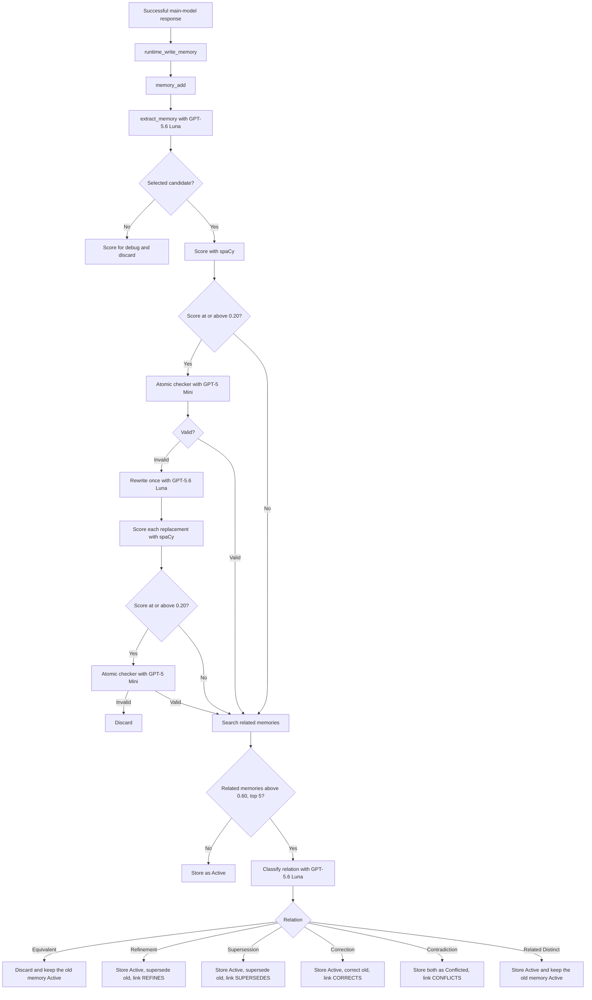
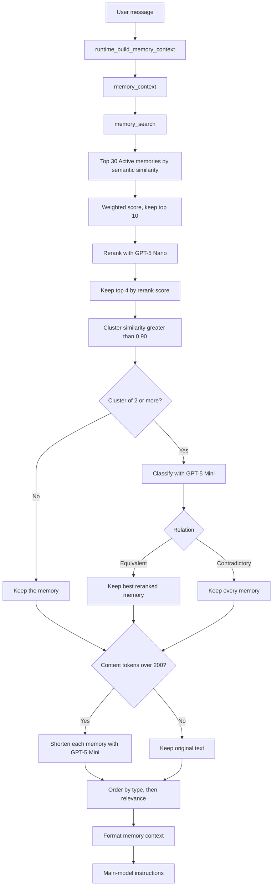
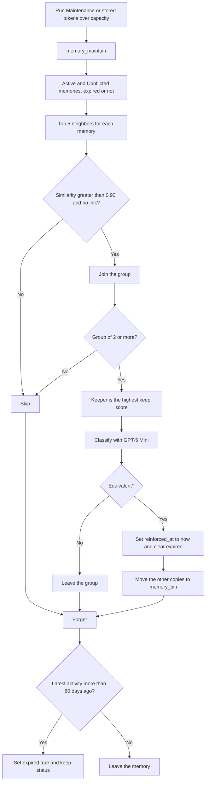

# AI Agent Memory Infrastructure — V4

The Write Path uses an LLM selector to extract atomic memories, scores each
selected candidate, and stores, links, or discards it after comparing it with
related memories. The Read Path retrieves a broad semantic candidate set,
filters it, then a context engine deduplicates, compresses, and orders the
memories the main model sees. The Maintenance Path removes duplicate copies
from the store and tags inactive memories as expired.

The project uses Python 3.13 and is managed with
[uv](https://docs.astral.sh/uv/).

## Models

- Main chat model: `gpt-4o-mini`
- Memory selector: `gpt-5.6-luna`
- Atomic checker: `gpt-5-mini`
- Atomic rewriter: `gpt-5.6-luna`
- Candidate relation classifier: `gpt-5.6-luna`
- Memory reranker: `gpt-5-nano`
- Relation classifier: `gpt-5-mini`
- Memory compressor: `gpt-5-mini`
- Dedup classifier: `gpt-5-mini`
- Embedding model: `text-embedding-3-small`
- Atomic score: spaCy `en_core_web_sm`
- Vector store: PostgreSQL with pgvector


## Setup

1. Copy `.env.example` to `.env`.
2. Add an OpenAI API key:
  ```dotenv
   OPENAI_API_KEY=your-api-key-here
   OPENAI_MODEL=gpt-4o-mini
   MEMORY_SELECTOR_MODEL=gpt-5.6-luna
   MEMORY_RERANKER_MODEL=gpt-5-nano
   MEMORY_COMPRESSOR_MODEL=gpt-5-mini
   MEMORY_RELATION_MODEL=gpt-5-mini
   MEMORY_CANDIDATE_RELATION_MODEL=gpt-5.6-luna
   MEMORY_ATOMIC_CHECKER_MODEL=gpt-5-mini
   MEMORY_ATOMIC_REWRITER_MODEL=gpt-5.6-luna
   MEMORY_DEDUP_MODEL=gpt-5-mini
   OPENAI_EMBEDDING_MODEL=text-embedding-3-small
   DATABASE_URL=postgresql://localhost:5432/agent_memory
  ```
3. Run PostgreSQL with the pgvector extension. The default URL expects a
  local server on port 5432. The app creates the `agent_memory` database
   and the `memories`, `memory_links`, and `memory_bin` tables when they
   are missing.
4. Install the locked dependencies, including the spaCy English model:
  ```bash
   uv sync
  ```
5. Start the interface:
  ```bash
   uv run streamlit run src/ai_agent_memory_infrastructure/app.py
  ```

The interface is available at `http://localhost:8501`.

## Memory API

`memory_add()`, `memory_search()`, and `memory_context()` each contain their
full pipeline, so they can run without the runtime functions. The main model
is not given them as tools yet. The Python runtime calls them automatically.

### API Functions

- `memory_add(conversation)`: extracts candidate memories, scores them, checks uncertain ones, compares selected memories with stored memories, and stores, links, or discards each one
- `memory_search(query, ...)`: retrieves Active memories that are not expired through both read-path filters and returns the top 4
- `memory_context(query, ...)`: runs `memory_search()`, then deduplicates, compresses, and orders the returned memories
- `memory_maintain()`: removes equivalent copies, then tags inactive memories as expired
- `memory_get(memory_id)`: loads one stored memory
- `memory_update(memory_id, ...)`: changes one stored memory
- `memory_delete(memory_id)`: deletes one stored memory and its links


### Runtime Functions

- `runtime_build_memory_context()`: calls `memory_context()` and formats the result for the main model
- `runtime_write_memory()`: calls `memory_add()` after a successful main-model response, then runs maintenance when the stored token total is over capacity
- `runtime_run_maintenance()`: calls `memory_maintain()` from the sidebar button


### Internal Functions

Write path, inside `memory_add()`:

- `extract_memory()`: calls GPT-5.6 Luna and returns selected and not-selected candidates
- `score_atomic_memory()`: uses spaCy to score how atomic a candidate is
- `check()`: asks GPT-5 Mini whether a high-scoring candidate is `valid` or `invalid`
- `rewrite()`: asks GPT-5.6 Luna to split an invalid candidate into one or more atomic memories
- `memory_search()` on the store: finds related stored memories by cosine similarity
- `classify()` on the candidate relation classifier: labels a candidate against those related memories
- `write_memory()`: validates, embeds, and inserts one approved record
- `record_memory_link()`: updates the older memory's status and stores the link

Read path, inside `memory_search()`:

- Semantic search embeds the query and returns the top 30 Active candidates that are not expired.
- `rank_by_retrieval_score()` scores those candidates and keeps the weighted top 10.
- `rerank()` asks GPT-5 Nano to score those 10 against the query.
- The top 4 by reranker score are what `memory_search()` returns.

Context engine, inside `memory_context()`, after `memory_search()`:

- `cluster_duplicate_memories()` groups returned memories whose stored content embeddings have cosine similarity greater than `0.90`.
- `classify()` asks GPT-5 Mini whether each group of two or more is `equivalent` or `contradictory`.
- `resolve_duplicate_group()` keeps the best reranked memory for an equivalent group and keeps every memory for a contradictory group.
- `apply_context_compression()` asks GPT-5 Mini to shorten each remaining memory when their content exceeds the token budget.
- `order_context_memories()` groups the result by memory type, then by relevance.
- `format_context_memories()` renders the ordered memories for the main model.

Maintenance path, inside `memory_maintain()`:

- `deduplicate()` groups Active and Conflicted memories, asks GPT-5 Mini whether each group is equivalent, and moves extra copies to `memory_bin`.
- `forget()` sets `expired` to true when a memory's latest activity is more than 60 days ago.

The numeric cuts above are the defaults. Parameter Configuration can change
them for the next message.

### Administrative Functions

- `count()`: returns the number of stored memories
- `clear()`: deletes all stored memories, links, and `memory_bin` rows


## Three Memory Paths

The architecture is divided into a Write Path, a Read Path, and a
Maintenance Path:

```text
User message
  → Read Path
  → Main LLM response
  → Write Path
  → Maintenance Path, when stored tokens exceed capacity
```

`Run Maintenance` can start the Maintenance Path at any time.

### Write Path

Information goes into memory. It answers:

> What from the current interaction should be remembered, and how should it
> be stored beside the memories that are already there?

The current Write Path contains:

1. A runtime trigger after a successful main-model response.
2. The public `memory_add(conversation)` operation.
3. GPT-5.6 Luna structured memory extraction.
4. Atomic candidate content, plus subject, predicate, and object.
5. Memory-type classification.
6. Importance and confidence scoring.
7. A selected or not-selected decision.
8. A spaCy atomic score for every candidate.
9. A GPT-5 Mini atomic check when a selected score is at or above `0.20`.
10. A GPT-5.6 Luna rewrite when that check is invalid, then the same score and check for each replacement.
11. Vector search for related Active and Conflicted memories, including expired ones.
12. A GPT-5.6 Luna relation label when related memories are found.
13. A fixed rule that stores, links, or discards the candidate.
14. Runtime-generated IDs, timestamps, session data, status, and metadata.
15. Content embedding with `text-embedding-3-small`.
16. Persistent storage in PostgreSQL.


### Read Path

Information comes out of memory and is prepared for the main LLM. It answers:

> Given what the user is asking now, which existing memories should the model
> know about, and how should they be presented?

The current Read Path contains retrieval filters and a context engine:

1. The current user message is the retrieval query.
2. The query is embedded with `text-embedding-3-small`.
3. pgvector cosine-similarity search runs across Active memories that are not expired, from all sessions.
4. The top 30 semantic matches become candidate memories.
5. Each candidate receives a weighted retrieval score from semantic similarity, recency, and stored importance.
6. The top 10 candidates by that weighted score are preserved.
7. GPT-5 Nano reranks those 10 against the current query.
8. The top 4 candidates by reranker score are returned.
9. Those returned memories are clustered when their stored content embeddings have cosine similarity greater than `0.90`.
10. GPT-5 Mini classifies each cluster as equivalent or contradictory.
11. Equivalent clusters keep the best reranked memory. Contradictory clusters keep every memory.
12. If the remaining memory content exceeds 200 tokens, GPT-5 Mini shortens each memory.
13. The remaining memories are grouped by type, then by relevance.
14. The ordered memories are formatted into the main-model instructions.
15. The conversation itself stays in the Responses API `input` parameter.


### Maintenance Path

Maintenance removes stored duplicates and tags inactive memories. It answers:

> Which stored copies are the same fact, which copy should remain, and which
> memories have gone unused long enough to expire?

The current Maintenance Path contains:

1. A sidebar button, or an automatic run after a write when stored content tokens exceed capacity.
2. A search of Active and Conflicted memories, expired or not.
3. At most 5 nearest neighbors for each of those memories.
4. Groups of memories whose cosine similarity is greater than `0.90` and that do not already have a link.
5. A keep score from stored importance and recency since `reinforced_at`.
6. A GPT-5 Mini label of `equivalent` or `not_equivalent` for each group of two or more.
7. For an equivalent group, the keeper stays, `reinforced_at` is set to now, `expired` is cleared, and the other copies move to `memory_bin`.
8. A not-equivalent group is left unchanged.
9. Forget then sets `expired` to true when the latest activity is more than 60 days ago. Status stays unchanged.


## Write Path

The runtime decides when to write memory. The public `memory_add()` operation
decides what becomes memory:




After every successful main-model response, the runtime passes the current
conversation to `memory_add()`. The memory selector sees raw transcript
messages in this form:

```json
[
  {"role": "user", "content": "I prefer concise answers."},
  {"role": "assistant", "content": "Understood."}
]
```

The selector returns structured output. Subject, predicate, and object sit
directly under content and must restate that one proposition:

```json
{
  "selected": [
    {
      "content": "The user prefers concise answers.",
      "subject": "The user",
      "predicate": "prefers",
      "object": "concise answers",
      "type": "preference",
      "importance": 0.8,
      "confidence": 0.99,
      "role": "user",
      "debug_source_quote": "I prefer concise answers.",
      "debug_reason": "This is a durable communication preference."
    }
  ],
  "not_selected": [
    {
      "content": "The assistant acknowledged the preference.",
      "subject": "The assistant",
      "predicate": "acknowledged",
      "object": "the preference",
      "type": "episode",
      "importance": 0.1,
      "confidence": 0.9,
      "role": "assistant",
      "debug_source_quote": "Understood.",
      "debug_reason": "A generic acknowledgement has no future value."
    }
  ]
}
```

`not_selected` candidates and `debug_reason` remain transient and are shown
in Memory Debug. Subject, predicate, and object are also stored on the memory row. The atomic score is not stored.

The selector audits the complete latest user/assistant turn. Every meaningful
statement goes into exactly one list. Non-durable content must appear in
`not_selected` rather than being omitted. Both lists are empty only when the
latest turn contains no meaningful content. Secret values are redacted from
rejected debug candidates.

An atomic memory contains exactly one independently updateable proposition.
If one part could be corrected, superseded, or contradicted without changing
the rest, the selector splits it. Atomic does not mean the shortest possible
sentence. A version, a qualifier, or an extension that belongs to one fact
stays with that fact. Examples the selector is given:

- Split `User likes Python and Java.` into one memory for Python and one for Java.
- Split a résumé bullet that joins peers with `and`, such as Python, NumPy, and scikit-learn, SQL and Superset, dashboards and metrics, environmental and remote-sensing data, data mining and machine learning, or translation and interpretation.
- Keep `MemoryOS uses Python 3.12.` as one memory.
- Keep `MemoryOS uses PostgreSQL with pgvector.` as one memory.
- Keep the school, employer, place, time, or purpose on the fact. `The user is majoring in Economics at New York University.` stays whole. When peers are split, that qualifier is copied onto each memory.
- Subject, predicate, and object cannot hold a second peer.


### Atomic Score

After selection, spaCy scores every candidate from its content. The six raw
counts are scaled from 0 to 1, then combined:

```text
score = 0.35 P + 0.20 L + 0.15 C + 0.10 J + 0.10 V + 0.10 T

```

- `P` is the predicate count. One asserted action or property stays at 0. Two or more becomes 1.
- `L` is the coordinated-list length. One item stays at 0. Three or more becomes 1.
- `C` is the clause count. One clause stays at 0. Three or more becomes 1.
- `J` is the coordination count. Any `and`, `but`, `while`, or similar marker becomes 1.
- `V` is the value or number count. One stays at 0. Three or more becomes 1.
- `T` is the token length. 15 tokens or fewer stays at 0. 45 or more becomes 1.

The weights sum to 1, so the score stays between 0 and 1. A higher score is
less atomic. A single short proposition scores 0.

A selected memory below `0.20` continues to the related-memory search. A
score of `0.20` or higher is sent to the atomic checker. That checker uses
the same atomic standard as the selector and returns `valid` or `invalid`.
`valid` continues. The checker does not rewrite or split the text.

`invalid` is not stored. GPT-5.6 Luna receives that one candidate and
returns one or more replacements. Each replacement uses only facts already
in the invalid text. Type, importance, confidence, role, and the source
quote are copied from the original candidate. Each replacement is scored
with spaCy and, when its score is at or above `0.20`, checked again. A
replacement that is still invalid is discarded. The rewrite runs once. A
replacement that repeats the original sentence is discarded. A valid
replacement, or one below the threshold, continues to the related-memory
search.

### Related Memories

The candidate content is embedded and compared with stored memories whose
status is Active or Conflicted, whether or not they are expired. Superseded
and Corrected memories stay in the database and are left out of this search.

The search keeps at most 5 memories whose cosine similarity is strictly
greater than `0.60`. If none qualify, the candidate is stored as Active.

If any qualify, GPT-5.6 Luna returns one label for the candidate. When the
related memories do not all share one relation, the label follows the
closest memory. Python then applies a fixed rule to every memory in that
related set:


| Relation         | New memory           | Older memory                                                | Link                 |
| ---------------- | -------------------- | ----------------------------------------------------------- | -------------------- |
| Equivalent       | Discarded            | Stays Active, `reinforced_at` set to now, `expired` cleared | None                 |
| Refinement       | Stored as Active     | Superseded                                                  | New `REFINES` old    |
| Supersession     | Stored as Active     | Superseded                                                  | New `SUPERSEDES` old |
| Correction       | Stored as Active     | Corrected                                                   | New `CORRECTS` old   |
| Contradiction    | Stored as Conflicted | Conflicted                                                  | New `CONFLICTS` old  |
| Related Distinct | Stored as Active     | Stays Active                                                | None                 |


### Selector Storage Policy

Importance measures future utility and consequence, not certainty:

- `0.0–0.2`: trivial or transient
- `0.3–0.4`: limited future usefulness
- `0.5–0.6`: useful recurring context
- `0.7–0.8`: stable preference, goal, project, decision, or constraint
- `0.9–1.0`: identity-critical fact, safety requirement, or persistent instruction

Confidence is separate: it measures how strongly the conversation supports
the candidate.

Typical information to store:

- Long-term preferences
- Projects
- Goals
- Decisions
- Constraints
- Important facts
- Repeated interests
- Long-running tasks
- Relationships between important entities
- Persistent instructions
- Confirmed corrections

Typical information not to store:

- Greetings
- Small talk
- Temporary statements
- One-off questions
- Information whose only relevance is already obvious from the current conversation and has no future value
- Random transient details
- Filler or generic assistant responses
- Speculation or unconfirmed claims
- Passwords, API keys, access tokens, credentials, or other secrets


## Memory Types

- `fact`: stable information presented as true
- `preference`: a user preference or recurring choice
- `goal`: an objective or desired future outcome
- `instruction`: persistent guidance for future behavior
- `episode`: something that happened at a specific point in time

Legacy records with type `conversation` are interpreted as `episode` records
when read.

## Stored Memory Record

Only the candidate `content` is embedded. Python and the selector attach the
remaining stored fields. `status` is its own column. A link, when one
exists, is a separate row:

```json
{
  "id": "generated-memory-id",
  "content": "The user prefers concise answers.",
  "subject": "The user",
  "predicate": "prefers",
  "object": "concise answers",
  "memory_type": "preference",
  "role": "user",
  "source": "memory_selector_v1",
  "session_id": "current-session-id",
  "importance": 0.8,
  "status": "active",
  "expired": false,
  "token_count": 6,
  "last_accessed_at": null,
  "reinforced_at": "generated-timestamp",
  "created_at": "generated-timestamp",
  "updated_at": "generated-timestamp",
  "metadata": {
    "confidence": 0.99,
    "debug_source_quote": "I prefer concise answers.",
    "exchange_id": "generated-exchange-id",
    "selector_model": "gpt-5.6-luna"
  }
}
```

```json
{
  "from_memory_id": "new-memory-id",
  "relation": "REFINES",
  "to_memory_id": "older-memory-id"
}
```

Status is one of `active`, `superseded`, `corrected`, or `conflicted`. `expired` is a separate true or false tag, so a memory can be both superseded and expired. `token_count` is the stored content token count from the `o200k_base` encoding. The read path uses that stored count. `last_accessed_at` is the last time retrieval returned the memory. It stays empty until then. `reinforced_at` starts equal to `created_at`. An equivalent duplicate, on the write path or in maintenance, sets it to now and clears `expired`. Recency on the read path and the maintenance keep score both age from `reinforced_at`.

The link relation is one of `REFINES`, `SUPERSEDES`, `CORRECTS`, or `CONFLICTS`.
`from_memory_id` is the new memory. `to_memory_id` is the older one.

IDs, timestamps, source, session ID, and exchange ID are generated by Python.
`debug_source_quote` and selector confidence are LLM-generated diagnostic
metadata. Rejected candidates, atomic candidates that stay invalid after
one rewrite, and equivalent duplicates are not persisted.

Retrieval scores, duplicate clusters, compressed wording, and the atomic score are not part of this record. They are calculated when a memory is read or written and then discarded with the debug session.
Read-path deduplication and compression never rewrite stored PostgreSQL
records. Write-path relation rules do change `status` and add links.
Maintenance can set `expired`, refresh `reinforced_at`, and move a duplicate
out of `memories` into `memory_bin`. `memory_bin` has the same columns as
`memories`. Moving a row deletes its links.

Embeddings are 1536-dimensional vectors from `text-embedding-3-small`.
Similarity is cosine similarity, computed as one minus the pgvector cosine
distance. The `memories` table has an HNSW index on that embedding.

## Read Path

`runtime_build_memory_context()` runs before the main model answers. It
triggers `memory_context()`, which owns search and the context engine:




### First Filter: Weighted Retrieval Score

Semantic search only supplies the broad set. It includes memories whose
status is Active and whose `expired` tag is false. Superseded, Corrected,
Conflicted, and expired memories stay stored and are left out of retrieval. Every one of the top 30 candidates is then
scored with stored memory data:

```text
retrieval_score = 0.6 semantic_score + 0.2 recency_score + 0.2 importance
```

- `semantic_score` is the pgvector cosine similarity, clamped to `0–1`.
- `importance` is the stored score produced by the memory selector.
- `recency_score = e^(-λt)`.
- `t` is the memory age in days, measured from `reinforced_at`.
- `λ = ln(2) / 30`, so recency falls by half every 30 days.
- A new memory starts with `reinforced_at` equal to `created_at`.
- An equivalent duplicate does not store a second copy. It sets `reinforced_at` on the memory that is kept, which resets decay.

The top 10 candidates by `retrieval_score` continue. The other candidates are
dropped before the reranker sees them.

### Second Filter: Reranker

The reranker reads the current user query together with each of the 10
surviving memory texts. It returns a `relevance_score` from `0` to `1` for
every candidate:

- `1.0`: the memory directly answers or is necessary for the query
- `0.5`: the memory is related, but incomplete or indirect
- `0.0`: the memory is unrelated to the query

That relevance score becomes both `rerank_score` and `final_score`. The top 4
memories by `final_score` are the ones returned to the context engine. A
memory can rank high on the weighted score and still be left out if the
reranker judges it less useful for the current question.

Before reranking, `final_score` equals `retrieval_score` and `rerank_score`
is empty. `semantic_score`, `recency_score`, `retrieval_score`,
`rerank_score`, and `final_score` are runtime retrieval fields. They are not
written to PostgreSQL.

### Context Deduplication

Deduplication runs only on the memories `memory_search()` returned, currently
up to 4. It compares the embeddings already stored for those contents. It
does not embed the text again, and it does not change PostgreSQL.

Two memories are linked when their cosine similarity is greater than `0.90`.
A similarity of exactly `0.90` is not a duplicate. Links are transitive: if A
matches B and B matches C, then A, B, and C are one cluster even when A and C
are at or below `0.90`.

A cluster of one memory skips the classifier. Each cluster of two or more is
sent to GPT-5 Mini, which must return one label for the whole group:

- `equivalent`: the memories state the same facts. Wording may differ. No memory adds, removes, or denies a fact that another memory states.
- `contradictory`: the memories disagree, one negates another, they give different values, or one memory states a fact the others do not.

The model does not rewrite text or choose a winner. Python acts on the label:

- `equivalent` keeps the memory with the highest `final_score`. Ties break on `semantic_score`, then on the earlier cluster member.
- `contradictory` keeps every memory in the cluster, unchanged.

Structured output allows only those two labels. If the response cannot be
parsed, the read path fails instead of guessing. Dedup is recorded as yes
only when an equivalent cluster drops at least one memory. A contradictory
cluster that keeps every memory is dedup no.

This read-path cluster is separate from the write-path relation. It changes
only the text sent to the main model.

### Context Compression

After deduplication, Python counts tokens in the remaining memory contents
with the `o200k_base` encoding. Type headings, roles, relevance labels, and
the chat transcript are not included.

The budget is 200 content tokens. At or under that budget, the memories are
returned unchanged and compression is no. Over the budget, GPT-5 Mini sees
the whole set and returns one shorter text per memory id. A proposal is
applied only when it is non-empty and strictly shorter than the original.
Otherwise that memory keeps its original text. Compression does not change
how many memories are returned, and it does not write the shorter text back
to PostgreSQL. One pass is used, so the result can still be over budget.
Compression is yes only when at least one remaining memory was actually
shortened.

### Context Ordering

Ordering uses fixed code. No model is called. Memories are grouped in this
type order:

1. `fact`
2. `preference`
3. `goal`
4. `instruction`
5. `episode`

Empty types are omitted. Inside a type, memories are ordered by `final_score`
descending, then `semantic_score` descending, then memory id. After the
reranker, `final_score` is the rerank score.

### Context Passed To The Main Model

The ordered memories are appended to the main model's `instructions`. The
conversation remains the Responses API `input`, with the newest user message
at the bottom:

```text
instructions:
You are a helpful AI assistant. Use these relevant memories when helpful. Ignore any that are unrelated:
fact
- [user; relevance=0.860; ] The user's name is Beta.
- [assistant; relevance=0.400; ] Beta lives in New York.
preference
- [user; relevance=0.910; ] User wants short answers.

input:
- user: What's my name?
```

`relevance` is the label in the prompt. The number is `final_score`. Each
memory is one line. Internal line breaks in a memory are collapsed to spaces.
The base instruction is sent alone when no memories remain.

## Maintenance

Maintenance runs after memories are stored. The sidebar button `Run Maintenance` starts it immediately. It also runs after a write when the stored token total is over capacity:

```text
run maintenance when sum(token_count) > 10000
```

`token_count` is the stored content count on every row in `memories`. The default capacity is 10,000. Deduplication runs first, then forget:




### Duplicate Search

The pool is every memory whose status is Active or Conflicted, whether or
not it is expired. Superseded and Corrected rows stay out. Each memory in
that pool asks pgvector for its closest neighbors, using the embedding
already stored on the row. No new embedding call is made.

A neighbor joins the group only when its cosine similarity is greater than
`0.90`. A similarity of exactly `0.90` stays out. The search keeps at most 5
neighbors per memory. Those links are transitive: if A matches B and B
matches C, then A, B, and C are one group. A pair can be missed when each
memory already has 5 closer neighbors.

A group of one is skipped. A pair that already has a row in `memory_links`
is skipped, so a refinement, supersession, correction, or contradiction is
not treated as a duplicate.

### Keep Score

Python chooses the keeper before the classifier runs:

```text
keep_score = 0.50 importance + 0.50 recency_score
```

- `importance` is the stored score from the memory selector.
- `recency_score = e^(-λt)`.
- `t` is the age in days, measured from `reinforced_at`. A missing `reinforced_at` uses `created_at`.
- `λ = ln(2) / 30`. This half-life belongs to maintenance. Its default is 30 days, the same number the read path uses, and it is set on its own.
- The two weights sum to 1, so the score stays between 0 and 1 when importance and recency do.

The highest `keep_score` is the keeper. Ties go to the later `reinforced_at`,
then the later `created_at`. Token count and `last_accessed_at` do not
choose the keeper.

### Dedup Label

GPT-5 Mini sees the keeper and the other members of the group. It returns
one label:

- `equivalent`: they state the same facts. Wording may differ. No memory adds, removes, or denies a fact that another memory states.
- `not_equivalent`: anything else, including a refinement, a newer state, a correction, a contradiction, or a distinct fact.

The model does not rewrite text or choose a winner. Python acts on the label:

- `equivalent` keeps the keeper. `reinforced_at` is set to now and `expired` is cleared. Each other copy is inserted into `memory_bin` with the same fields, then deleted from `memories`. Its links are deleted with it.
- `not_equivalent` leaves every member in `memories`, unchanged.

Structured output allows only those two labels. If the response cannot be
parsed, maintenance fails instead of guessing.

### Forget

Forget then looks at every memory that is not already expired, including
Superseded and Corrected rows:

```text
last_activity = latest of created_at, updated_at, last_accessed_at, reinforced_at
expire when last_activity < now - 60 days
```

A missing `last_accessed_at` or `reinforced_at` uses `created_at`. When the
latest of those dates is more than 60 days ago, `expired` is set to true.
Status stays as it was. The row stays in `memories`. Retrieval still
requires Active and `expired` false, so an expired Active memory drops out
of the read path and remains available to the write path and to the next
maintenance search.

A keeper just reinforced by dedup has `reinforced_at` of now, so that same
pass does not expire it. A copy moved to `memory_bin` is already gone before
forget runs.

## Parameter Configuration

The sidebar button `Parameter Configuration` opens a page in the same
Streamlit session. A change applies to the next message. Past turns keep the
scores they were built with. If a draft is invalid, the last valid settings
remain in use.

Retrieval weights must sum to 1. The cuts must stay in order: semantic
candidates, then the weighted pool, then the number returned. Atomic score
weights must also sum to 1. Dedup importance and recency weights must also
sum to 1.


| Setting                 | Default |
| ----------------------- | ------- |
| Semantic Weight         | 0.60    |
| Recency Weight          | 0.20    |
| Importance Weight       | 0.20    |
| Half-Life Days          | 30      |
| Semantic Candidates     | 30      |
| Weighted Candidates     | 10      |
| Returned Memories       | 4       |
| Similarity Threshold    | 0.90    |
| Content Token Limit     | 200     |
| Predicate Weight        | 0.35    |
| List Item Weight        | 0.20    |
| Clause Weight           | 0.15    |
| Coordination Weight     | 0.10    |
| Value Weight            | 0.10    |
| Length Weight           | 0.10    |
| Atomic Score Threshold  | 0.20    |
| Related Similarity      | 0.60    |
| Related Memories        | 5       |
| Memory Token Capacity   | 10000   |
| Dedup Similarity        | 0.90    |
| Dedup Importance Weight | 0.50    |
| Dedup Recency Weight    | 0.50    |
| Dedup Half-Life Days    | 30      |


Duplicate clustering, related-memory search, and maintenance dedup all use a
strict greater-than comparison. The atomic checker runs when the score is
greater than or equal to the atomic score threshold. The content token limit
counts memory content only. Maintenance runs when the stored token total is
greater than the memory token capacity.

Changing a number reruns the Streamlit script. The process does not need a
restart for a parameter change.

## Sessions And Interface

- Streamlit keeps the active transcript in `st.session_state`.
- Each API request resends the active transcript; OpenAI does not retain it.
- `Clear Conversation` clears the visible transcript but keeps the session ID.
- `New Session` clears the transcript and generates a new session ID.
- PostgreSQL memory is shared across sessions.
- `Clear Saved Memories` deletes all persisted memories, links, and `memory_bin` rows.
- `Parameter Configuration` opens the number controls in the same browser tab.
- The side control offers `Off`, `Show Memory Debug`, `Show Retrieval Inspector`, or `Show Maintenance Run`. Only one panel is open.

`Show Memory Debug` has two pages:

- `Breakdown` keeps the existing tabs: retrieved memories from the final context, candidates selected for storage, and candidates the selector rejected. Retrieved cards show Final, Retrieval, Semantic, Recency, and Importance. Selected and rejected cards show subject, predicate, object, and the atomic score. A checked memory also shows Valid or Invalid. An invalid memory that was rewritten lists the replacements. A stored or discarded candidate shows its status, relation, and any link.
- `Context` shows the full prompt sent to the main model, including instructions and input.

`Show Retrieval Inspector` has three pages:

- `Score` lists retrieval candidates in a table ordered by combined score. Columns are Memory, Combined, Semantic, Recency, Importance, Rerank, and Tokens. Rows selected after reranking and before deduplication are highlighted. The Tokens column counts only those rows.
- `Context` shows one summary line: `Memories Used`, `Memory Tokens`, `Compression`, and `Dedup`.
- `Dedup` lists every cluster above the duplicate threshold, the Equivalent or Contradictory label, and, for an equivalent cluster, the text that was kept.

`Show Maintenance Run` keeps each maintenance pass from this browser session, newest first. A pass started by the sidebar button is labeled `Manual`. A pass started because stored tokens exceeded capacity is labeled `Token Capacity`.

- `Dedup` lists each duplicate group, the Equivalent or Not Equivalent label, and every member. A member shows whether it was kept, moved to `memory_bin`, or left unchanged, plus its status, expired tag, content, keep score, and importance.
- `Forget` lists each memory tagged expired by that pass, with the status that stayed in place and its content.

The runtime searches across all sessions. Session IDs are stored on each
memory but are not currently used as retrieval filters.

## Local Data And Security

- `.env` contains the API key and is excluded from Git.
- PostgreSQL stores the memories outside the project folder. The database files are not part of the Git repository.
- `.venv/` contains reproducible local dependencies and is excluded from Git.
- `.env.example`, `pyproject.toml`, and `uv.lock` are safe to commit.

Never store passwords, API keys, access tokens, or other credentials as
memory. The selector is instructed to reject secrets, but deterministic secret
filtering can be added in a later version.

## Tests

Run:

```bash
uv run python -m unittest discover -s tests -v
```

The tests cover memory lifecycle operations, selector filtering, runtime
writing, atomic scoring, the atomic checker threshold, atomic rewrite,
related-memory search,
status and link rules, weighted retrieval, the top-10 to top-4 rerank cut,
duplicate clustering, equivalent keep-best and contradictory keep-both,
compression after deduplication, context ordering, prompt formatting,
maintenance dedup and forget, and legacy `conversation`-to-`episode`
compatibility.

## Current Limitations

- One selector-model call is made after each successful response.
- One atomic-checker call is made for each selected memory at or above the atomic score threshold, and again for a rewrite that is still at or above that threshold.
- One atomic-rewriter call is made for each selected memory the checker marks invalid. A second invalid result is discarded.
- One candidate-relation call is made when a selected memory has related stored memories.
- The atomic score can flag a sentence that is still one proposition, and the checker can still accept or reject it incorrectly.
- The candidate relation classifier returns one label for the related set.
- Candidate writes and their links are not one transaction.
- One reranker-model call is made before each response when memories exist.
- The reranker is an LLM scorer, and it sees only the weighted top 10.
- Read-path deduplication runs only on the returned top 4. Store-wide duplicate removal is the maintenance path.
- The read-path relation classifier judges each cluster, and a correct label is not guaranteed.
- Maintenance keeps at most 5 neighbors per memory, so a duplicate beyond those 5 can be missed.
- One dedup-classifier call is made per maintenance group of two or more, and a correct label is not guaranteed.
- An equivalent maintenance group deletes the extra copies and their links. Those copies remain in `memory_bin`.
- A relation-model call is made once per read-path cluster of two or more.
- A compressor-model call is made only when remaining content exceeds the token budget.
- Compression is one pass and may still leave the context over budget.
- Selector confidence is diagnostic rather than guaranteed truth.
- The main model has no direct memory tools.
- Ordered transcripts are not persisted outside Streamlit session state.
- Retrieval scores, clusters, compressed text, and atomic scores are not stored, so they cannot be inspected after the debug session ends.

