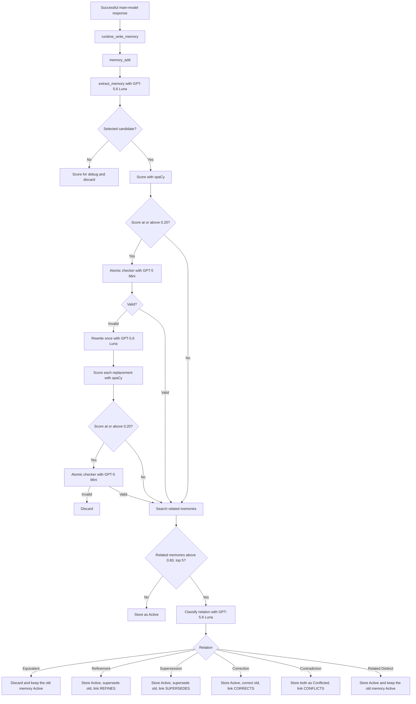
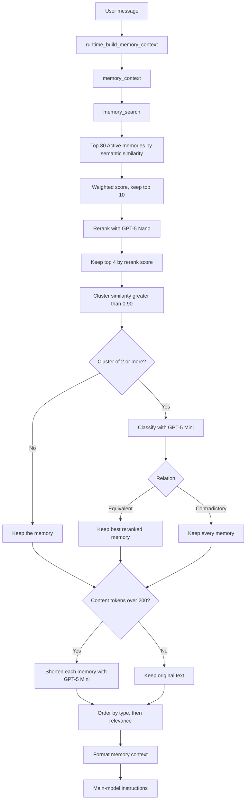
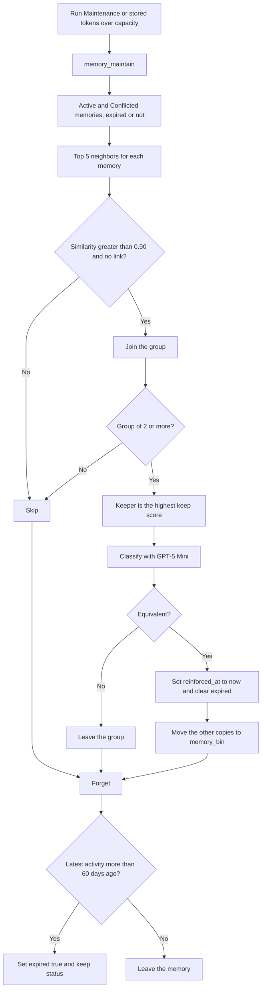
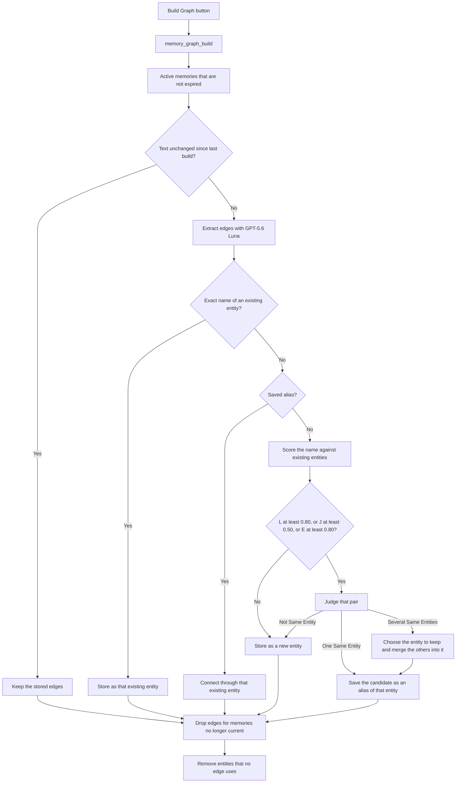
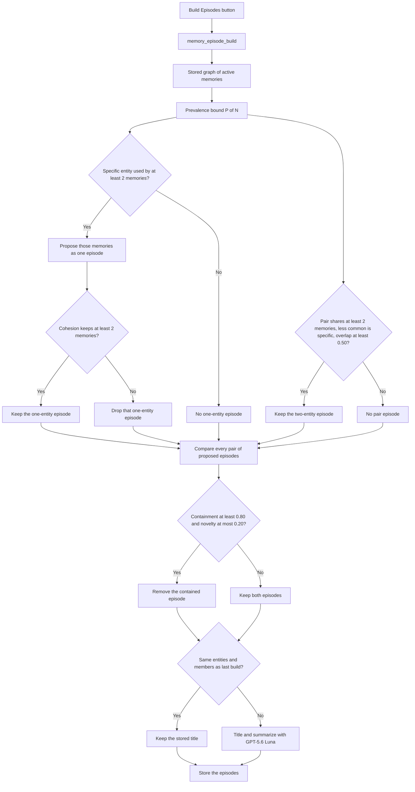
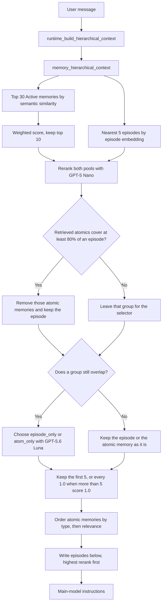
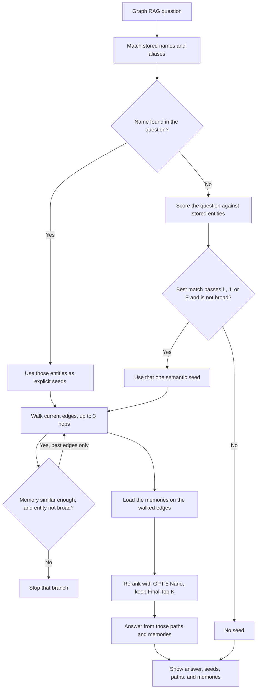

# AI Agent Memory Infrastructure — V6

The Write Path uses an LLM selector to extract atomic memories, scores each
selected candidate, and stores, links, or discards it after comparing it with
related memories. The Read Path retrieves a broad semantic candidate set,
filters it, then a context engine deduplicates, compresses, and orders the
memories the main model sees. The Maintenance Path removes duplicate copies
from the store and tags inactive memories as expired. The Graph Path builds
entities and edges from the atomic memories already stored. The Episode Path
groups those memories into higher-level episodes from the stored graph. The
Graph RAG Path asks one question of that stored graph and shows the answer
only on its own page.

The project uses Python 3.13 and is managed with
[uv](https://docs.astral.sh/uv/).

## Models

- Main chat model: `gpt-5.6-sol`
- Memory selector: `gpt-5.6-luna`
- Atomic checker: `gpt-5-mini`
- Atomic rewriter: `gpt-5.6-luna`
- Candidate relation classifier: `gpt-5.6-luna`
- Memory reranker: `gpt-5-nano`
- Relation classifier: `gpt-5-mini`
- Memory compressor: `gpt-5-mini`
- Dedup classifier: `gpt-5-mini`
- Graph extractor: `gpt-5.6-luna`
- Entity judge: `gpt-5.6-luna`
- Entity selector: `gpt-5.6-luna`
- Episode titler: `gpt-5.6-luna`
- Episode group selector: `gpt-5.6-luna`
- Embedding model: `text-embedding-3-small`
- Atomic score: spaCy `en_core_web_sm`
- Vector store: PostgreSQL with pgvector

## Setup

1. Copy `.env.example` to `.env`.
2. Add an OpenAI API key:
   ```dotenv
   OPENAI_API_KEY=your-api-key-here
   OPENAI_MODEL=gpt-5.6-sol
   MEMORY_SELECTOR_MODEL=gpt-5.6-luna
   MEMORY_RERANKER_MODEL=gpt-5-nano
   MEMORY_COMPRESSOR_MODEL=gpt-5-mini
   MEMORY_RELATION_MODEL=gpt-5-mini
   MEMORY_CANDIDATE_RELATION_MODEL=gpt-5.6-luna
   MEMORY_ATOMIC_CHECKER_MODEL=gpt-5-mini
   MEMORY_ATOMIC_REWRITER_MODEL=gpt-5.6-luna
   MEMORY_DEDUP_MODEL=gpt-5-mini
   MEMORY_GRAPH_MODEL=gpt-5.6-luna
   MEMORY_ENTITY_JUDGE_MODEL=gpt-5.6-luna
   MEMORY_ENTITY_SELECTOR_MODEL=gpt-5.6-luna
   MEMORY_EPISODE_TITLE_MODEL=gpt-5.6-luna
   MEMORY_EPISODE_GROUP_MODEL=gpt-5.6-luna
   OPENAI_EMBEDDING_MODEL=text-embedding-3-small
   DATABASE_URL=postgresql://localhost:5432/agent_memory
   ```
3. Run PostgreSQL with the pgvector extension. The default URL expects a
   local server on port 5432. The app creates the `agent_memory` database
   and the `memories`, `memory_links`, and `memory_bin` tables when they
   are missing.
4. Install the locked dependencies, including the spaCy English model:
   ```bash
   uv sync
   ```
5. Start the interface:
   ```bash
   uv run streamlit run src/ai_agent_memory_infrastructure/app.py
   ```

The interface is available at `http://localhost:8501`.

## Memory API

`memory_add()`, `memory_search()`, and `memory_context()` each contain their
full pipeline, so they can run without the runtime functions. The main model
is not given them as tools yet. The Python runtime calls them automatically.

### API Functions

- `memory_add(conversation)`: extracts candidate memories, scores them, checks uncertain ones, compares selected memories with stored memories, and stores, links, or discards each one
- `memory_search(query, ...)`: retrieves Active memories that are not expired through both read-path filters and returns the top 4
- `memory_context(query, ...)`: runs `memory_search()`, then deduplicates, compresses, and orders the returned memories
- `memory_maintain()`: removes equivalent copies, then tags inactive memories as expired
- `memory_graph_build()`: rebuilds the current entity graph from Active memories that are not expired
- `memory_episode_build()`: groups those graph memories into episodes and titles each new or changed episode
- `memory_hierarchical_context(query, ...)`: retrieves the weighted atomic pool and the nearest episodes, reranks them together, resolves overlap, and returns the top 5, or every survivor scored `1.0` when more than 5 reach that score
- `run_graph_rag()`: answers one question from the current graph and returns the seeds, paths, memories, and answer. It does not write.
- `memory_get(memory_id)`: loads one stored memory
- `memory_update(memory_id, ...)`: changes one stored memory
- `memory_delete(memory_id)`: deletes one stored memory and its links

### Runtime Functions

- `runtime_build_memory_context()`: calls `memory_context()` and formats the result for the main model
- `runtime_write_memory()`: calls `memory_add()` after a successful main-model response, then runs maintenance when the stored token total is over capacity
- `runtime_run_maintenance()`: calls `memory_maintain()` from the sidebar button
- `runtime_build_graph()`: calls `memory_graph_build()` from the sidebar button
- `runtime_build_episodes()`: calls `memory_episode_build()` from the sidebar button
- `runtime_build_hierarchical_context()`: calls `memory_hierarchical_context()` and formats atomic memories, then episodes, for the main model

### Internal Functions

Write path, inside `memory_add()`:

- `extract_memory()`: calls GPT-5.6 Luna and returns selected and not-selected candidates
- `score_atomic_memory()`: uses spaCy to score how atomic a candidate is
- `check()`: asks GPT-5 Mini whether a high-scoring candidate is `valid` or `invalid`
- `rewrite()`: asks GPT-5.6 Luna to split an invalid candidate into one or more atomic memories
- `memory_search()` on the store: finds related stored memories by cosine similarity
- `classify()` on the candidate relation classifier: labels a candidate against those related memories
- `write_memory()`: validates, embeds, and inserts one approved record
- `record_memory_link()`: updates the older memory's status and stores the link

Read path, inside `memory_search()`:

- Semantic search embeds the query and returns the top 30 Active candidates that are not expired.
- `rank_by_retrieval_score()` scores those candidates and keeps the weighted top 10.
- `rerank()` asks GPT-5 Nano to score those 10 against the query.
- The top 4 by reranker score are what `memory_search()` returns.

Context engine, inside `memory_context()`, after `memory_search()`:

- `cluster_duplicate_memories()` groups returned memories whose stored content embeddings have cosine similarity greater than `0.90`.
- `classify()` asks GPT-5 Mini whether each group of two or more is `equivalent` or `contradictory`.
- `resolve_duplicate_group()` keeps the best reranked memory for an equivalent group and keeps every memory for a contradictory group.
- `apply_context_compression()` asks GPT-5 Mini to shorten each remaining memory when their content exceeds the token budget.
- `order_context_memories()` groups the result by memory type, then by relevance.
- `format_context_memories()` renders the ordered memories for the main model.

Maintenance path, inside `memory_maintain()`:

- `deduplicate()` groups Active and Conflicted memories, asks GPT-5 Mini whether each group is equivalent, and moves extra copies to `memory_bin`.
- `forget()` sets `expired` to true when a memory's latest activity is more than 60 days ago.

Graph path, inside `memory_graph_build()`:

- `extract()` asks GPT-5.6 Luna to turn one stored atomic memory into entity edges.
- Shared entity names connect those memories. The conversation is not read.

Episode path, inside `memory_episode_build()`:

- `form_episodes()` groups memories that share a specific entity, or a qualifying pair of entities, using the graph already stored.
- `apply_single_entity_cohesion()` drops a memory whose embedding sits far from the centroid of a one-entity episode.
- `drop_redundant_episodes()` removes an episode that is mostly contained in another.
- `title()` asks GPT-5.6 Luna for a title and a brief summary of an episode whose entities or members changed. The summary uses only that episode's atomic memories.

Hierarchical read path, inside `memory_hierarchical_context()`:

- `hierarchical_atomic_retrieval()` keeps the weighted top 10 from the same semantic search the Atomic Read Path uses.
- `hierarchical_episode_retrieval()` returns the nearest 5 episodes by the stored episode embedding.
- `rerank_mixed()` asks GPT-5 Nano to score both pools on one scale.
- `select_hierarchical_return()` removes atomic memories that already cover an episode, then asks GPT-5.6 Luna to choose `episode_only` or `atom_only` for each group that remains.
- `format_hierarchical_context()` writes the atomic memories in context order, then the episodes.

The numeric cuts above are the defaults. Parameter Configuration can change
them for the next message.

### Administrative Functions

- `count()`: returns the number of stored memories
- `clear()`: deletes all stored memories, links, `memory_bin` rows, graph rows, and episode rows

## Six Memory Paths

The architecture is divided into a Write Path, a Read Path, a Maintenance
Path, a Graph Path, an Episode Path, and a Graph RAG Path:

```text
User message
  → Read Path
  → Main LLM response
  → Write Path
  → Maintenance Path, when stored tokens exceed capacity
```

The Graph RAG Path is not in that chain. `Graph RAG` starts it only when
that button is clicked. Its answer stays on the Graph RAG page.

`Run Maintenance` can start the Maintenance Path at any time. `Build Graph`
starts the Graph Path only when that button is clicked. The graph is rebuilt
from the memories stored at that moment. `Build Episodes` starts the Episode
Path only when that button is clicked. It reads the graph already stored.

### Write Path

Information goes into memory. It answers:

> What from the current interaction should be remembered, and how should it
> be stored beside the memories that are already there?

The current Write Path contains:

1. A runtime trigger after a successful main-model response.
2. The public `memory_add(conversation)` operation.
3. GPT-5.6 Luna structured memory extraction.
4. Atomic candidate content, plus subject, predicate, and object.
5. Memory-type classification.
6. Importance and confidence scoring.
7. A selected or not-selected decision.
8. A spaCy atomic score for every candidate.
9. A GPT-5 Mini atomic check when a selected score is at or above `0.20`.
10. A GPT-5.6 Luna rewrite when that check is invalid, then the same score and check for each replacement.
11. Vector search for related Active and Conflicted memories, including expired ones.
12. A GPT-5.6 Luna relation label when related memories are found.
13. A fixed rule that stores, links, or discards the candidate.
14. Runtime-generated IDs, timestamps, session data, status, and metadata.
15. Content embedding with `text-embedding-3-small`.
16. Persistent storage in PostgreSQL.

### Read Path

Information comes out of memory and is prepared for the main LLM. It answers:

> Given what the user is asking now, which existing memories should the model
> know about, and how should they be presented?

The current Read Path contains retrieval filters and a context engine:

1. The current user message is the retrieval query.
2. The query is embedded with `text-embedding-3-small`.
3. pgvector cosine-similarity search runs across Active memories that are not expired, from all sessions.
4. The top 30 semantic matches become candidate memories.
5. Each candidate receives a weighted retrieval score from semantic similarity, recency, and stored importance.
6. The top 10 candidates by that weighted score are preserved.
7. GPT-5 Nano reranks those 10 against the current query.
8. The top 4 candidates by reranker score are returned.
9. Those returned memories are clustered when their stored content embeddings have cosine similarity greater than `0.90`.
10. GPT-5 Mini classifies each cluster as equivalent or contradictory.
11. Equivalent clusters keep the best reranked memory. Contradictory clusters keep every memory.
12. If the remaining memory content exceeds 200 tokens, GPT-5 Mini shortens each memory.
13. The remaining memories are grouped by type, then by relevance.
14. The ordered memories are formatted into the main-model instructions.
15. The conversation itself stays in the Responses API `input` parameter.

The sidebar `Read Path` control chooses this path or Hierarchical Read Path. Hierarchical Read Path is documented after the Episode Path.

### Maintenance Path

Maintenance removes stored duplicates and tags inactive memories. It answers:

> Which stored copies are the same fact, which copy should remain, and which
> memories have gone unused long enough to expire?

The current Maintenance Path contains:

1. A sidebar button, or an automatic run after a write when stored content tokens exceed capacity.
2. A search of Active and Conflicted memories, expired or not.
3. At most 5 nearest neighbors for each of those memories.
4. Groups of memories whose cosine similarity is greater than `0.90` and that do not already have a link.
5. A keep score from stored importance and recency since `reinforced_at`.
6. A GPT-5 Mini label of `equivalent` or `not_equivalent` for each group of two or more.
7. For an equivalent group, the keeper stays, `reinforced_at` is set to now, `expired` is cleared, and the other copies move to `memory_bin`.
8. A not-equivalent group is left unchanged.
9. Forget then sets `expired` to true when the latest activity is more than 60 days ago. Status stays unchanged.

### Graph Path

The graph is built from atomic memories that are already stored. It answers:

> Which entities do these memories mention, and which memories meet because
> they mention the same entity?

The current Graph Path contains:

1. The `Build Graph` sidebar button. A write or a maintenance run does not start it.
2. A read of Active memories whose `expired` tag is false.
3. One GPT-5.6 Luna call per memory that is new or whose stored text changed.
4. Each extracted name is checked against the entity names already stored. Capitalization and extra spaces are ignored. A direct match is stored as that existing entity. A name already saved as an alias is connected to that entity. Neither is scored or judged.
5. Any other name is compared with every entity already stored. The score vector is normalized Levenshtein similarity `L`, Jaccard similarity of the words `J`, and embedding cosine similarity `E`. The name embedding is stored on the `graph_entities` row and reused. Only a name that does not yet have one is sent to the embedding model.
6. A pair is sent to the entity judge when `L` is at least `0.80`, `J` is at least `0.50`, or `E` is at least `0.80`. Each passing pair is judged on its own. One `Same Entity` result stores the new name as an alias and connects the memory to that existing entity. Several `Same Entity` results are duplicates: a second model chooses the entity to keep, the other existing names and the candidate name become its aliases, and their edges move onto the kept entity. `Not Same Entity` leaves that pair unchanged. When no passing pair is the same entity, the name is stored as a new entity.
7. Entities and edges written to `graph_entities` and `graph_edges`. An alias is written to `graph_entity_aliases`.
8. An edge that records the memory id it came from.
9. A memory left out of the current set drops its edges. An entity with no remaining edge is removed.

### Episode Path

An episode is a set of atomic memories about one situation. It sits above
the entity graph. It answers:

> Which stored memories belong to the same situation, once a name that is
> shared too widely has been set aside?

The current Episode Path contains:

1. The `Build Episodes` sidebar button. A write, a maintenance run, or Build Graph does not start it.
2. A read of the entities and edges already stored for Active memories that are not expired.
3. A prevalence bound that depends on how many of those memories exist.
4. One episode for each specific entity, then a cohesion check on that episode's memory embeddings.
5. One episode for a pair of entities when they overlap enough and the less common entity is specific.
6. A redundancy pass that removes an episode mostly contained in another.
7. One GPT-5.6 Luna title and brief summary for each episode whose entities or members changed. The summary is written from those member memories only.
8. Episode rows, member rows, and entity rows written to `memory_episodes`, `memory_episode_members`, and `memory_episode_entities`.

Hierarchical Read Path, documented after the Episode Path, reads these episodes together with atomic memories when that sidebar choice is selected.

### Graph RAG Path

Graph RAG asks one question of the graph that is already stored. It answers:

> Which current edges and atomic memories support an answer to this
> question, and what does that evidence say?

The current Graph RAG Path contains:

1. The `Graph RAG` sidebar button. A chat message does not start it.
2. A match from the question to stored entity names and aliases.
3. One fallback seed from the entity-resolution scores when no name matches.
4. One walk of at most 3 hops from each seed that is not broad. A hop continues only when the edge's memory is similar enough to the question, and only the best of those edges are followed.
5. GPT-5 Nano reranks the memories on the walked edges. Final Top K are kept. The default is `10`.
6. One answer from the main chat model, shown only on the Graph RAG page.

## Write Path

The runtime decides when to write memory. The public `memory_add()` operation
decides what becomes memory:



After every successful main-model response, the runtime passes the current
conversation to `memory_add()`. The memory selector sees raw transcript
messages in this form:

```json
[
  {"role": "user", "content": "I prefer concise answers."},
  {"role": "assistant", "content": "Understood."}
]
```

The selector returns structured output. Subject, predicate, and object sit
directly under content and must restate that one proposition:

```json
{
  "selected": [
    {
      "content": "The user prefers concise answers.",
      "subject": "The user",
      "predicate": "prefers",
      "object": "concise answers",
      "type": "preference",
      "importance": 0.8,
      "confidence": 0.99,
      "role": "user",
      "debug_source_quote": "I prefer concise answers.",
      "debug_reason": "This is a durable communication preference."
    }
  ],
  "not_selected": [
    {
      "content": "The assistant acknowledged the preference.",
      "subject": "The assistant",
      "predicate": "acknowledged",
      "object": "the preference",
      "type": "episode",
      "importance": 0.1,
      "confidence": 0.9,
      "role": "assistant",
      "debug_source_quote": "Understood.",
      "debug_reason": "A generic acknowledgement has no future value."
    }
  ]
}
```

`not_selected` candidates and `debug_reason` remain transient and are shown
in Memory Debug. Subject, predicate, and object are also stored on the memory row. The atomic score is not stored.

The selector audits the complete latest user/assistant turn. Every meaningful
statement goes into exactly one list. Non-durable content must appear in
`not_selected` rather than being omitted. Both lists are empty only when the
latest turn contains no meaningful content. Secret values are redacted from
rejected debug candidates.

An atomic memory contains exactly one independently updateable proposition.
If one part could be corrected, superseded, or contradicted without changing
the rest, the selector splits it. Atomic does not mean the shortest possible
sentence. A version, a qualifier, or an extension that belongs to one fact
stays with that fact. Examples the selector is given:

- Split `User likes Python and Java.` into one memory for Python and one for Java.
- Split a résumé bullet that joins peers with `and`, such as Python, NumPy, and scikit-learn, SQL and Superset, dashboards and metrics, environmental and remote-sensing data, data mining and machine learning, or translation and interpretation.
- Keep `MemoryOS uses Python 3.12.` as one memory.
- Keep `MemoryOS uses PostgreSQL with pgvector.` as one memory.
- Keep the school, employer, place, time, or purpose on the fact. `The user is majoring in Economics at New York University.` stays whole. When peers are split, that qualifier is copied onto each memory. If one message states an employer and then lists work done there, every activity names that employer. A longer sentence is acceptable when it keeps a person, organization, school, place, time, project, product, or tool that could later link this memory to another.
- Subject, predicate, and object cannot hold a second peer.

### Atomic Score

After selection, spaCy scores every candidate from its content. The six raw
counts are scaled from 0 to 1, then combined:

```text
score = 0.35 P + 0.20 L + 0.15 C + 0.10 J + 0.10 V + 0.10 T
```

- `P` is the predicate count. One asserted action or property stays at 0. Two or more becomes 1.
- `L` is the coordinated-list length. One item stays at 0. Three or more becomes 1.
- `C` is the clause count. One clause stays at 0. Three or more becomes 1.
- `J` is the coordination count. Any `and`, `but`, `while`, or similar marker becomes 1.
- `V` is the value or number count. One stays at 0. Three or more becomes 1.
- `T` is the token length. 15 tokens or fewer stays at 0. 45 or more becomes 1.

The weights sum to 1, so the score stays between 0 and 1. A higher score is
less atomic. A single short proposition scores 0.

A selected memory below `0.20` continues to the related-memory search. A
score of `0.20` or higher is sent to the atomic checker. That checker uses
the same atomic standard as the selector and returns `valid` or `invalid`.
`valid` continues. The checker does not rewrite or split the text.

`invalid` is not stored. GPT-5.6 Luna receives that one candidate and
returns one or more replacements. Each replacement uses only facts already
in the invalid text. Type, importance, confidence, role, and the source
quote are copied from the original candidate. Each replacement is scored
with spaCy and, when its score is at or above `0.20`, checked again. A
replacement that is still invalid is discarded. The rewrite runs once. A
replacement that repeats the original sentence is discarded. A valid
replacement, or one below the threshold, continues to the related-memory
search.

### Related Memories

The candidate content is embedded and compared with stored memories whose
status is Active or Conflicted, whether or not they are expired. Superseded
and Corrected memories stay in the database and are left out of this search.

The search keeps at most 5 memories whose cosine similarity is strictly
greater than `0.60`. If none qualify, the candidate is stored as Active.

If any qualify, GPT-5.6 Luna returns one label for each related memory.
Python applies the fixed rule only to that memory:

| Relation | New memory | Older memory | Link |
| --- | --- | --- | --- |
| Equivalent | Discarded | Stays Active, `reinforced_at` set to now, `expired` cleared | None |
| Refinement | Stored as Active | Superseded | New `REFINES` old |
| Supersession | Stored as Active | Superseded | New `SUPERSEDES` old |
| Correction | Stored as Active | Corrected | New `CORRECTS` old |
| Contradiction | Stored as Conflicted | Conflicted | New `CONFLICTS` old |
| Related Distinct | Stored as Active | Stays Active | None |

The new memory is stored once for the whole set. It is discarded when every label is Equivalent, and also when the labels are only Equivalent and Related Distinct. The Equivalent rows are reinforced. A Refines, Supersedes, or Corrects label changes only that older memory. If any label is Contradiction, the one new memory is stored as Conflicted. The other labels still apply only to their own rows.

### Selector Storage Policy

Importance measures future utility and consequence, not certainty:

- `0.0–0.2`: trivial or transient
- `0.3–0.4`: limited future usefulness
- `0.5–0.6`: useful recurring context
- `0.7–0.8`: stable preference, goal, project, decision, or constraint
- `0.9–1.0`: identity-critical fact, safety requirement, or persistent instruction

Confidence is separate: it measures how strongly the conversation supports
the candidate.

Typical information to store:

- Long-term preferences
- Projects
- Goals
- Decisions
- Constraints
- Important facts
- Repeated interests
- Long-running tasks
- Relationships between important entities
- Persistent instructions
- Confirmed corrections

Typical information not to store:

- Greetings
- Small talk
- Temporary statements
- One-off questions
- Information whose only relevance is already obvious from the current conversation and has no future value
- Random transient details
- Filler or generic assistant responses
- Speculation or unconfirmed claims
- Passwords, API keys, access tokens, credentials, or other secrets

## Memory Types

- `fact`: stable information presented as true
- `preference`: a user preference or recurring choice
- `goal`: an objective or desired future outcome
- `instruction`: persistent guidance for future behavior
- `episode`: something that happened at a specific point in time

Legacy records with type `conversation` are interpreted as `episode` records
when read.

## Stored Memory Record

Only the candidate `content` is embedded. Python and the selector attach the
remaining stored fields. `status` is its own column. A link, when one
exists, is a separate row:

```json
{
  "id": "generated-memory-id",
  "content": "The user prefers concise answers.",
  "subject": "The user",
  "predicate": "prefers",
  "object": "concise answers",
  "memory_type": "preference",
  "role": "user",
  "source": "memory_selector_v1",
  "session_id": "current-session-id",
  "importance": 0.8,
  "status": "active",
  "expired": false,
  "token_count": 6,
  "last_accessed_at": null,
  "reinforced_at": "generated-timestamp",
  "created_at": "generated-timestamp",
  "updated_at": "generated-timestamp",
  "metadata": {
    "confidence": 0.99,
    "debug_source_quote": "I prefer concise answers.",
    "exchange_id": "generated-exchange-id",
    "selector_model": "gpt-5.6-luna"
  }
}
```

```json
{
  "from_memory_id": "new-memory-id",
  "relation": "REFINES",
  "to_memory_id": "older-memory-id"
}
```

Status is one of `active`, `superseded`, `corrected`, or `conflicted`. `expired` is a separate true or false tag, so a memory can be both superseded and expired. `token_count` is the stored content token count from the `o200k_base` encoding. The read path uses that stored count. `last_accessed_at` is the last time retrieval returned the memory. It stays empty until then. `reinforced_at` starts equal to `created_at`. An equivalent duplicate, on the write path or in maintenance, sets it to now and clears `expired`. Recency on the read path and the maintenance keep score both age from `reinforced_at`.

The link relation is one of `REFINES`, `SUPERSEDES`, `CORRECTS`, or `CONFLICTS`.
`from_memory_id` is the new memory. `to_memory_id` is the older one.

IDs, timestamps, source, session ID, and exchange ID are generated by Python.
`debug_source_quote` and selector confidence are LLM-generated diagnostic
metadata. Rejected candidates, atomic candidates that stay invalid after
one rewrite, and equivalent duplicates are not persisted.

Retrieval scores, duplicate clusters, compressed wording, and the atomic score are not part of this record. They are calculated when a memory is read or written and then discarded with the debug session.
Read-path deduplication and compression never rewrite stored PostgreSQL
records. Write-path relation rules do change `status` and add links.
Maintenance can set `expired`, refresh `reinforced_at`, and move a duplicate
out of `memories` into `memory_bin`. `memory_bin` has the same columns as
`memories`. Moving a row deletes its links.

Embeddings are 1536-dimensional vectors from `text-embedding-3-small`.
Similarity is cosine similarity, computed as one minus the pgvector cosine
distance. The `memories` table has an HNSW index on that embedding.

## Read Path

`runtime_build_memory_context()` runs before the main model answers. It
triggers `memory_context()`, which owns search and the context engine:



### First Filter: Weighted Retrieval Score

Semantic search only supplies the broad set. It includes memories whose
status is Active and whose `expired` tag is false. Superseded, Corrected,
Conflicted, and expired memories stay stored and are left out of retrieval. Every one of the top 30 candidates is then
scored with stored memory data:

```text
retrieval_score = 0.6 semantic_score + 0.2 recency_score + 0.2 importance
```

- `semantic_score` is the pgvector cosine similarity, clamped to `0–1`.
- `importance` is the stored score produced by the memory selector.
- `recency_score = e^(-λt)`.
- `t` is the memory age in days, measured from `reinforced_at`.
- `λ = ln(2) / 30`, so recency falls by half every 30 days.
- A new memory starts with `reinforced_at` equal to `created_at`.
- An equivalent duplicate does not store a second copy. It sets `reinforced_at` on the memory that is kept, which resets decay.

The top 10 candidates by `retrieval_score` continue. The other candidates are
dropped before the reranker sees them.

### Second Filter: Reranker

The reranker reads the current user query together with each of the 10
surviving memory texts. It returns a `relevance_score` from `0` to `1` for
every candidate:

- `1.0`: the memory directly answers or is necessary for the query
- `0.5`: the memory is related, but incomplete or indirect
- `0.0`: the memory is unrelated to the query

That relevance score becomes both `rerank_score` and `final_score`. The top 4
memories by `final_score` are the ones returned to the context engine. A
memory can rank high on the weighted score and still be left out if the
reranker judges it less useful for the current question.

Before reranking, `final_score` equals `retrieval_score` and `rerank_score`
is empty. `semantic_score`, `recency_score`, `retrieval_score`,
`rerank_score`, and `final_score` are runtime retrieval fields. They are not
written to PostgreSQL.

### Context Deduplication

Deduplication runs only on the memories `memory_search()` returned, currently
up to 4. It compares the embeddings already stored for those contents. It
does not embed the text again, and it does not change PostgreSQL.

Two memories are linked when their cosine similarity is greater than `0.90`.
A similarity of exactly `0.90` is not a duplicate. Links are transitive: if A
matches B and B matches C, then A, B, and C are one cluster even when A and C
are at or below `0.90`.

A cluster of one memory skips the classifier. Each cluster of two or more is
sent to GPT-5 Mini, which must return one label for the whole group:

- `equivalent`: the memories state the same facts. Wording may differ. No memory adds, removes, or denies a fact that another memory states.
- `contradictory`: the memories disagree, one negates another, they give different values, or one memory states a fact the others do not.

The model does not rewrite text or choose a winner. Python acts on the label:

- `equivalent` keeps the memory with the highest `final_score`. Ties break on `semantic_score`, then on the earlier cluster member.
- `contradictory` keeps every memory in the cluster, unchanged.

Structured output allows only those two labels. If the response cannot be
parsed, the read path fails instead of guessing. Dedup is recorded as yes
only when an equivalent cluster drops at least one memory. A contradictory
cluster that keeps every memory is dedup no.

This read-path cluster is separate from the write-path relation. It changes
only the text sent to the main model.

### Context Compression

After deduplication, Python counts tokens in the remaining memory contents
with the `o200k_base` encoding. Type headings, roles, relevance labels, and
the chat transcript are not included.

The budget is 200 content tokens. At or under that budget, the memories are
returned unchanged and compression is no. Over the budget, GPT-5 Mini sees
the whole set and returns one shorter text per memory id. A proposal is
applied only when it is non-empty and strictly shorter than the original.
Otherwise that memory keeps its original text. Compression does not change
how many memories are returned, and it does not write the shorter text back
to PostgreSQL. One pass is used, so the result can still be over budget.
Compression is yes only when at least one remaining memory was actually
shortened.

### Context Ordering

Ordering uses fixed code. No model is called. Memories are grouped in this
type order:

1. `fact`
2. `preference`
3. `goal`
4. `instruction`
5. `episode`

Empty types are omitted. Inside a type, memories are ordered by `final_score`
descending, then `semantic_score` descending, then memory id. After the
reranker, `final_score` is the rerank score.

### Context Passed To The Main Model

The ordered memories are appended to the main model's `instructions`. The
conversation remains the Responses API `input`, with the newest user message
at the bottom:

```text
instructions:
You are a helpful AI assistant. Use these relevant memories when helpful. Ignore any that are unrelated:
fact
- [user; relevance=0.860; ] The user's name is Beta.
- [assistant; relevance=0.400; ] Beta lives in New York.
preference
- [user; relevance=0.910; ] User wants short answers.

input:
- user: What's my name?
```

`relevance` is the label in the prompt. The number is `final_score`. Each
memory is one line. Internal line breaks in a memory are collapsed to spaces.
The base instruction is sent alone when no memories remain.

## Maintenance

Maintenance runs after memories are stored. The sidebar button `Run Maintenance` starts it immediately. It also runs after a write when the stored token total is over capacity:

```text
run maintenance when sum(token_count) > 10000
```

`token_count` is the stored content count on every row in `memories`. The default capacity is 10,000. Deduplication runs first, then forget:



### Duplicate Search

The pool is every memory whose status is Active or Conflicted, whether or
not it is expired. Superseded and Corrected rows stay out. Each memory in
that pool asks pgvector for its closest neighbors, using the embedding
already stored on the row. No new embedding call is made.

A neighbor joins the group only when its cosine similarity is greater than
`0.90`. A similarity of exactly `0.90` stays out. The search keeps at most 5
neighbors per memory. Those links are transitive: if A matches B and B
matches C, then A, B, and C are one group. A pair can be missed when each
memory already has 5 closer neighbors.

A group of one is skipped. A pair that already has a row in `memory_links`
is skipped, so a refinement, supersession, correction, or contradiction is
not treated as a duplicate.

### Keep Score

Python chooses the keeper before the classifier runs:

```text
keep_score = 0.50 importance + 0.50 recency_score
```

- `importance` is the stored score from the memory selector.
- `recency_score = e^(-λt)`.
- `t` is the age in days, measured from `reinforced_at`. A missing `reinforced_at` uses `created_at`.
- `λ = ln(2) / 30`. This half-life belongs to maintenance. Its default is 30 days, the same number the read path uses, and it is set on its own.
- The two weights sum to 1, so the score stays between 0 and 1 when importance and recency do.

The highest `keep_score` is the keeper. Ties go to the later `reinforced_at`,
then the later `created_at`. Token count and `last_accessed_at` do not
choose the keeper.

### Dedup Label

GPT-5 Mini sees the keeper and the other members of the group. It returns
one label:

- `equivalent`: they state the same facts. Wording may differ. No memory adds, removes, or denies a fact that another memory states.
- `not_equivalent`: anything else, including a refinement, a newer state, a correction, a contradiction, or a distinct fact.

The model does not rewrite text or choose a winner. Python acts on the label:

- `equivalent` keeps the keeper. `reinforced_at` is set to now and `expired` is cleared. Each other copy is inserted into `memory_bin` with the same fields, then deleted from `memories`. Its links are deleted with it.
- `not_equivalent` leaves every member in `memories`, unchanged.

Structured output allows only those two labels. If the response cannot be
parsed, maintenance fails instead of guessing.

### Forget

Forget then looks at every memory that is not already expired, including
Superseded and Corrected rows:

```text
last_activity = latest of created_at, updated_at, last_accessed_at, reinforced_at
expire when last_activity < now - 60 days
```

A missing `last_accessed_at` or `reinforced_at` uses `created_at`. When the
latest of those dates is more than 60 days ago, `expired` is set to true.
Status stays as it was. The row stays in `memories`. Retrieval still
requires Active and `expired` false, so an expired Active memory drops out
of the read path and remains available to the write path and to the next
maintenance search.

A keeper just reinforced by dedup has `reinforced_at` of now, so that same
pass does not expire it. A copy moved to `memory_bin` is already gone before
forget runs.

## Graph Path

The Graph Path does not read the conversation and does not change a memory.
`Build Graph` is the only way it runs.



GPT-5.6 Luna sees one stored memory: its content, subject, predicate, and
object. It returns edges whose endpoints are entities copied from that
memory. A school, employer, place, time, or purpose becomes its own entity
when the memory states it. Before a name is stored, it is checked against
the entity names already in `graph_entities`. Capitalization and extra
spaces are ignored. A direct match is stored as that existing entity, with
no score and no judge. A name already saved as an alias is connected to
that entity in the same way. Any other name is scored against each entity
already stored. The score is `[L, J, E]`: `L` is the normalized
Levenshtein similarity, `J` is the Jaccard similarity of the
whitespace-separated words, and `E` is the cosine similarity of the two
name embeddings. An entity's name embedding is stored on that
`graph_entities` row and reused. Only a name that does not yet have one
is sent to the embedding model. A pair at or above `L` `0.80`, `J` `0.50`,
or `E` `0.80`
is judged on its own by GPT-5.6 Luna. One `Same Entity` result does not
create a new entity row. The candidate name is saved in
`graph_entity_aliases`, and the memory is connected through that existing
entity. When more than one existing name is judged the same entity, those
entities are duplicates. A second GPT-5.6 Luna call chooses which one to
keep. Every other existing name is replaced by the chosen entity: its edges
move onto that entity, and its name is saved as an alias. If two edges on
the same memory become the same connection after that move, one of those
edge rows is removed. The relation on the remaining edge stays as it was.
The candidate
name is saved as an alias of the chosen entity too. `Not Same Entity`
leaves that pair separate. If no judged pair is the same entity, the
candidate name is stored as a new entity.

`The user is majoring in Economics at New York University.` produces:

- `The user` — majoring in — `Economics`
- `The user` — majoring at — `New York University`

A second memory that also names New York University meets the first one
through that shared entity. The path is memory, edge, entity, edge, other
memory. `graph_edges.edge_id` is that connection's own id. `memory_id` is the atomic memory it came from. `graph_entities`
stores one row per entity. `entity_id` is that entity's own id. `name` is
the text copied from the memory. `name_key` is that name with case and
extra spaces removed, and it is how two mentions become one entity.
`embedding` is the vector for that name. It is written once and reused
when a later name is scored. `NYU`
and `New York University` stay separate names until a `Same Entity`
judgment stores `NYU` as an alias. A longer name that contains an organization also emits that
organization. `WeBank's Risk Division` includes `WeBank`, with an edge
`part of`. `the WeBank AI assistant` includes `WeBank` the same way.

`graph_builds` has one row per memory that has already been read.
`memory_id` is that atomic memory. `source_key` is a fingerprint of its
content, subject, predicate, object, and the graph extraction rule.
`built_at` is when that build was recorded. An unchanged fingerprint is
skipped on the next Build Graph. A rule change makes every current memory
look new, so the next Build Graph reads them again.

Superseded, corrected, conflicted, expired, and binned memories are not in
the current graph. Their edges are removed on the next build.

## Episode Path

The Episode Path does not read the conversation and does not change a memory.
`Build Episodes` is the only way it runs. It uses the graph that Build Graph
has already stored.



`N` is the number of Active memories that are not expired. An entity's
degree is how many of those memories contain that name in the stored graph.
Its prevalence is that degree divided by `N`. No entity name is special.
The prevalence bound is

`P(N) = (baseline + 0.30) / (1 + N/scale)`.

The default baseline is `0.20` and the default scale is `100`, so an empty
store starts at `0.50`. Both the baseline and the `0.30` shrink as `N`
grows, and the bound falls toward `0`. The scale is the memory count that
cuts the bound in half. An entity is specific when its degree is at least
`2` and its prevalence is at or below `P(N)`. The minimum of `2` is fixed.

A specific entity is one episode. Its members are the memories that contain
it. A one-entity episode then checks embedding cohesion. The stored content
embedding of each member is `v_i`. Their average is the centroid `c`. Each
memory scores `s_i`, the cosine similarity of `v_i` to `c`. Cohesion is the
average of those scores. Minimum cohesion is the smallest score. Deviation
is the standard deviation of the scores. A memory stays when `s_i` is at or
above Minimum Cohesion. The episode stays when at least `2` memories remain,
their mean cohesion is at or above Mean Cohesion, and their minimum is still
at or above Minimum Cohesion. Both cohesion defaults are `0.00`, so a memory
is removed only when its cosine is negative. The three scores are saved on
the episode. A two-entity episode does not use this check.

Two entities are one episode when at least `2` memories contain both, the
less common entity is specific, and their overlap is at least Entity
Overlap. The default is `0.50`. Overlap is

`C(A, B) = c(A, B) / min(d(A), d(B))`.

`c(A, B)` is the number of memories that contain both names. `d(A)` and
`d(B)` are the degrees. `C` is the share of the less common entity's
memories that also contain the other entity. A memory can belong to more
than one episode.

After those episodes are proposed, every pair is scored again. Jaccard
similarity of the two memory sets is

`J(A, B) = |A ∩ B| / |A ∪ B|`.

Containment of episode `B` in episode `A` is `|A ∩ B| / |B|`. Novelty of
`B` given `A` is `|B − A| / |B|`. Episode `B` is removed when its
containment is at least `0.80` and its novelty is at most `0.20`. With
those defaults the two numbers describe the same split: at least 80 percent
of `B` is already in `A`, and at most 20 percent of `B` is new. If each
episode meets that test for the other, the one with more memories stays. A
tie keeps the episode with fewer entities.

GPT-5.6 Luna sees the entity names that define the episode and the text of
its member memories. It returns a short title and a one- or two-sentence
summary for later retrieval. The summary states only facts explicitly
supported by the member atomic memories. It does not add inferred or
external facts, and it does not use a conversation. An episode whose entity
ids and member ids match the stored fingerprint keeps its title and summary.
A new set, or a changed member list, is titled and summarized again. The embedding of the title,
summary, and entity names is stored on that same build. An unchanged
fingerprint reuses the stored embedding.

`New York University` is one episode when only a small share of the active
memories name it. The memories that name both `WeBank` and `an AI assistant`
are a second episode when the less common of those two names is specific
and at least half of its memories also name the other. If that pair's
memories are already 80 percent inside another episode, the pair is
removed and the larger episode stays.

`memory_episodes` stores one row per episode. `episode_id` is that
episode's own id. `entity_key` is the entity ids that define it.
`title` is the model name, or the name kept from the last build.
`source_key` is a fingerprint of those entity ids and the member memory
ids. `created_at` is when the episode row was first stored. `updated_at`
is when its title or members last changed. `member_count` is the number
of member rows for that episode. `summary` is the brief retrieval text
written from those member memories. `embedding` is the vector of the
title, the summary, and the entity names, written on that build and reused
when the fingerprint is unchanged. `cohesion`,
`minimum_cohesion`, and `cohesion_stddev` are the one-entity scores. A
two-entity episode leaves those three empty.

`memory_episode_members` stores `episode_id` and `memory_id`. One memory
can appear in more than one episode. `memory_episode_entities` stores
`episode_id` and `entity_id`, the names that caused the join.

`Show Episodes` lists each title, its summary, the entities that joined it, the cohesion
scores of a one-entity episode, and the member memories. `Clear Built
Episodes` deletes the episode rows and leaves the graph and the memories.
`Clear Built Graph` deletes the graph rows. Saved memories stay.

## Hierarchical Read Path

Hierarchical Read Path is the read side of the episodes. It runs only when
the sidebar `Read Path` control is set to `Hierarchical Read Path`. `Atomic
Read Path` remains the default and is the Read Path above. This path does
not build episodes. It reads the episode rows Build Episodes has already
stored, together with atomic memories, and prepares one prompt for the main
model.



The current user message is the query for both searches. The searches do
not use each other's results.

The atomic search is the first part of the Atomic Read Path. It embeds the
query with `text-embedding-3-small`, searches Active memories that are not
expired, keeps the top 30 by cosine similarity, scores them with the same
weighted retrieval score, and keeps the top 10. Semantic Candidates and
Weighted Candidates in Parameter Configuration change those two cuts. This
path does not continue into the Atomic Read Path's top-4 rerank cut,
duplicate clustering, or compression.

The episode search embeds that same query again and compares it with
`memory_episodes.embedding`. That vector is the title, the summary, and the
entity names stored by Build Episodes. Episodes with no embedding are
skipped. The nearest 5 are kept. The episode limit is fixed at 5.

GPT-5 Nano then scores the weighted top 10 and those 5 episodes in one
call. The question is how useful each candidate is for answering the
current query. Both types use the same `0` to `1` scale:

- `1.0`: the candidate directly answers or is necessary for the query
- `0.5`: the candidate is related, but incomplete or indirect
- `0.0`: the candidate is unrelated to the query

An atomic memory is shown as its type and its content:

```text
TYPE: ATOMIC_MEMORY
CONTENT: The user interned at WeBank.
```

An episode is shown as its type, title, summary, and entity names. The
reranker does not see the episode's member memories:

```text
TYPE: EPISODE
TITLE: WeBank Internship
SUMMARY: The user interned at WeBank and worked on XGBoost.
ENTITIES: WeBank, XGBoost.
```

The score becomes the rank, highest first. A tied rerank score keeps an
episode ahead of an atomic memory. Two episodes, or two atomic memories,
then break the tie by embedding similarity: the episode embedding for an
episode, and the memory embedding for an atomic memory.

An atomic memory in that ranked pool is marked when it is a member of one
of the retrieved episodes. That episode and those atomic memories are one
group. An atomic memory can belong to more than one retrieved episode.

Before the selector, coverage is checked for each retrieved episode:

`coverage = |retrieved atomic memories ∩ episode members| / |episode members|`.

The numerator counts member memories that are in the ranked atomic pool.
The denominator is every member stored on that episode, including members
that were not retrieved. When coverage is at least `0.80`, those
overlapping atomic memories are removed and the episode stays. The selector
is not asked about that group. Four of an episode's five members in the
atomic pool is `0.80`, so the episode stays and those four memories are
removed. Three of five stays a group for the selector.

A group that remains is sent to GPT-5.6 Luna. The selector sees the current
query, the text of the atomic memories from this retrieval that still
belong to the episode, and only the episode's title, summary, and entity
names. It does not see the episode's other stored member memories. It
answers whether the episode summary preserves enough of the information
needed to answer the current query, and returns one label:

- `episode_only`: the summary preserves enough. Those atomic memories are removed and the episode stays.
- `atom_only`: the summary does not preserve enough. Those atomic memories stay and the episode is removed.

An atomic memory that still sits in more than one remaining group is
removed only when every one of those groups returns `episode_only`. If any
of them returns `atom_only`, the atomic memory stays. Each episode is
removed only when its own group returns `atom_only`. An episode with no
overlapping atomic memory left, and an atomic memory that belongs to none
of the retrieved episodes, both stay without a selector call.

The survivors keep their rerank order. The first 5 are returned. When more
than 5 of those survivors, atomic memories and episodes together, scored a
perfect `1.0`, every one of those `1.0` results is returned instead. A
score below `1.0` does not extend the list. Returned Memories in Parameter
Configuration does not change this cut.

The prompt puts the atomic memories first, in the same context order as the
Atomic Read Path: by type, then by rerank score inside a type. Episodes are
written below them, highest rerank score first. Each episode is its title
and rerank score, a summary line, an entities line, and its member memories
as a list. The member list is every memory stored on the episode, oldest
first, not only the memories that were in the retrieval pool.

```text
instructions:
You are a helpful AI assistant. Use these relevant memories when helpful. Ignore any that are unrelated:
fact
- [user; relevance=0.860; ] The user's name is Beta.
preference
- [user; relevance=0.910; ] User wants short answers.

WeBank Internship (0.950)
summary: The user interned at WeBank and worked on XGBoost.
entities: WeBank, XGBoost
- The user interned at WeBank.
- The user used XGBoost at WeBank.

input:
- user: What did I do at WeBank?
```

`relevance` on an atomic line is the rerank score. The number after an
episode title is that episode's rerank score. `Show Retrieval Inspector (Hierarchical)`, on the `Ranking` page, lists that reranked set. A row that goes into the prompt is green. A row removed by coverage or the group choice is red. A row that misses the return cut stays unhighlighted. The `Context` page shows this prompt.

## Graph RAG Path

Graph RAG is its own path. It does not run inside a chat turn. The sidebar
button `Graph RAG` opens the page. The question is not sent through the
Atomic Read Path or the Hierarchical Read Path, and the answer is not given
to the main conversation. The path is read-only. It does not change
memories, episodes, entities, edges, or aliases.



A name in the question is an explicit seed. Capitalization, extra spaces,
and punctuation around a word are ignored. `AI assistant` matches the
stored entity `AI Assistant`. An alias matches the entity it already points
to. A shorter name that sits inside a longer match is dropped, so `AI` does
not replace `AI Assistant` when both are present. No new entity is created,
and no alias is saved.

When the question names nothing stored, the question is compared with every
existing entity. The scores are the same three used while building the
graph: normalized Levenshtein similarity `L`, Jaccard similarity of the
words `J`, and cosine similarity `E` of the question embedding and the
stored name embedding. A pair passes when `L` is at least `0.80`, `J` is at
least `0.50`, or `E` is at least `0.80`. The highest passing score is the
one seed. The entity judge is not called.

A broad entity is one whose prevalence is above the Episode Path bound
`P(N)`. Prevalence is the entity's degree divided by `N`, the count of
Active memories that are not expired. A broad entity is not entered, even
when the question names it. A memory on an edge that merely touches a broad
entity can still be kept. The walk does not continue through that entity.
`The user` is treated like any other name.

The walk starts at each seed that is not broad and can continue for 3 hops.
An edge is current when its memory is Active and not expired. Superseded,
Corrected, Conflicted, and expired memories stay out. At each entity, the
source memory of every current edge is scored against the question by
cosine similarity. An edge continues the walk only when that score is at
least Hop Similarity. The default is `0.50`. Only the best Frontier Cap of
those edges are followed. The default is `5`. An entity is entered only
once. Each entity still keeps at most Max Edges Per Seed of the passing
edges. The default is `30`. Every kept edge records the seed that started
the branch, both entity ids and names, the relation, the edge id, the
source memory id, and the hop, from `1` to `3`.

The memories on the walked edges are sent to GPT-5 Nano. It scores how
useful each memory is for the question, on the same `0` to `1` scale as the
read-path reranker. Final Top K remain. The default is `10`. Hop Similarity,
Frontier Cap, Max Edges Per Seed, and Final Top K are set on the Graph RAG
page. The cosine similarity from the walk is kept on each memory so the
page can show it.

The main chat model, `gpt-5.6-sol` unless the OpenAI Model field says
otherwise, receives the question, the paths that point at the remaining
memories, and those memory texts. It is told to use only that evidence and
to say when the evidence is not enough. The page shows:

- the answer
- each seed name and entity id
- each path as `source --relation--> target`, with its memory id
- each supporting memory, which opens to the full stored text, the cosine similarity, and the rerank score

The result also keeps the seed, the edge, the neighboring entity, and the
source memory id together, so a sentence on the page can be traced back to
the edge it came from.

## Parameter Configuration

The sidebar button `Parameter Configuration` opens a page in the same
Streamlit session. Retrieval, write, and maintenance changes apply to the
next message. Past turns keep the scores they were built with. The three
entity thresholds apply to the next Build Graph. Prevalence, overlap,
cohesion, containment, and novelty apply to the next Build Episodes. If a
draft is invalid, the last valid settings remain in use.

Retrieval weights must sum to 1. The cuts must stay in order: semantic
candidates, then the weighted pool, then the number returned. Atomic score
weights must also sum to 1. Dedup importance and recency weights must also
sum to 1.

| Setting | Default |
| --- | --- |
| Semantic Weight | 0.60 |
| Recency Weight | 0.20 |
| Importance Weight | 0.20 |
| Half-Life Days | 30 |
| Semantic Candidates | 30 |
| Weighted Candidates | 10 |
| Returned Memories | 4 |
| Similarity Threshold | 0.90 |
| Content Token Limit | 200 |
| Predicate Weight | 0.35 |
| List Item Weight | 0.20 |
| Clause Weight | 0.15 |
| Coordination Weight | 0.10 |
| Value Weight | 0.10 |
| Length Weight | 0.10 |
| Atomic Score Threshold | 0.20 |
| Related Similarity | 0.60 |
| Related Memories | 5 |
| Memory Token Capacity | 10000 |
| Dedup Similarity | 0.90 |
| Dedup Importance Weight | 0.50 |
| Dedup Recency Weight | 0.50 |
| Dedup Half-Life Days | 30 |
| Levenshtein Similarity | 0.80 |
| Jaccard Similarity | 0.50 |
| Embedding Similarity | 0.80 |
| Prevalence Baseline | 0.20 |
| Prevalence Decay Scale | 100 |
| Mean Cohesion | 0.00 |
| Minimum Cohesion | 0.00 |
| Entity Overlap | 0.50 |
| Episode Containment | 0.80 |
| Episode Novelty | 0.20 |

Duplicate clustering, related-memory search, and maintenance dedup all use a
strict greater-than comparison. The atomic checker runs when the score is
greater than or equal to the atomic score threshold. A name pair is sent to the entity judge when Levenshtein similarity, Jaccard similarity, or embedding similarity is greater than or equal to its threshold. A one-entity episode keeps a memory
when its cosine to the centroid is at or above Minimum Cohesion, and the
episode stays when the remaining mean and minimum are at or above their
thresholds. A two-entity episode qualifies when overlap is at or above
Entity Overlap. An episode is removed when its containment in another is
at or above Episode Containment and its novelty is at or below Episode
Novelty. The content token limit
counts memory content only. Maintenance runs when the stored token total is
greater than the memory token capacity.

Changing a number reruns the Streamlit script. The process does not need a
restart for a parameter change.

## Sessions And Interface

- Streamlit keeps the active transcript in `st.session_state`.
- Each API request resends the active transcript; OpenAI does not retain it.
- `Clear Conversation` clears the visible transcript but keeps the session ID.
- `New Session` clears the transcript and generates a new session ID.
- PostgreSQL memory is shared across sessions.
- `Clear Saved Memories` deletes all persisted memories, links, `memory_bin` rows, graph rows, and episode rows.
- `Build Graph` rebuilds the entity graph from the atomic memories stored now.
- `Clear Built Graph` deletes the stored entities, edges, aliases, and build marks. Saved memories stay.
- `Show Graph Connection (Visual)` opens a 3D view of atomic memories joined by a shared entity. The Group menu lists every entity shared by two or more memories, whatever the size. A group of more than 20 memories is a hub: one point, with a line to each memory that names it. A smaller group is drawn with a line between the memories that share it. All Groups draws every hub together with the smaller lines, and the memories joined by a hub share one color. Click a memory point to read it. Click a hub point, or a diamond on a line, to see the shared entity.
- `Show Graph Connection (Table)` opens one table per entity shared by two or more memories. Each table lists the memories that name that entity. The same memory can appear in more than one table.
- `Graph RAG` opens a read-only question page over the stored graph. The result stays on that page and is not sent to the main chat.
- `Build Episodes` groups the stored graph into episodes and titles each new or changed episode.
- `Show Episodes` opens one table per episode. Each table lists the title, the summary, and the member memories. A one-entity episode also shows cohesion, minimum cohesion, and deviation.
- `Clear Built Episodes` deletes the stored episodes. The graph and the saved memories stay.
- `Read Path` chooses `Atomic Read Path` or `Hierarchical Read Path` for the next response. Atomic Read Path is the default.
- `Parameter Configuration` opens the number controls in the same browser tab.
- The side control offers `Off`, `Show Memory Debug`, `Show Retrieval Inspector (Atomic)`, `Show Retrieval Inspector (Hierarchical)`, `Show Maintenance Run`, or `Show Runtime Debug`. Only one panel is open. The atomic inspector shows turns from Atomic Read Path. The hierarchical inspector shows turns from Hierarchical Read Path.

`Show Runtime Debug` lists each run from this browser session, newest first. The latest run is expanded. A run is recorded when that path actually executes:

- A chat message records `Read`, `Main Model`, and `Write`. `Read` is the active read path. Atomic read splits into semantic search, the weighted score, rerank, deduplication, compression, and ordering. Hierarchical read splits into the atomic pool, episode retrieval, rerank, and group selection. `Main Model` is the time spent generating the reply. `Write` splits into selection, the candidate checks, related search, and storage. If stored tokens are over capacity, `Maintenance` is a section inside `Write`.
- `Build Graph` records loading the current memories, then each changed memory: extraction, name resolution, the entity judge or selector when they run, and storing the edges.
- `Build Episodes` records forming, cohesion, redundancy, titling, embedding, and storing.
- `Run Maintenance` records deduplication and forget.
- `Graph RAG` records a search from the Graph RAG page.

Model calls and embedding calls are nested under the section that made them. The same section repeated in one run is combined into one line with a count and the total time, such as `Extractor × 4`. A section that does not run is omitted. Opening a page, or clearing memories, the graph, or episodes, is not a run.

`Show Memory Debug` has three pages:

- `Breakdown` keeps the existing tabs: retrieved memories from the final context, candidates selected for storage, and candidates the selector rejected. Retrieved cards show Final, Retrieval, Semantic, Recency, and Importance. Selected and rejected cards show subject, predicate, object, and the atomic score. A checked memory also shows Valid or Invalid. An invalid memory that was rewritten lists the replacements. A stored or discarded candidate shows its status, relation, and any link.
- `Context` shows the full prompt sent to the main model, including instructions and input.
- `Link` shows `memory_links` as a table. The columns are Index, Newer Memory, Relation, and Older Memory. The relations are Refines, Supersedes, Corrects, and Conflicts.

`Show Retrieval Inspector (Atomic)` has four pages. It is shown when Atomic Read Path is selected:

- `Score` lists retrieval candidates in a table ordered by combined score. Columns are Memory, Combined, Semantic, Recency, Importance, Rerank, and Tokens. Rows selected after reranking and before deduplication are highlighted. The Tokens column counts only those rows.
- `Context` shows one summary line: `Memories Used`, `Memory Tokens`, `Compression`, and `Dedup`.
- `Dedup` lists every cluster above the duplicate threshold, the Equivalent or Contradictory label, and, for an equivalent cluster, the text that was kept.
- `Episodes` lists no episode ranking for an Atomic Read Path turn.

`Show Retrieval Inspector (Hierarchical)` has four pages. It is shown when Hierarchical Read Path is selected:

- `Atomic` lists the semantic pool, up to 30 memories, in the same columns as the atomic score page. The weighted top 10 are highlighted.
- `Episodes` lists the nearest 5 episodes. The columns are Title, Summary, Entities, and Embedding.
- `Ranking` lists the reranked atomic memories and episodes together. A row that goes into the prompt is Selected and highlighted green. A row removed by coverage or the group choice is Removed and highlighted red. A row that survives those steps but misses the return cut has no highlight.
- `Context` shows the prompt sent to the main model, including instructions and input.

`Show Maintenance Run` keeps each maintenance pass from this browser session, newest first. A pass started by the sidebar button is labeled `Manual`. A pass started because stored tokens exceeded capacity is labeled `Token Capacity`.

- `Dedup` lists each duplicate group, the Equivalent or Not Equivalent label, and every member. A member shows whether it was kept, moved to `memory_bin`, or left unchanged, plus its status, expired tag, content, keep score, and importance.
- `Forget` lists each memory tagged expired by that pass, with the status that stayed in place and its content.

The runtime searches across all sessions. Session IDs are stored on each
memory but are not currently used as retrieval filters.

## Local Data And Security

- `.env` contains the API key and is excluded from Git.
- PostgreSQL stores the memories outside the project folder. The database files are not part of the Git repository.
- `.venv/` contains reproducible local dependencies and is excluded from Git.
- `.env.example`, `pyproject.toml`, and `uv.lock` are safe to commit.

Never store passwords, API keys, access tokens, or other credentials as
memory. The selector is instructed to reject secrets, but deterministic secret
filtering can be added in a later version.

## Tests

Run:

```bash
uv run python -m unittest discover -s tests -v
```

The tests cover memory lifecycle operations, selector filtering, runtime
writing, atomic scoring, the atomic checker threshold, atomic rewrite,
related-memory search,
status and link rules, weighted retrieval, the top-10 to top-4 rerank cut,
duplicate clustering, equivalent keep-best and contradictory keep-both,
compression after deduplication, context ordering, prompt formatting,
maintenance dedup and forget, graph extraction and entity resolution,
episode grouping, cohesion, overlap, redundancy, hierarchical retrieval,
episode coverage, the episode group choice, hierarchical prompt formatting,
runtime timing, graph RAG, and legacy
`conversation`-to-`episode` compatibility.

## Current Limitations

- One selector-model call is made after each successful response.
- One atomic-checker call is made for each selected memory at or above the atomic score threshold, and again for a rewrite that is still at or above that threshold.
- One atomic-rewriter call is made for each selected memory the checker marks invalid. A second invalid result is discarded.
- One candidate-relation call is made when a selected memory has related stored memories.
- The atomic score can flag a sentence that is still one proposition, and the checker can still accept or reject it incorrectly.
- The candidate relation classifier returns one label for each related memory. A wrong label still changes that memory's status.
- Candidate writes and their links are not one transaction.
- One reranker-model call is made before each response when memories exist.
- The reranker is an LLM scorer, and it sees only the weighted top 10.
- Read-path deduplication runs only on the returned top 4. Store-wide duplicate removal is the maintenance path.
- The read-path relation classifier judges each cluster, and a correct label is not guaranteed.
- Maintenance keeps at most 5 neighbors per memory, so a duplicate beyond those 5 can be missed.
- One dedup-classifier call is made per maintenance group of two or more, and a correct label is not guaranteed.
- One graph-extractor call is made for each current memory that is new or whose stored text changed. The entity judge is called once per name pair that reaches a similarity threshold, and a same-entity label is not guaranteed. When several existing entities are judged the same, one more model call chooses which entity remains.
- One episode-title call is made for each episode whose entities or members changed. That call returns a title and a summary. A title is not guaranteed to name the situation, and a summary is not guaranteed to include every member fact. Cohesion defaults of `0.00` remove a memory only when its cosine to the centroid is negative. A two-entity episode can be removed when its memories are already inside a larger episode.
- The Atomic Read Path does not search episodes. Hierarchical Read Path is documented with the Episode Path. It does not run the top-4 cut, duplicate clustering, or compression. Its episode search and coverage check are fixed. The return is the top 5, or every survivor scored `1.0` when more than 5 reach that score. Semantic Candidates and Weighted Candidates still apply to its atomic pool.
- An equivalent maintenance group deletes the extra copies and their links. Those copies remain in `memory_bin`.
- A relation-model call is made once per read-path cluster of two or more.
- A compressor-model call is made only when remaining content exceeds the token budget.
- Compression is one pass and may still leave the context over budget.
- Selector confidence is diagnostic rather than guaranteed truth.
- The main model has no direct memory tools.
- Ordered transcripts are not persisted outside Streamlit session state.
- Retrieval scores, clusters, compressed text, and atomic scores are not stored, so they cannot be inspected after the debug session ends.
